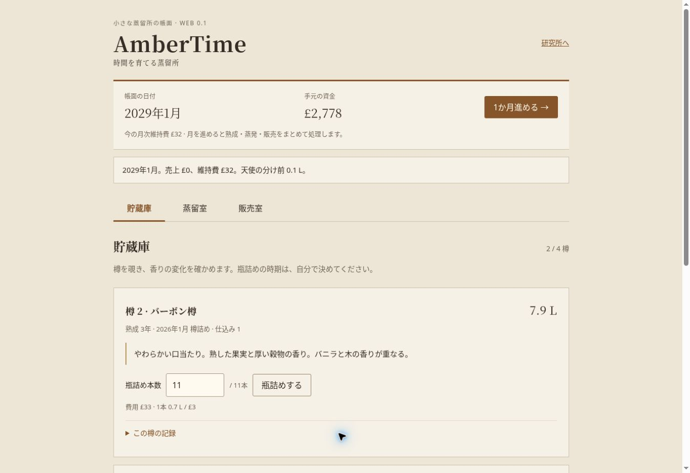

# AmberTime 0.1 — 検証記録

2026-10-14。実装PR #365、検証対象 `f1e424d5a8868b7ebf859f0bd28b5368b41070b5`。Stagingマージ `4ea33ceccbc5c6585cf53a6f772f65514cc887f6`。同一Git treeを確認した。

Pages run `38496742221` 成功。配信先 https://sukimastock.github.io/yumaniwa-town-staging/works/ambertime/ をクラウドChromeで直接操作。ローカルsupervisorはproc mount制限で起動できず、実配信後にブラウザ確認した。順序の変更を未確認扱いのまま隠していない。

| 確認 | 観測結果 |
| --- | --- |
| 初回導入 | 2026年1月・£4,000・最初の仕込みボタン・3段階説明を表示 |
| 蒸留 | 抽出50→65%で予測32→34.4 L。実行で£260を控除 |
| 原酒分割 | 同じ仕込み1を17.2 LずつBourbon/Refillへ詰め、樽代を控除 |
| 半年 | 2樽の熟成6か月、残量16.9/17.0 L、資金£3,288。月次維持費£32 |
| 部分瓶詰め | Bourbonから12本、£36。残りの樽は熟成を続ける |
| 価格と売上 | £60で翌月0本、£21に設定した翌月12本・£252。資金£3,440 |
| 再投資 | 抽出20%で仕込み5、27.2 L。ニューメイク38本を商品化 |
| 保存・再開 | 手動保存と再読み込み後も2026年9月、£3,066、2樽・商品38本/設定価格を維持 |
| ニューメイク需要 | £16で初月5本・£80、その後38本完売・£608 |
| 画面非依存 | 販売室のまま27か月進め、戻ると両樽が合計36か月。Bourbonは軟らかく木が重なる、Refillは丸さと淡いバニラ |
| 樽履歴 | 過去の試飲メモと現在の変化を展開して確認 |
| 初期化 | 確認をキャンセルすると進行維持。承認すると初期資金/年月/空棚へ戻る |
| ブラウザ表示 | 1348px幅で表示・入力・費用・制約理由・価格設定・記録を確認 |
| エラー | 捕捉84件は全てブラウザ拡張のmetadata送信エラー。AmberTime URL/名称由来は0件 |

ブラウザの操作テストは約6分で、価格を維持するか下げるか、12本を今売って樽の残りを待つかの結果まで観測した。「繰り返し遊びたくなる」という主観的評価を認証するものではない。

ゲーム20テスト成功。基盤Lifecycle/Release/Guide 65回帰成功。数値72比較＋独立抽出/樽144比較。既存10作品Search生成一致、Scope/Risk/Impact、exact-tree trusted syntax成功。PRの5 checks全て成功。既存作品のゲーム操作を全件やり直したとは扱わない。共有Engine/町本体/他work/公開集合の差分なし、既存Release静的検査FAIL 0。

スマートフォン向けviewport、600px以下のCSS、44px主要操作領域は実装・ソース確認済み。ブラウザの表示幅変更APIがなく、縮小viewport操作・実iPhone/iPad/SafariはUNVERIFIED。ブラウザ上で破損保存や保存禁止の注入テストは未実施（モデル不整合保存の拒否とUIエラー経路はテスト/独立読取レビュー済み）。作者の操作感・長期の面白さもUNVERIFIED。

設計/数値の正本はDESIGN.md、BALANCE.md、parameters.mjs。ドット絵UIへ交換してもmodel.mjsの状態遷移・月次時計・シード・出自/履歴を保持する。施設やイベントで問題を埋めない。
