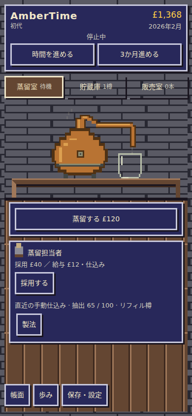
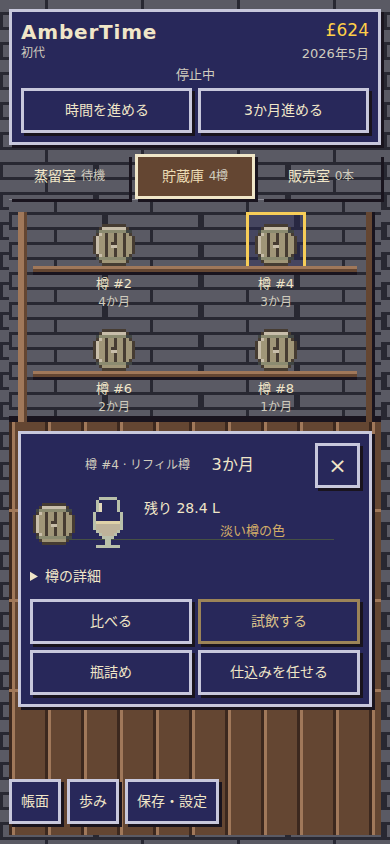
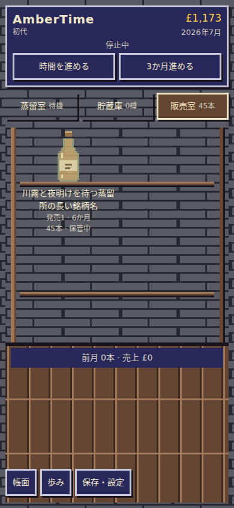
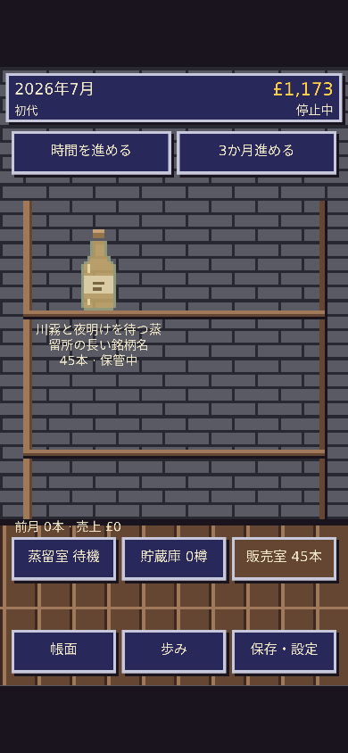

# AmberTime — Canvas rooms

Stagingだけの表示・入力の再構成。本編のモデル、既存素材、保存キー・形式、旧保存、参考作品、共有Engine、終了済み試作、Productionは変更していない。

## 構成

360×640の論理画面を等比拡大し、余白は中央配置。石壁・木床・棚・設備・樽・グラス・ボトルを共通の3px単位でCanvasへ描き、通常フォントの文字はDPRに合わせた別の高解像度描画で重ねる。SVGの矩形素材を再利用し、画像として文字まで拡大しない。

描画順は壁・床→棚・設備→物体→状況・操作。描画とタップ領域が同じ座標定義を参照する。各操作には元のnative buttonを重ね、操作名・Tab/Enter・フォーカスを維持。RAFは変更時の再描画だけで、時計・乱数・保存を呼ばない。参考作品のランタイムは複製・変更していない。

- **貯蔵庫**：実際の4樽の容量に対応する棚。空きもそのまま部屋に残り、樽を選ぶと詳細・試飲・比較・瓶詰めの窓が重なる。
- **蒸留室**：蒸留器と受け器を固定。採取状態・終了・樽詰めは室内、担当者・製法は窓へ分けた。
- **販売室**：4本ずつの棚とページ切替。商品の窓で価格・販売先・味・記録を扱い、連絡の操作を物体の外へ置いた。
- **情報窓**：既存dialogを使い、長い内容は窓内だけでスクロール。樽・担当者の実際のDOMを移すため、入力・イベントの複製はない。閉じると元の物体、子窓から戻ると元の操作へフォーカスが戻る。

## 画面

画像はCSSピクセル相当。前は着手時main、後は今回の同じ公開モデル操作による到達可能な状態。樽ゼロ・少数・満杯、商品の増加、熟成の違いは検証JSONにも残した。

| 390×844 | 前 | 後 |
| --- | --- | --- |
| 蒸留室 |  |  |
| 貯蔵庫 |  |  |
| 販売室 |  |  |

[360×740の蒸留室](after/360-distill.png) · [貯蔵庫](after/360-warehouse.png) · [販売室](after/360-sales.png) · [試飲](after/360-tasting.png) · [比較](after/360-comparison.png) · [瓶詰め](after/360-bottling.png) · [ボトル詳細](after/360-product-window.png)

[390×844の試飲](after/390-tasting.png) · [比較](after/390-comparison.png) · [瓶詰め](after/390-bottling.png) · [PCの三室](after/1280-warehouse.png)

## 検証

- `node --test works/ambertime/tests/*.test.mjs`：575件成功（既存572件＋座標・入力変換・固定配置の3件）。
- `node works/ambertime/tests/canvas-browser.mjs`：360×740 / 390×844 / 360×640 / 1024×768 / 1280×900。ページ寸法・scrollX/Y・全主要操作の矩形と中央の遮蔽を、スクロールさせずに確認。44px以上の領域と実座標タップを使用。
- 樽ゼロ・1・4、商品ゼロ・6、初期・12・72か月、蒸留・抽出終了・樽詰め・試飲・比較・瓶詰め・価格・販売、担当者の採用・依頼・取消・稼働、製法・フォーカス復帰を確認。
- 試飲の三指標は実際の保存値と一致。前回の印・風味タイプを維持。窓の開閉で棚の座標と保存バイトが変わらず、既存時計の6秒で1か月だけ進むことを確認。
- v17の保存元バイトを維持し、移行後と世代交代後の再読込を確認。独立試作の保存キーのsentinelも維持。
- Chromiumの2倍ピンチでもCanvasを縮め直さず、表示領域に合わせた窓の入力・確定に到達できることを確認。長い銘柄名、窓内の文字2倍、高さ430pxで入力・確定に到達できることを確認。通常画面のスクロールなしの証拠と、詳細内のスクロールは分けている。
- Lifecycle、生成ページ整合、公開済み作品集合のRelease Validatorを確認。Scope / Risk / ImpactはPRの固定headで検査。独立レビューで指摘された重なり・通知・エラー・世代情報・子窓のフォーカスを修正し再確認。

[機械検証とソース・画像ハッシュ](after/browser-results.json)。これはChromiumで観測した範囲の記録で、実機確認や作者の採用決定を意味しない。

## 修正中に確認した問題

| 原因 | 修正・再確認 |
| --- | --- |
| 旧試飲CSSの非表示スペーサーが窓のフッターでも場所を取る | overlay内では非表示を優先。2×2の操作と液体が見える画像を確認 |
| 販売の連絡操作とボトル上部が重なる | 連絡を床側、ページ切替を棚上部へ分離。操作中央の遮蔽も検査 |
| 見た目をCanvasへ移すと旧status通知が隠れる | 読み上げ用の通知を投影し、保存エラーは窓内にも表示 |
| 子窓から戻るとBODYへフォーカスが移る | 表示状態だけに戻り先を保持し、元の製法ボタンへの復帰を独立再検証 |

## 未確認

実機iPhone Safari、OSキーボード、VoiceOver、OSの文字拡大は未確認。文字2倍・短い入力画面はChromiumでの模擬確認。長い履歴や条件・文字拡大時は窓内スクロールを使う。通常倍率でのページ全体の縦横スクロールは使わない。見た目の採用判断は実際に触って行う。
