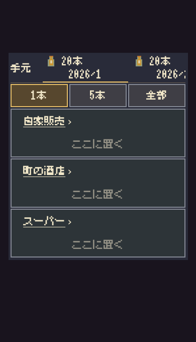
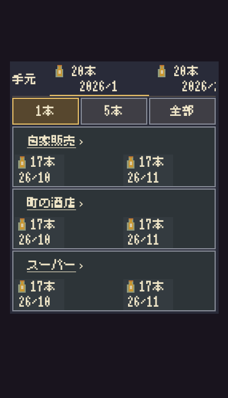
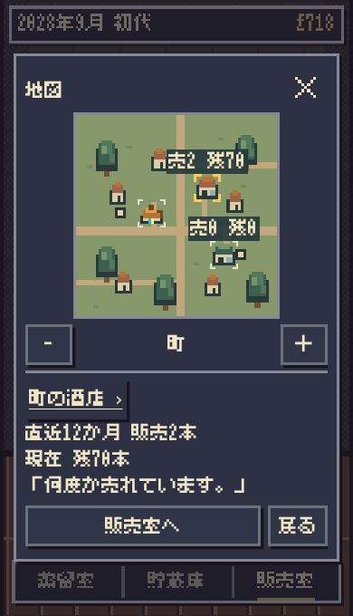

# 店名・商品欄の直接操作と地図中央寄せ

基準 main: 617bd10da5f5d868ddd5dbb709030521e1ca3558（#734）。今回の作者指示で、独立した「店情報」「ここに置く」・右下ボタンという過去条件を置き換える。work AGENTSへ追記し、他の受入条件は維持する。

- 販売室の店名を下線＋›のnative buttonに変更。既存の店情報を開く。
- 店舗欄の背景全体が配置用native button。店名/瓶のボタンとは兄弟要素で、重複発火しない。空の欄だけ薄い「ここに置く」。既存の瓶は引き取り、取消・確定・保存成功後の演出は既存処理のまま。
- 右操作列を撤去して商品札に幅を返す。字体は縮めず、通常3店舗各0/1/2商品を短い表示高さでも確認。3以上は情報を維持して折返す。
- 地図の上端固定を撤去し、他のモーダルと同じvisualViewport中央配置処理へ戻す。上下safe-area差分の半分だけmargin補正して安全な矩形の中心に置く。222px Canvas、売/残/納、四隅、蒸留所の再選択、初回intrinsic flexは維持。
- 地図下部も独立「店情報」を店名＋›へ置き換える。

検証

- unit 68成功。販売室のネイティブブラウザー回帰2成功（正式保存の切替/バックアップ失敗/再読込/合法配置/実販売とD.tickDistillery一致）。
- Chromium: 360×568・375×620・390×680と360×500・375×550・390×590で18状態。通常3店舗の各0/1/2商品で縦overflowなし。店名は状態不変、背景は正確に1本だけ配置、瓶/取消も状態不変。商品がない欄だけヒント。+17/−17が商品文字や店名と重ならない。
- Linux WebKitでも販売欄18状態成功（同じ6 viewport、店名/背景/瓶/取消の押分け・数量演出）。
- 多商品: 0/1/2/3/12商品×3幅の15状態、個別識別/引き取り/取消/3店実売通知が成功。多商品で必要なスクロールは許容。
- 地図: Chromium63・Linux WebKit60観測。実Canvasと画面ピクセル一致、中心座標、初回/店舗→蒸留所/開閉/縮尺/往復/再読込/状態と保存バイト不変を確認。レイアウト21状態、専用ラベル密度48状態成功。
- 旧右下・上端固定の幾何テストを今回の明示指示に合わせ更新。長い数値は既存DOMへ文字を上書きする旧fixtureから、実描画関数で新規生成する専用map-counts回帰48状態へ集約（ラベル境界/衝突/共通字体の検査は維持）。
- 独立読取レビュー: 兄弟ボタン/ポインター/保存経路/安全領域補正にblockerなし。地図店名の折返し指定の詳細度を修正。
- 表現監査: 店名・実数値・空欄ヒントのみ。重複ボタンや説明は追加しない。

実機iPhone Safariの指での押し分け、上下ツールバー開閉、下線の視認性は未確認。ブラウザーviewportとsafe-area検証を実機確認としない。Production変更なし。

| 比較 | 前 | 後 |
|---|---|---|
| 販売室（表示用fixture） | [前](market-before.png) | [後](market-after.png) |
| 地図（正規履歴fixture） | [前](map-before.png) | [後](map-after.png) |

