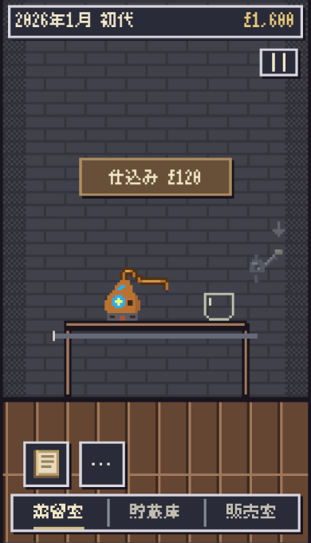
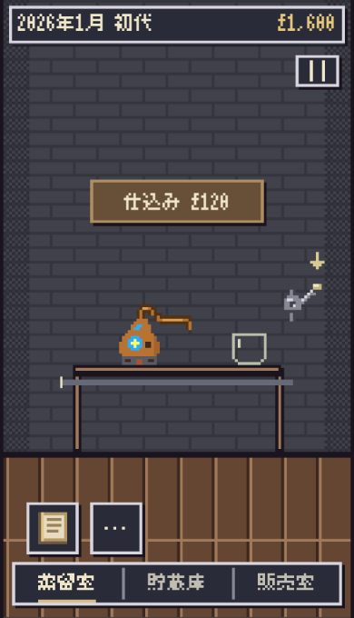
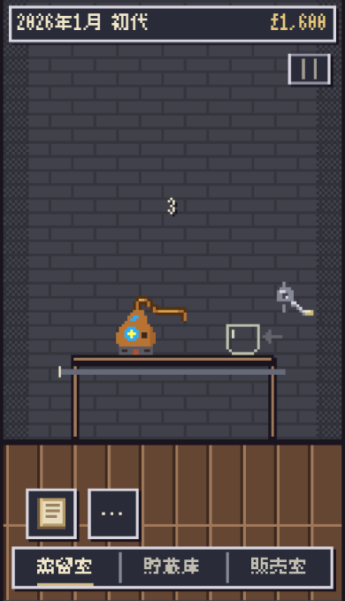
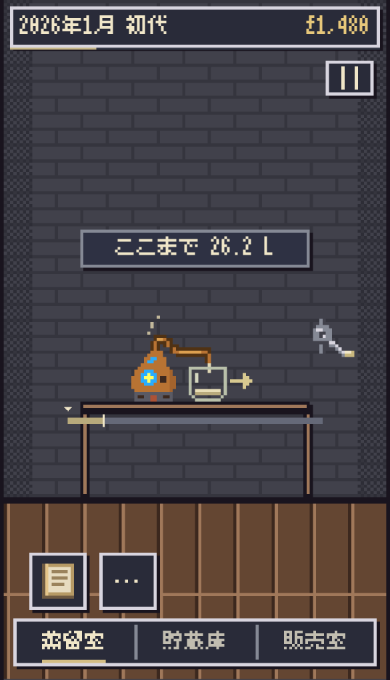
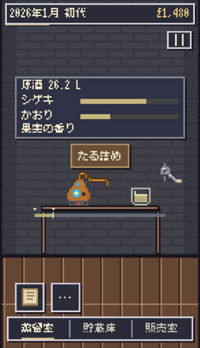

# 蒸留の視線誘導と進行演出

基準 main 5555c6e21c9a66b076b86192d0606c6b5c46e4a8（#737）。今回の作者指示による本編表示の調整。単一のPlan Lockをbranch先頭に固定した。Production変更なし。

- 画面の操作文を撤去し、読み上げ用情報だけ保持。レバー画像の形は維持する。
- 初期はレバーと矢印を淡色・静止・無効。「仕込み」を決めると有効になる。取消では有効にしない。決定はUI内だけに保持し、boot/reset/開始後は失効。既存core.lastDistillationにも紐付け、自動担当者が別の一樽を造った後へ古い決定を持ち越さない。正式保存形式は変更しない。
- レバーを引いた後はグラス側へ矢印を移す。採取前は左、採取中は右を示す。操作可能時のみ穏やかな色差で点滅。待ち中・無効時は静止。reduced-motionでは有効でも静止する。
- 3秒の処理自体は残っていたが、仕込みボタン186..231が数字228を覆っていた。カウントダウン中はボタンを非表示にし、3・2・1を元の位置に描く。
- 液面は、レバー導入前の0d2c886dで使っていた既存d.litres/40の蒸留進行カーブへ戻す。以前の最初のタップで終了量見込み約24Lへ飛ぶ表示をやめ、採取中は0→5.6→11.2L相当の演出へ。採取終了時は既存core.spiritの確定26.23L等へ一致させる。収量そのものは終了位置で決まる既存仕様のまま、積算計算や独立タイマーを作らない。
- 樽詰めボタンはy264..309へ。結果窓の下端255と蒸留機パイプ315の間で、地図や販売室の配置は変えない。

検証

- 関連unit131件成功（入力・採取/品質/経済・保存・時計・画面・販売UIを含む）。準備を別batchへ持ち越さない実ハンドラー回帰も追加。
- Chromium53 / Linux WebKit51チェック成功。360×568・375×620・390×680、通常motionとreduced-motion。モデル・保存・再読込・ジェスチャ・終了後保持は従来と一致。
- 3・2・1は実Canvasの明色画素を検出し、数字領域のhashが全て異なることを確認。ボタンによる隠れも確認。旧操作文領域の文字画素は0。
- 初期/取消はレバー無効、決定後のみ有効。初期・無効の矢印は900ms後も静止、有効時は通常motionだけ画素hashが変わる。終了後は矢印なし。
- 液面は採取中の既存d.litresと一致し、終了後は既存実量に一致。樽詰めのhit・結果窓/道具/機器との非重複を確認。
- 実Window時計＋touch採取例も成功。販売室ブラウザー2件、地図の初回/中央/蒸留所再選択63観測も成功。
- 独立読取レビューで自動仕込み後の準備失効を補強。他の描画・配置・タイマー・計算/保存へのblockerなし。
- 実行環境の再構築のみ実施。Chromiumはnpm公式registryのSparticuz配布、WebKit26.5は公式Playwright配布。Ubuntu公式debのSHA256照合済みライブラリを一時領域に抽出して利用し、OS/aptのsandbox・リポジトリ依存・CIを変更していない。
- 以前から存在する未追跡の実験用tmpは保持し候補へ含めない。Scope→Risk→Impactは公開候補commitの--headで確認する。
- 表現監査: 可視操作文を削除し、指定された矢印と既存の仕込み/樽詰め・結果値だけを残す。

iPhone Safari実機は未確認。初回→決定→レバー→グラスへの視線の流れ、点滅の強さ、触れやすさ、実機ツールバー・端末負荷・作者採否は別途確認する。

| 初期（無効） | 決定後（有効） |
|---|---|
|  |  |
| 3 | 採取中 |
|  |  |

