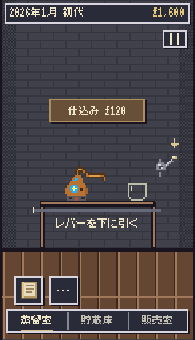
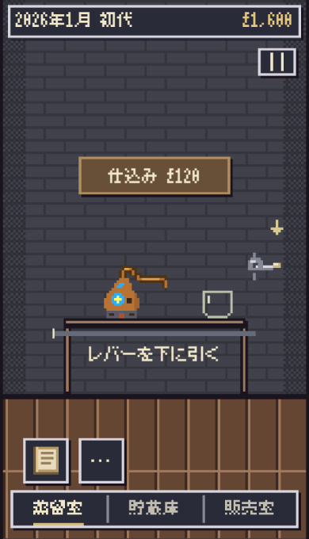
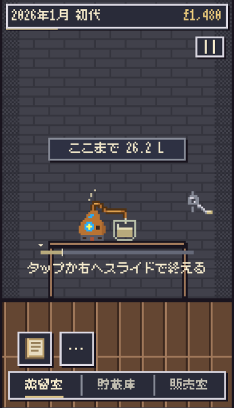
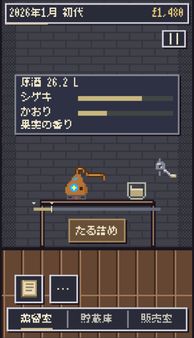

# レバーとグラスの蒸留体験

基準 main: 0d2c886d85d0dd1ae5ec878b1864cea777fa43ca（#735）。PR #736では実装前r0と表示テスト追加r1を固定したが、CIがPlan差分1件を要求して拒否した。検査を変更せず、新branchの先頭で完全scopeの単一r0を固定し、同じ検証済み実装を再利用した（元PRに経緯を保存）。Production変更なし。

操作と既存処理の接続

- レバー: 相対18/36 CSS pxで上・横・下の3姿勢。下方向優位で36px以上引き、離したときだけ既存prepareDistillation→3秒カウントダウン→startRangeDistillation。途中解除・tap・cancelは開始しない。仕込みボタンは材料選択だけ、決めるで窓を閉じる。非stage4の旧モデルは既存startDistillationへ接続する。
- グラス: pointerupでtapまたは正方向slideを確定し、既存finishDistillation経由でbeginCollection/stopDistillation。開始は左、終了は右。短い/逆向き/cancelは未確定のまま。互換clickは再実行しない。既存の最小幅12step（旧方式9step等）前は無効＋待ち表示とし、新条件は作らない。
- 期限切れのやり直しはレバーから既存restartRangeDistillationへ。追加費用なし。担当者の自動仕込みには手動入力を割り込ませない。画面移動・hidden・resizeで未確定gestureのみ破棄する。
- 大きいnative透明ボタンをCanvasの絵に重ね、captureで画像外でも追跡。実表示の最小44px。レバーには下キー2回→Enter、グラスには通常キーボード操作も残す。座標は3pxの既存セル単位、道具への回転transformや画像filterなし。

量についての重要な既存仕様

現行の原酒量は採取開始からの実測積算ではなく、終了位置に基づく収量。開始位置は風味へ作用するが、収量の経済曲線は変更しない（economy.mjs stopRangeDistillation）。既存distillationReadoutの量だけを液面へ渡す。採取前は空、採取中は既存の終了位置による見込み量、採取後はcore.spirit.litres。PARAMETERSのbase24＋extra16＝40Lを上限目盛とする。早期0→14は26.23L、後期80stepはより多くなり、8段の液面セルで差が見える。新しい積算値やタイマーは作らない。

描画と画面

- 受け位置x174、待機x237、口中心と既存蛇口x192を揃える。グラス内だけに液体セルを描く。レバーは右側の丸い金属根元・短い縦パイプ・3姿勢のピクセル部品。
- 固定案内は旧採取ボタン行を使用。結果時は既存の原酒表示とたる詰めを残す。器具配置を文言で動かさず、新しいスクロールを作らない。
- 自動移動/吸着/キャンセル復帰は140ms。reduced-motionは即時、直接ドラッグは維持。矢印は準備前のみ900msごとの穏やかな色差、reduced-motionでは静止。別室/窓/hiddenでは移動を終え、不要な描画timerを残さない。
- 古いstillArtの既定出力は不変。新しいインタラクティブ描画だけ受けグラスを分離し、元の蒸留機ドットを保存する。

検証

- 関連unit129成功。入力7＋投影3、既存蒸留・区間・品質・経済・保存・時計・レイアウト・字体・販売UIを含む。独立読取レビューで期限切れ導線と最小採取幅表示を照合・修正し、残差blockerなし。
- 360×568 / 375×620 / 390×680: Chromium23、Linux WebKit21チェック成功。新しいページoverflowなし、44px以上のhit、全画像に実Canvas描画。通常motion375とreduced-motion360/390の両方を確認。
- 実mouseの画像外drag/capture、途中/cancel/逆/短slide、tap開始→slide終了、slide開始→tap終了、追加tap、正式保存バイトと状態、reload保持、早期/後期の液面差を検証。375pxキャンセル復帰の検査は140ms演出終了後に待って判定する（製品変更なし）。
- fake clockによる決定的な同区間比較に加え、Chromiumではnative Window timers＋実touch tapで1例成功。0→16の26.55Lで既存モデル・保存と一致。入力イベントや描画timerを二重登録しない。
- 販売室の実ブラウザー回帰2成功、地図初回/中央/蒸留所再選択63観測成功。既存の販売・地図・共通字体を維持する。
- Scope→Risk→Impact PASS。独立担当は入力controller/unit/browserのみ、メインが統合と公開。表現監査は指定ガイド・既存数値・必要な道具と矢印だけ。

実機iPhone Safariは未確認。指での握りやすさ、下げ切る距離、グラスの追従/押分け、ツールバー開閉・安全領域・端末負荷は実機で確認が必要。Linux WebKitの成功を実機確認として扱わない。

| 開始前 | 引いている途中 |
|---|---|
|  |  |
| 採取中 | 採取終了 |
|  |  |
