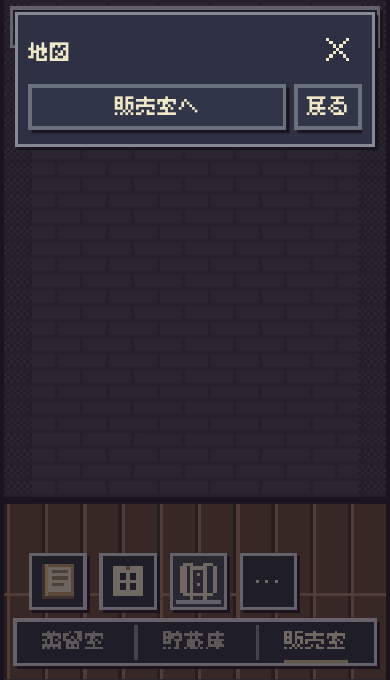
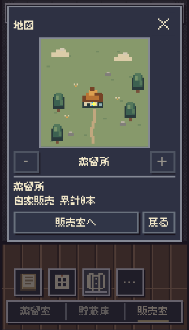

# 地図の初回表示欠落：調査と互換性修正

2026-10-31。基準main `ac5088ef`（#728 merge）。Staging限定。正式保存・販売/評判/口コミ・解放条件・地理・第3段階Labは変更しない。

## 確認できたことと限界

共有画像では、タイトル直下にフッターが並び、地図枠・拡縮・情報欄の全てが消えている。地図だけの描画失敗なら残るはずの枠と操作もないため、本文領域の高さ消失を強く支持する。画面には`Preview`、`Content / Changes / Status`があり、通常Safariの画面ではなくアプリ内プレビューと読める。画像から、そのプレビューのソースcommit、WebViewのバージョン、実際の計算済みCSS値は分からない。ローカル版と公開Stagingの同一性も未確認。

**最新Linux WPE WebKit26.5とChromium153の通常条件では、修正前の不具合は再現しなかった。実機の発生条件が確定したとは報告しない。**

一方、本文の2つの`flex:1`が定長のゼロ基準へ解決される条件を注入すると、共有画像と同じ133〜135px高のダイアログ、本文0px、タイトルとフッターのみの状態を3幅で再現した。これは互換性ストレス条件であり、実機Safariそのものを再現した証拠ではない。修正はこのゼロ基準依存を取り除く防御的な互換性対策。公開後も同じ実機Previewでの再確認が必要。

## 描画と表示領域の切り分け

現行地図は144×144のCanvasを222×222 CSSpxで表示する。`shop-app.mjs`でDOMを生成し、既存`drawGameMap`を同期呼出ししてから`showModal()`する。保存された範囲・既存の店舗投影を渡しており、新しい地図用データは作らない。

調査条件では例外なし。縮退条件でもCanvasのBitmapには18色、描画回数1、paintKeyが存在した。子Canvasの矩形も222×222のままだった。しかし`#dialog-body`高が0で、`overflow:hidden`がCanvas・操作・情報を全てクリップしていた。スクリーンショットの地図ピクセル一致は0。したがって、**この縮退条件の原因は未描画ではなく親の表示領域消失**である。

旧回帰は子Canvasの幅と地図操作を中心に検査し、祖先によるクリッピングを確認していなかった。これにより、今回の種類の欠落を検出できなかった。

## #725 / #728との関係

| 変更 | 確認した差分 |
| --- | --- |
| #725より前 | 日常地図の本文はflex:none・overflow:visible、情報欄128px、地図180px |
| #725 | 本文とworld-map-viewにflex:1、本文overflow:hiddenを導入。auto高・max-height制約のdialog内でゼロ基準への依存ができた |
| #728 | 安全領域のtop/max-heightと購入反応を調整。地図描画の方式は変更していない |
| 今回 | 本文とworld-map-viewをflex:0 1 autoへ。共通フォント・222px地図・横並び操作・安全領域・情報欄スクロールは維持 |

#725の宣言に問題を起こせる構造があることは確認したが、実機プレビューでそれを発火させた要因と実際のソース版は未確定。#725/#728を実機不具合の確定原因として断定しない。dialogのheight:fit-contentだけを与えた追加プローブも通常WPEでは縮退せず、iOSだけのUA既定CSS差という仮説は採用しない。

## 最小修正

- `room-scene.css`：日常地図の`#dialog-body`と`.world-map-view`の2宣言だけを`flex:1`→`flex:0 1 auto`へ。内容からauto高を確保した上で、画面の最大高に合わせて縮める。情報欄のmin-height:0と内部スクロールを維持。
- `index.html`：変更したCSSの配信識別子を更新。
- 新規 `tests/map-initial-display-browser.mjs`：初回タップの実可視描画回帰。
- `design/map-initial-display/`：検証結果と再現画像。ユーザーの実機画像そのものは公開repositoryへ転載していない。

`shop-app.mjs` / `canvas-scene.mjs` / `world-map-view.mjs` / 共通フォント / 保存モデルは変更しない。仮画像・遅延描画・余分な再描画・文字や地図の縮小は追加しない。

## 黄色い枠

黄色い枠はCSSのfocus-visible表示。Canvasの管理アイコンに描くアクティブ表示は`dialog.open && kind==='world-map'`で別に決まる。地図を閉じる処理は既存仕様で地図アイコンへフォーカスを戻す。今回これらは変更しない。

黄色枠だけを地図の開閉状態とみなさず、回帰ではdialog.open、data-kind、実画面の地図、閉じた後のfocus先を別々に検査した。共有画像が「閉じた後だった」と推定したわけではない。初回タップ直後というユーザー報告を維持して調査した。

## ブラウザー検証

| 条件 | 360×568 | 375×620 | 390×680 |
| --- | --- | --- | --- |
| 修正前・通常Chromium153 | 表示正常 | 表示正常 | 表示正常 |
| 修正前・通常WPE WebKit26.5 | 表示正常 | 表示正常 | 表示正常 |
| 修正前・ゼロ基準注入WPE | 本文0px、表示欠落 | 本文0px、表示欠落 | 本文0px、表示欠落 |
| 修正後・Chromium | 可視地図222px | 可視地図222px | 可視地図222px |
| 修正後・WPE WebKit26.5 | 可視地図222px | 可視地図222px | 可視地図222px |

地図が解放された直後の初回タップ、閉じて再表示、2店舗の選択と情報切替、拡大/縮小、販売室→貯蔵庫→販売室→地図、保存読込直後を検証。真の新規ゲームでは既存仕様どおり地図入口は非表示。最初の瓶詰め後に地図を開ける。これらの状態は既存runCareerと正式公共APIから生成した。スタッフ案内だけは公共のnoticeStaffOpportunityを使って既読にし、別の自動案内を地図回帰へ混ぜない。

回帰は本文の非ゼロ高、Canvasの222px、クリップする全祖先とviewportの交差、Bitmapの10色超、実スクリーンショット上のRGB一致85%以上を併せて確認。実測一致は約96〜100%。Bitmapだけ描画済みで画面には見えない場合をPASSにしない。地図は実際に蒸留所・町の建物が見えることも画像で目視確認した。

通常の修正前は各engine39観測で正常。注入条件では9観測（初期3件と初回6件）で欠落を記録。修正後の主回帰はChromium48観測、WebKit45観測で成功、例外なし。Chromiumでは上下44/34pxの安全領域も検査。別途#728の短い画面のタッチスクロール5観測が成功した。通常CSS経路は`AMBER_MAP_ZERO_BASIS=0`でも再検査する。

旧CSSへ新回帰を適用すると、注入条件の最初のタップでexit1（期待したRED）、修正後はexit0。**注入はテスト用HTTP応答で旧2宣言を`flex:1 1 0px`へ正規化する処理。正式ゲーム・データにこのスタイルを追加しない。** テストはデフォルトでこのストレスを含み、通常条件は明示的に0を指定する。

全ての地図操作前後で、正式保存文字列と公開モデルのsnapshot JSONを完全一致確認。別途関連のmap/販売UI/scene-input73件、指定販売室ブラウザー2件が成功。Scope→Risk→Impact、syntax、diffも確認。独立レビューは製品差分、可視ピクセル回帰、根拠の限界を照合し、阻害問題なし。表現監査では新しい可視文言や装飾を追加していない。

## 画像

次は**注入したゼロ基準条件**の同じ初回タップ比較。実機不具合を直接撮り直した画像ではない。

| 修正前・本文0px | 修正後・可視地図222px |
| --- | --- |
|  |  |

[タップ前の販売室](before-tap-390.png) / [複数店](after-multiple-390.png) / [閉じた後のフォーカス](closed-focus-390.png)。元データはJSON検証記録。

## 実行環境と再現

Playwrightの公式WebKit26.5/v2336を取得。通常のinstall-depsは環境のsetgroups権限制約で失敗。公式Ubuntu Nobleの必要ライブラリを配布indexのSHA256に照合してテスト用フォルダへ展開し、WebKit bundle内だけから参照させた。OS設定・repository依存・CI・権限は変更していない。WPE headlessはソフトウェア描画で実行。これはLinux WebKitの検証で、iPhone Safari/WKWebViewの実機検証ではない。

```sh
# Chromium / 互換性ストレス込み（旧CSSならRED）
AMBER_BROWSER_MODULE=/absolute/playwright/index.mjs AMBER_BROWSER_EXECUTABLE=/absolute/chromium node works/ambertime/tests/map-initial-display-browser.mjs
# WebKit。必要な実行ライブラリは事前に利用可能にする
LIBGL_ALWAYS_SOFTWARE=1 AMBER_BROWSER_MODULE=/absolute/playwright/index.mjs AMBER_MAP_ENGINE=webkit AMBER_WEBKIT_EXECUTABLE=/absolute/pw_run.sh node works/ambertime/tests/map-initial-display-browser.mjs
# 通常条件だけ。診断captureにはAMBER_MAP_CAPTURE=1
AMBER_MAP_ZERO_BASIS=0 AMBER_BROWSER_MODULE=/absolute/playwright/index.mjs node works/ambertime/tests/map-initial-display-browser.mjs
```

実装前Lockは `.change-plans/ambertime-map-initial-display/r0.lock.json`（local先行1c7237d6、remote先行 `145bb4a5d784c0b30548a3249f9dde59fc240f7c`）。CI/merge/Pages/public smokeのexact SHAはPRに記録する。

## 残る実機確認

- 更新済みの同じアプリ内Previewと、公開Staging URLの双方で販売室→地図を初回タップし、蒸留所/町・拡縮・情報欄が見えること。
- Previewがどのcommitを表示しているかを確認。通常ブラウザーとの違いを、保存データの削除で解決しない。
- 開閉、店舗選択、画面往復、端末向き/ホストUI変化での再配置、実指スクロール。

実機で再発した場合は、当該環境の本文・dialog・visualViewport寸法と表示しているソース版の確認が必要。通常WPEでの成功や注入条件でのRED/GREENを、実機の原因確定・実機PASSへ読み替えない。
