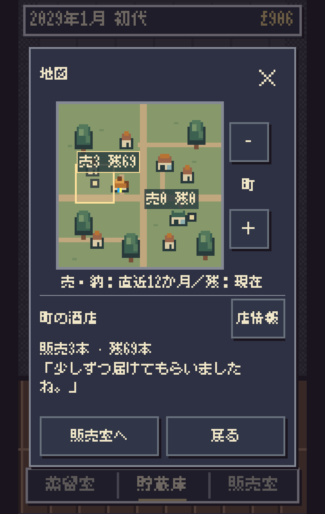
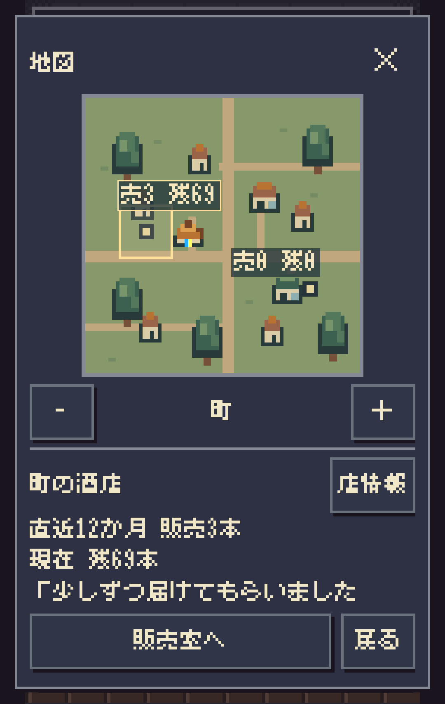
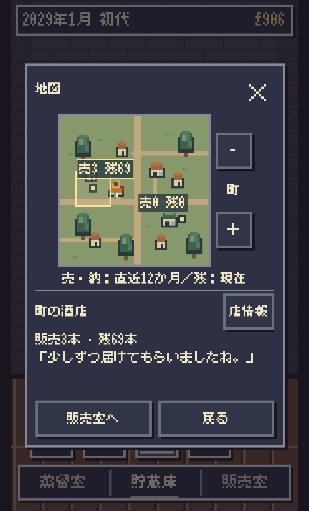
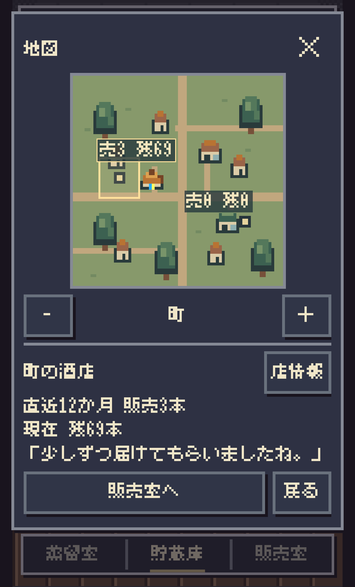
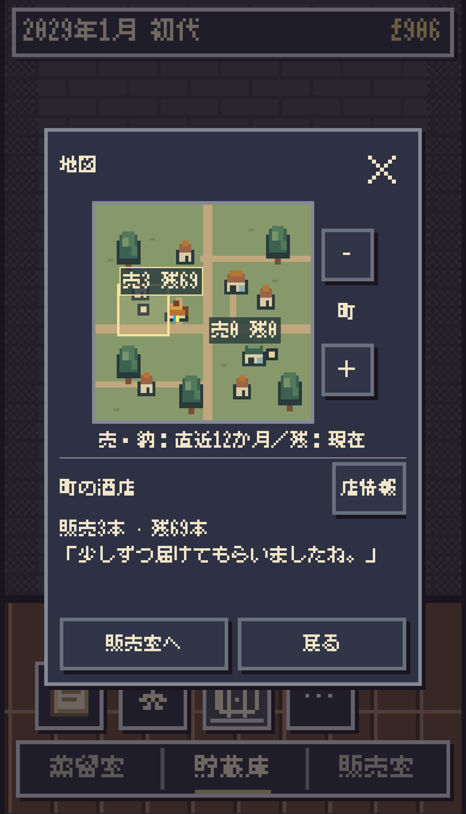
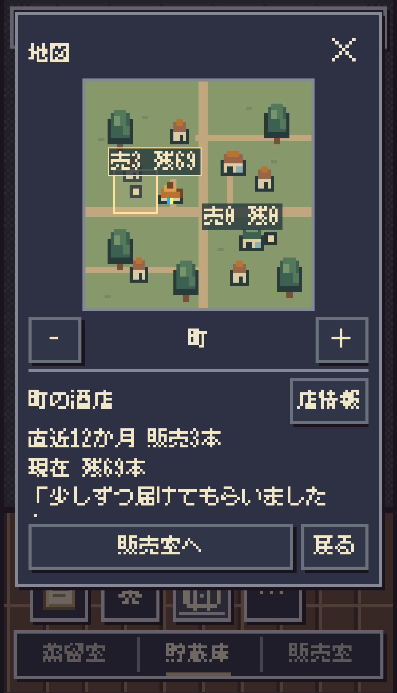

# 地図画面の再設計・第1段階

2026-10-31。Staging限定。実機Safariと作者の採否は未確認。Production変更なし。

## 原因・既存UIとの比較

地図専用の `html[data-font-uniform="1"] #action-dialog.daily-map ...` が `16px/20px!important` を指定し、Canvasと共通の `--uniform-font-size` / `--uniform-line-height` より詳細度が高かった。フォント統一#644/#645、地図導入#703/#704/#708、日常地図#722を現行source・履歴・既存REPORTで照合した。

タイトル・本文・ボタンは既存 `font-uniform.css` をそのまま使う。3px系の画面倍率に従う枠線、既存色、選択色、上右の閉じる操作を維持。日常地図の16px上書きを削除しただけで共通のフォント定義は変えていない。360×568/375×620では18.67px、390×680では21.33pxとなり、各画面のCanvasと一致する。端末幅だけで固定pxを選んだものではない。

## 設計比較と採用

| 状態 | 採用構成と理由 |
| --- | --- |
| 蒸留所のみの範囲 | 222px地図＋下の操作＋実際の自家販売累計。空の128px枠を置かない |
| 町・複数店 | 地図と操作の位置を固定し、未選択では自家販売と期間凡例を表示 |
| 店舗選択 | 店名・既存店情報導線・直近12か月の販売/納品・現在残数・既存反応 |
| 長い店舗情報 | 情報欄だけ上限まで伸び、以降は内部スクロール。地図を縮小しない |
| 広い範囲 | 既存の町集計と口コミ到達を表示。地域の販売実績を生成しない |

右側縦操作＋180px地図の継続、文字縮小、画面全体の固定高、大きな空欄、新しい詳細階層は採用しない。地図下の横並び操作は45px以上。情報量でダイアログ高は変わるが上端は固定し、地図・範囲操作・閉じるは動かない。販売室へのフッターは情報欄の直下、長文時は画面内に固定される。地図の上端固定は既存Canvas側のinline中央配置だけを地図限定CSSで上書きし、共有runtimeは変更しない。

地図の外枠は186→228px、描画面は180→222px。地理・店舗配置計算・描画sourceは不変。札は共通フォントのまま最大60%幅で折り返し、「999+」でも収める。スーパーの札だけ2論理単位下へ動かし2行時の接触を避けた（建物位置・選択位置は不変）。

## 検証

- 関連map/販売UI/販売ルール/model/正式保存回帰113件成功。最終文言・札調整後に表示関連69件を再実行して成功。
- 指定 `market-compact-browser` / `market-rules-browser` 2件成功。360/375/390/430、DPR1/3、実在庫・月進行・旧保存・配分/回収・バックアップ失敗・reduced-motion確認。他画面の共通CSSは不変。
- 地図専用Chromium153：変更前18状態＋変更後24状態、合計42状態成功。360×568、375×620、390×680、DPR3。蒸留所範囲、町、2店舗切替、範囲変更、999+、長文、閉じる、再表示、販売室を確認。横はみ出しなし・通常ボタン44px以上・地図外枠228px・店舗切替で地図/操作のy座標一致・往復の正式保存バイト一致・ブラウザーエラーなし。`browser-results.json` に実測。
- 蒸留所のみの表示確認は、実際の経歴保存を範囲1で表示したもの。新規ゲームから最初の一本までの全操作確認と混同しない。最大数/長文はDOMだけを変更した表示fixtureで、ゲームの保存へ架空の記録は追加していない。3店舗同時の最大数、実機Safariは未確認。
- 既存公共APIによる100シード×36か月＝3,600か月、4,800操作境界で経済状態/保存/復元が完全一致。全100シードの最終保存SHA256が旧 `design/map-daily/results.json` と一致。`parity-results.json` に証拠。
- `font-uniform.test.mjs` の4件中3件成功、1件は着手前mainでも失敗。期待する `canvas-scene.mjs?v=store-market-main-r1` はすでに `market-rules-r1&daily=1` へ更新済みだったための古い文字列期待。判定を弱めたりテストを変更したりせず記録。共通フォントの実寸一致はブラウザーで別途確認。
- Scope→Risk→Impact、node syntax、diff checkを確認。独立レビュー：阻害問題なし。表現監査6点：不要な副題/説明/架空反応を追加せず、期間凡例・操作名を保持。

360pxの短い画面では長い反応の末尾を情報欄内でスクロールする。文字を縮めて全文を押し込まない。実機では欄内スクロール、画面下部の安全領域、ピクセル輪郭、店舗タップの触感を追加確認する。

## 再現と画像

`AMBER_BROWSER_MODULE=/absolute/playwright/index.mjs AMBER_BROWSER_EXECUTABLE=/absolute/chromium AMBER_MAP_FIXTURE=/absolute/native-game.json node works/ambertime/tests/map-layout-browser.mjs`

`AMBER_MAP_BEFORE` は変更前のindex.html/shop-app.mjs/room-scene.cssを置いたディレクトリ。未指定では現行版だけ検査。fixtureは `design/map-daily/run.mjs` の `compareCareer(1,{horizon:36,onFinal:...})` が返す正式モデル保存を使用。

| 幅 | 変更前 | 変更後 |
| --- | --- | --- |
| 360 |  |  |
| 375 |  |  |
| 390 |  |  |

実装前Lock：元759de095。公開用fresh Lockはmain b36748b8へ同一scopeで固定（並行変更は食卓生成器のみ）。リモート先行Lock commit fb69305bfa7c8846f479fc539a18c9a1e44cbcbd。PR/必須CI/Pages/公開版確認はPRにexact SHAで追記する。
