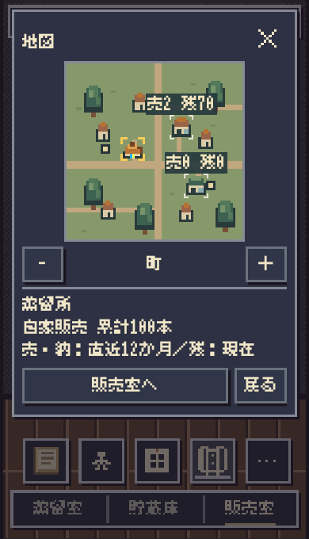
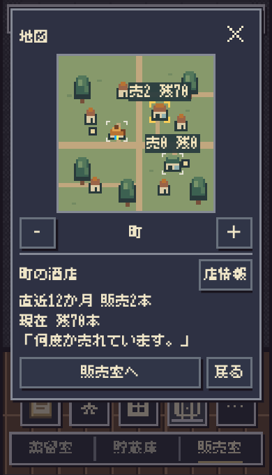

# 地図の場所選択修正

基準 main: 0be25b029d59802f51708a259d9c1cc4cf461354（#733）。

蒸留所は初期の黄色カーソルだけがあり、店舗と異なりタップ対象を生成していなかった。店舗選択後に戻る手段がなかった。店舗の44pxボタンも透明で背景の家との区別ができなかった。

蒸留所に44pxボタンを追加し既存の未選択ID（null＝蒸留所）へ戻す。選択可能な場所は淡色の短い四隅、選択中は既存の黄色い四隅とする。背景の家には印もボタンも生成しない。常時アニメーションなし。広域の集計縮尺では従来どおり建物選択を追加しない。

既存の222px地図、売・残と納品の区別、ラベル配置、描画、フォント、ゲーム計算、正式保存形式は変更しない。短い選択反応とreduced-motionも既存動作を維持する。

- Chromium: 360×568 / 375×620 / 390×680、63観測成功。Linux WebKit: 同3幅、60観測成功。実Canvas色と画面画像の一致、初回/開閉/店舗→蒸留所の繰返し/縮尺/販売室との往復/再読込、44px領域、四隅の表示と情報欄一致、正式ゲーム状態・保存バイト一致を確認。
- ラベル密度ストレス: Chromium 48状態成功。3縮尺、999+、全選択でラベル/カーソル衝突なし。
- 関連unit: 68成功。Scope/Risk/Impact: PASS。独立レビュー: 選択経路・装飾家の除外・44px領域の非重複・ポインター・縮尺同期を確認しblockerなし。蒸留所ボタンの欠落を検知するassertも追加。販売室ブラウザー回帰2成功。
- 表現監査: 操作対象を示す最小の四隅のみ。説明カードや重複した可視テキストは追加しない。
- 実機iPhone Safariの指での選びやすさ、淡色印の見分けやすさは未確認。Linux WebKitを実機確認扱いしない。Production変更なし。

