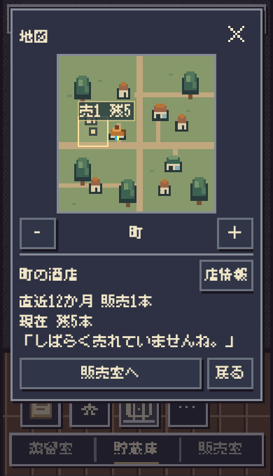
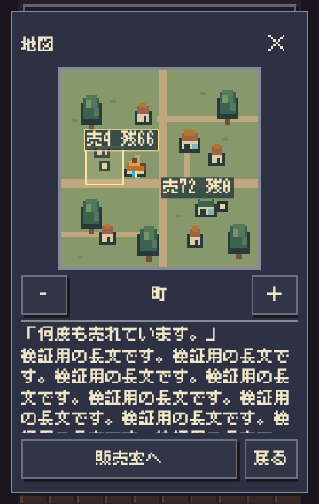
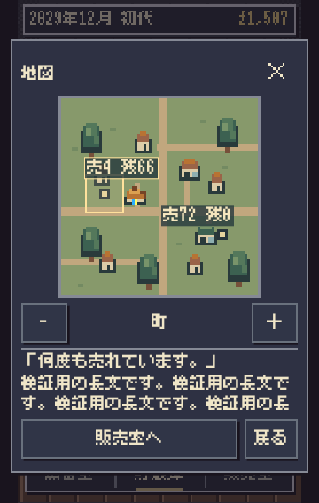

# 地図画面の再設計・第2段階：継続試遊

2026-10-31。基準main `189223bf`、PR #725の表示を維持。Staging限定。これは規則に沿う操作と画面の評価であり、作者本人の面白さ・触感・実機Safari確認を代替しない。

## 結論

地図は「どの店に残っているか」「どちらで売れているか」を町の上で見比べ、回収・再配置を考える補助画面として成立している。広域表示は口コミの到達を眺める役割がある。一方、自分のどのウイスキーが届いたか、同じ店との関係が時間とともに深まったか、次にどの味を造りたいかという体験は十分ではない。現時点で販売室を地図へ全面置換する根拠は不足している。

A・Bの修正を2件だけ行った。Cは以下の比較案として残し、新しい通知・演出・店舗・関係モデル・必須確認は追加しない。

## 再現方法と事実

既存 `experiments/market-design/v01/run.mjs` の公共API操作を、正式 `newMarketRulesDistillery` へ適用。seed1、同時樽上限2、12か月熟成、mixed配分、120か月。資金・解放・味・販売・世代の規則は変更しない。地図投影を加えた経歴と加えない経歴の結果が一致した。別途既存 `compareCareer(1,{horizon:120})` で174操作境界の状態JSON、保存復元が一致し、最終保存SHA256は `51f7d265a65724b1e4348bade9005c014c0ac12a6ff3b1afa1497baaecb2305f`。

各スナップショットはモデル自身のserialize/restoreを通す。raw保存は再現時の一時出力で、架空の店舗・売上を正式保存へ加えていない。再現コードと集計は `run.mjs` / `scenario-results.json`、詳細は `parity-120.json`。

| シナリオ | 公共APIで到達した状態 | 地図を使って分かったこと・限界 |
| --- | --- | --- |
| 真の初期 | 0か月、地図入口なし | 初瓶詰め前は地図を開けない既存設計。成熟セーブの範囲1を初期と呼ばない |
| 最初の一本 | 12か月、蒸留所範囲が利用可能 | 自家販売累計を確認。まだ町の変化は少ない |
| 初回販売 | 13か月、自家販売→近所範囲 | 近所へ視点が広がる。ただし自家販売の累計が中心で、届いた商品自体は見えない |
| 町・周辺への拡大 | 20/22か月。まだ取扱店なし | 口コミの到達。販売店網の広がりとは別。拡大速度は今回変更しない |
| 店舗解放直後 | 23か月、町の酒店。残0・売0 | 範囲3なら新しい選択先に気づける。広域を保持している場合は店の個別位置が出ず集計になる |
| 初回配置 | 24か月、酒店に36本・購入0本 | 置いた先の残数で到着を確認できる。挨拶は変わらない。売上は次の月以降であり、配置を販売扱いしない |
| 初酒店販売 | 28か月、累計1本購入、棚71本 | 追加配置済みのため残は初回36本より増えている。売と残を分けて読める。最初の購入を短い反応で確認 |
| 同店継続 | 32か月、酒店の異なる購入月が2回 | 反応がrepeatへ変わる。訪問回数や納品回数の記録ではない |
| 複数店舗 | 32か月、スーパーも取扱開始 | 店ごとの在庫・購入を比較できる。開いた直後は未選択情報なので、店の反応はタップして読む |
| 販売差 | 47か月、直近12か月は酒店4本・スーパー72本、残66本・0本 | 売れ方の違いと店頭在庫の偏りが明確。数字だけでは味の相性や客層の理由までは分からない |
| 継続・長期 | 47か月に酒店long、120か月で地球範囲まで解放、取扱は2店 | 範囲変更・店探しは動作。反応は6購入月以上で頭打ちになり、120か月でも酒店long・スーパーrepeat。継続関係を細かく育てる表示ではない |
| 販売室往復 | 実在する手元の瓶を選ぶ→1本を店へ置く→保存→地図→店→販売室 | 在庫は変わり、現金・収益合計は配置だけでは変わらない。地図往復でその保存文字列は不変。新しい「確定」ボタンはない。現行の保存成功が確定に相当 |

## A：安全領域

旧ダイアログは上端12px・最大高view-height−24px。Chromiumの公式 `Emulation.setSafeAreaInsetsOverride` で上44/下34pxがCSS envに現れる条件を与えると、360×568では上12〜下556pxとなり安全領域へ入った。

地図に限り、上余白を `max(12px,env(safe-area-inset-top))`、下余白も同様として最大高を計算した。通常env=0では従来と同じ。viewport設定・共通レイアウト・文字・222px描画面は変更しない。360×568では修正後、上44〜下534px、情報欄client71px、フッター下522px。地図外枠228pxを維持し、情報欄をスクロールできる。

これはsafe-area値を与えたブラウザー検証。通常Safariでブラウザー側が安全領域を除いたviewportを提供する場合はenv=0になり得る。iPhoneのノッチ・ホームインジケーター・アドレスバー伸縮の実機検証完了とはしない。

## B：購入記録と納品の言葉の食い違い

`shop.deliveries` は旧卸方式では納品だが、店頭方式の境界後は客の購入記録として使われる。従来の地図は既存反応をそのまま使い、「届きました／何度も届けて／しばらく届いていない」と表示していた。

公共APIによる別経歴で、28か月の初購入後に酒店の瓶を全数回収→6か月進行→34か月に5本を再配置。棚は0→5本となるが、旧地図の反応は「しばらく届いていませんね。」で、直前の操作と矛盾した。

地図の店頭方式だけ、既存の購入集計と同じ `month > startedMonth` の購入行を既存反応classifierへ渡し、短文を「店頭で売れました。」「何度か売れています。」「何度も売れています。」「しばらく売れていませんね。」へ合わせた。新しい閾値や評判計算は作っていない。旧卸・デパートの納品文は維持。共通の店反応モデルも変更しない。店頭方式の「店情報」は短い反応を表示しないため、この導線で旧文言と並ぶ問題もない。

境界月の旧卸納品を購入として表示していた既存fixtureの期待をreceived→awaitへ修正し、旧納品／新購入を分けて検証する。判定の弱化ではなく、本修正の対象となる誤解釈の回帰防止。新規テストでは正式モデルの1本再配置を使い、保存文字列不変と旧共通反応の非変更も確認した。

## 操作・読みやすさ

- 建物と札のどちらをタップしても同じ店が選ばれ、両方の選択状態と情報欄の店名が対応した。
- 店舗切替で地図・拡大縮小のy座標は不変。情報量でフッターが伸縮する場合はあるが、情報欄上限後は固定される。
- 長文は情報欄だけを指のドラッグでスクロール。ページ・地図・フッターは動かない。実際の長い反応と、別途DOMだけに挿入した長文ストレスを区別して検証した。
- 新しい取扱店や販売差は、町範囲なら見つけやすい。広域は町の集計と口コミの到達先で、店舗の正確な場所や遠方の実売網を示していない。拡大縮小ロジックの変更は提案に留め、今回は維持。
- 地図の「売・納＝直近12か月／残＝現在」という区別を保持。累計と直近の混同を避けた。
- 地図は任意の補助画面。瓶を置いた後に自動表示しない。地図を見ずに販売を続けられる。

## ゲーム体験の評価とC比較案

| 観点 | 現行で成立する部分 | 不足する部分／比較案 |
| --- | --- | --- |
| 町へ広がる実感 | 取扱店の場所・在庫・購入と、口コミの到達を見渡せる | 実売と口コミの二つの広がりを同じ地図で読み分ける必要がある。比較は「町を日常確認する現行」と「広域を開く目的を分ける案」。新通知や自動ズームは今回は追加しない |
| 同じ店との関係 | 購入履歴に応じた短い反応の変化 | 粗い段階が頭打ちになる。人間関係の成長モデルではない。既存の直近購入・現在在庫・商品の情報だけで理解が増すか比較し、新しい関係数値は作らない |
| 販売室との往復 | 異なる店の売れ方を見て、回収・再配置・次の味を試す動機になり得る | 現行地図には商品の味・瓶・発売日の識別がなく、なぜそう売れたかは弱い。選択店に既存SKUを1件だけ添える案と、現在の集計だけの案を比較する。今回は実装しない |

反応が出ること自体を繰り返し開く理由とせず、「この店にはどの瓶が残り、別の店では何が売れたか」が判断につながるかを次段階で見る。AIの操作評価で作者の継続意欲まで成立したとは判断しない。

## 地図を販売室の中心へ据える構想

利点は、届け先の位置と販売結果を同じ場所で理解できること、往復を減らせる可能性があること。懸念は、222px地図が短い画面の大きな部分を使い、瓶・数量・回収先の操作を圧迫すること、地図の「店を選ぶ」と販売室の「瓶を置く」が同じタップに混ざること、味と店の関係が薄いまま地図だけ目立つこと。

第3段階ではまず独立した比較Labで、A＝現行の販売室＋任意地図、B＝地図を表示しつつ既存の瓶・本数・置く操作を保持、を比べるのが妥当。最初に確認する課題は、1本/5本を2店へ配る、瓶を引き取る、売れ方の違いを見る、地図を見ずに次の仕込みへ戻る、の4つ。360/375/390・未解放/2店/3店・多SKU・長い情報で、押し間違い、必要操作、瓶/数量の保持、正式保存一致を確認する。地図への全面置換はこの比較と作者試遊の後に判断する。今回は未実装。

## 検証証拠と境界

115件の関連自動回帰（新規2件含む）と、指定販売室ブラウザー2件が成功。10年/174操作境界の状態・保存一致、Scope→Risk→Impact、syntax、diffを確認。独立レビューはBの意味・境界・非変更性とsafe-areaの操作可能領域を確認し、阻害問題なし。表現監査では不要な副題・通知・架空の感情を追加せず、事実に合わない納品表現だけを修正した。

3幅のシナリオ・安全領域・タッチ・旧表示比較93観測、実配分の往復9観測、安全領域内タッチの追加6観測を記録（重複する条件は別実行）。ブラウザー詳細、3幅の結果、画像は同ディレクトリの `browser-results.json` / `roundtrip-results.json` / `safe-area-before.json` / `safe-area-after.json`。真の初期は地図が非表示、3店同時・999+は第1段階の表示ストレスとは区別し、今回の実経歴では2店。Safariの慣性・ゴムバンド・ホーム操作・実指の感覚は未確認。

再現：`node works/ambertime/design/map-stage2/run.mjs /tmp/amber-stage2` → `AMBER_BROWSER_MODULE=/absolute/playwright/index.mjs AMBER_BROWSER_EXECUTABLE=/absolute/chromium node works/ambertime/tests/map-stage2-browser.mjs`。タッチ操作はCDPのtouchStart/Move/Endを使用。safe-area overrideの仕様は [Chrome DevTools Protocol](https://chromedevtools.github.io/devtools-protocol/tot/Emulation/#method-setSafeAreaInsetsOverride)。実機Safariへ読み替えない。

初回実装前Lock f0a1aa6d。旧卸境界テストの正しい期待値更新が必要になったため、同じmain上でscopeを先行固定し直した公開用Lockは `.change-plans/ambertime-map-stage2-ready/r0.lock.json`、先行remote commit `21a99092e8920389033f5fff918eb26ea2584213`。並行mainの食卓生成器更新を保持し、対象差分なしを照合してmain `3b1ad96f`上に同一scopeの最終Lock `.change-plans/ambertime-map-stage2-final/r0.lock.json`（先行remote commit `2744ebd32bf5b42c3b4651843eefa67969d0f259`）を固定した。CI・merge・Pages/public smokeのexact SHAはPRに追記する。

## 変更前後の画像

| 内容 | 変更前 | 変更後 |
| --- | --- | --- |
| 5本再配置後の反応 |  |  |
| 上44/下34pxの安全領域・長文ストレス |  |  |

[最初の一本](first-bottle.png) / [店舗差](store-difference.png) / [広域](wide-map.png)。スクリーンショットはブラウザー再現であり実機撮影ではない。
