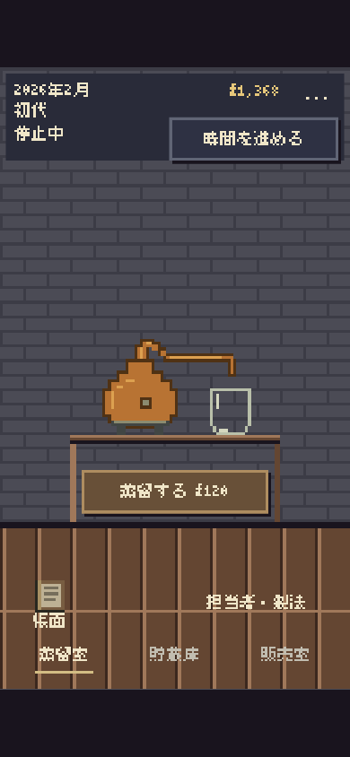
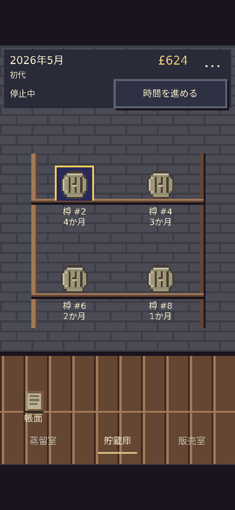
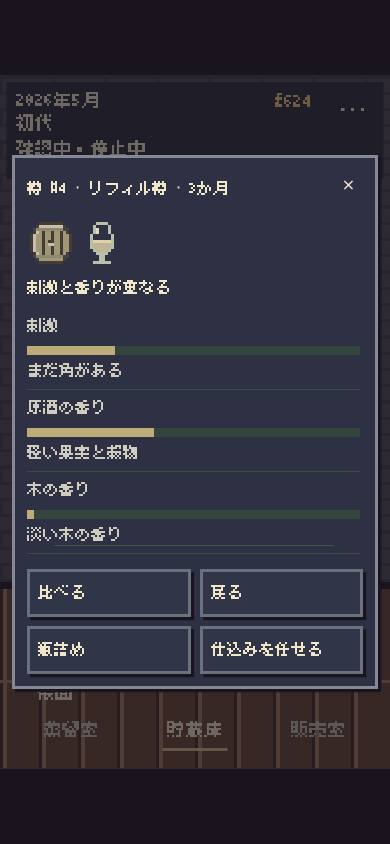

# AmberTime — 美咲ゴシック

Stagingのみ。基準はPR #507/#508反映済みの `2a1cf90f36cecf98ccd0763941eca0c15f0b2ce2`。開始時に未マージのAmberTime PRはなかった。全体回帰のコードは `5dc18fbab787ce4024305cadf1cefea16349f081`。後続の実行コード差分は、世代交代直前の予約案内1文の短縮と、案内3行時に原酒表示を24論理px下げる配置調整。追加の状態別検証で確認した。Plan Lock: `.change-plans/ambertime-misaki-font/r0.lock.json`。

## フォントと表示

作者公式の通常版「美咲ゴシック」2021.0505のTTFを未改変で同梱。第2ではない。変換・サブセット・外部CDN・独自フォントエンジンなし。取得元は https://littlelimit.net/misaki.htm 、ライセンスは https://littlelimit.net/font.htm 。原著作権文書、取得時ライセンス、元ZIPとTTFのSHA256は [fonts/PROVENANCE.md](../../fonts/PROVENANCE.md) に保存した。

Canvasと小窓は16pxを起点とした。Canvasは実際の画面倍率×DPRに応じて、物理ピクセルの文字サイズを8の倍数に丸め、基線・位置を整数へ合わせる。計測も同じサイズを使う。背景・物体・タップ領域の拡大率は維持した。通常の8倍数CSS指定だけで均一とは判断していない。

初回のCanvas計測・折返し・描画はフォントロード完了後。1.8秒で未到着なら代替フォントで操作可能にし、遅延到着時は再計測・再描画する。HTMLはready時に同じフォントを適用して再レイアウト。太字の合成・横圧縮・文字の画像化なし。入力欄と保存データ欄は、入力中や長い技術的内容の可読性を優先して一貫して通常フォントにした。未収録の𠮷・髙・﨑・😀・éはフォントスタックが補完する。

小窓の見出しも16pxへ揃えた。24px試行では月表示が分断されたため採用しなかった。枠・影の既存3論理px単位、主操作の暖色、選択印、フォーカス、44px以上の通常タップ領域を維持。商品名の改行と直下の状態表示に同じ行間を使用する。蒸留室の案内が3行になるときは、原酒表示全体を24論理px下げ、案内・原酒・設備が重ならないようにする。費用や条件のための3行表示を残し、切り詰めて隠さない。棚の省略は実測幅によるもの。全文は既存のボタン名と詳細窓に残し、保存名を切り詰めない。既存の入力上限40文字は変更していない。

## 変更前後

同じpublic-model fixture、390×844。画像はCSS表示サイズの比較であり、物理DPRの画素検査とは分ける。

| 画面 | 変更前 | 変更後 |
| --- | --- | --- |
| 蒸留室 |  |  |
| 貯蔵庫 |  |  |
| 販売室 |  |  |
| 試飲の小窓 |  |  |

[360pxの最終試飲窓](after/360-tasting.png)／[PCの試飲窓](after/1280-tasting.png)／[文字・記号・欠字・入力のDPR3検査画像](font-checks/cold-settings-dpr3.png)。最後の画像の検査用文字と入力は自動検査が一時的に挿入したもの。本編に追加表示はない。

主な短縮：

| 変更前 | 変更後 |
| --- | --- |
| まだ樽はありません。 | まだ樽がありません |
| 瓶詰めした商品が、ここに並びます。 | 瓶詰めすると商品が並びます |
| 蒸留を再開する | 蒸留を再開（Canvas表示のみ。元の操作名は維持） |
| 予約は次の代へ引き継ぎます。最後の仕込みは自分で行います。 | 最後の仕込みは自分で · 予約は次代へ |

費用・条件・結果・警告・単位・風味文は削っていない。新しい説明・装飾・常設設定は増やしていない。

## 検証

- `node --test works/ambertime/tests/*.test.mjs`：577成功、失敗0。全体回帰のSHAで実施。その後は案内1文と条件付きの表示位置だけを変更。製造・熟成・経済・契約・銘柄・店・製法・担当者・世代交代・旧保存を含む。各モデル、保存キーと形式、時間処理、入力制御のソースは変更なし。
- `node works/ambertime/tests/pixel-space-browser.mjs`：360×740/DPR1、390×844/DPR3、360×640/DPR2、1024×768/DPR2、1280×900/DPR1。最終版10結果、198寸法、108ジェスチャー、16画像。三室・樽0/少数/複数、試飲・比較・瓶詰め・販売・製法・担当者・帳面・歩み・設定を操作。保存不変、旧保存と世代交代後の再読込、破損保存原文保持、操作不可・選択・フォーカス、キーボード、閉じる操作、窓内スクロール・背後固定を確認。
- 同じ検査で高さ640へのリサイズ、430pxの入力画面、入力保持、文字200%、2倍拡大時の入力と確定を確認。通常画面はページスクロールなし、44px以上の主要タップ領域。小窓内の長い内容はスクロールを維持。
- `node works/ambertime/tests/misaki-browser.mjs`：cold/warm/failed/delayed×DPR1/3の8条件。フォント未確定中のCanvas計測・描画なし、整数物理サイズ・座標、遅延到着後のready、失敗時の設定操作、指定用語・記号のcmap、未収録文字と通常入力を確認。失敗時にネットワーク取得エラーが出るのは意図した試験。
- 実際の銘柄名欄に未収録文字を含む長い名前を入力し、430px高での保持、通常の瓶詰め、再読込後の保存名と商品窓の全文を確認：[実入力の記録](review/real-brand-name-results.json)。
- `node works/ambertime/tests/misaki-phase-browser.mjs`：世代交代直前・予約保持・手動蒸留をpublicモデル操作で作り、厳密再読込も成功。旧案内は3行になり原酒表示へ重なったため上記の短文へ変更。360×740/DPR1、390×844/DPR3、390×640/DPR1、768×1024/DPR3、1280×900/DPR1それぞれ正常/フォント失敗の10条件で、2行以内かつ最下端が原酒パネル159pxより上に収まることを実計測。抽出位置・樽種・由来を残した長いsuffixの境界も検査。レイアウト・入力の関連5テストも成功。[追加結果](review/phase-results.json)。さらに、手動の4樽目の樽詰め後に原酒表示を残して担当者へ予約する実操作を360/390/PC・正常/代替字体の6条件で確認。3行時はパネル183〜267、設備開始270で分離。2行時は元の位置を維持。[3行の実画面](review/phase-fullrack-390-misaki.png)。
- [独立レビュー](review/visual-review.md)：修正指摘2点は解消。390の三室/小窓、最終360試飲・メニュー、PC試飲、DPR1/3の文字・入力を目視。正常/キャッシュ/遅延のCanvas日付部分は文字色と背景色の2色だけで、中間のぼけ色なし。これは採取した領域の結果であり、全HTML・代替字体のドット均一性の証明ではない。
- Lifecycle/LAB整合、既存公開10作品のSearch/Share生成整合は成功。共有側の変更なし。Scope→Risk→Impact、PRのbase-owned Plan/Risk・Trusted Evidence・Change Operations・Release Validator CIは別途exact headで照合する。CIを作者採用やRelease Completeとは扱わない。

[最終ブラウザ記録](after/browser-results.json)／[フォント読み込み記録](font-checks/results.json)／[画素検査](review/header-pixel-review.json)。全体回帰SHAの16画像と11ソースのハッシュ整合を確認。その後の2ソースの変更は追加状態検証と別ハッシュで区別する。単体テストと追加フォント資材の証拠は `verification-summary.json` を参照。

未確認：実機iPhone/iPad Safari、OSキーボード、VoiceOver、OS文字拡大、作者の読み心地・採用判断。HTML小窓と未収録文字の代替字体には配置やブラウザ依存のアンチエイリアスがあり得る。TTFの今回の表示は実用的と判断し、BDF/PNG方式は追加していない。Production変更なし。
