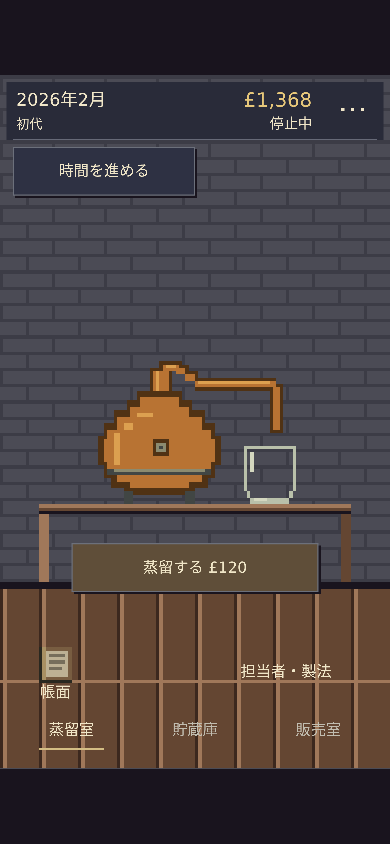
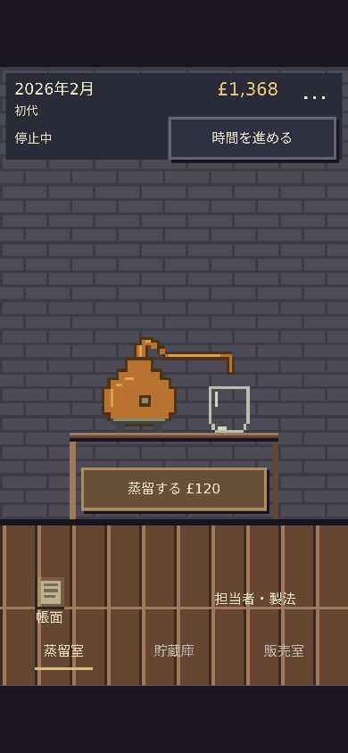
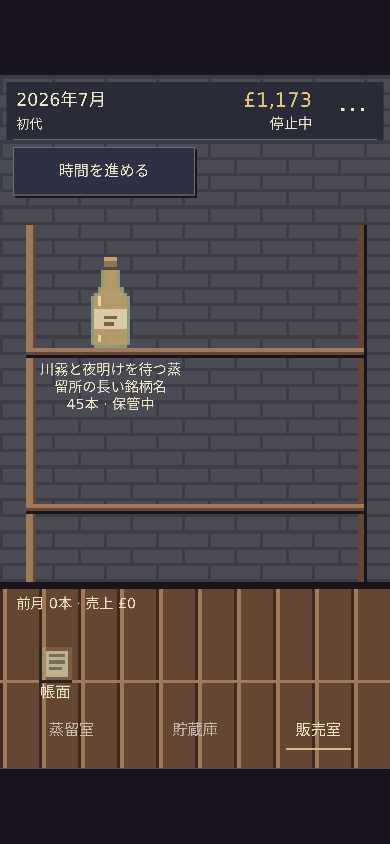
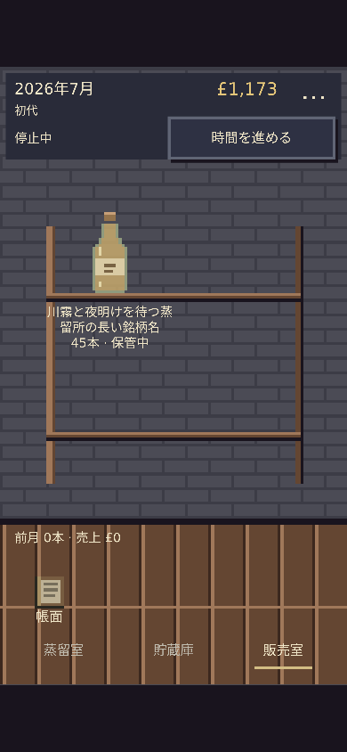
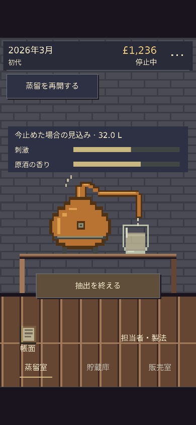
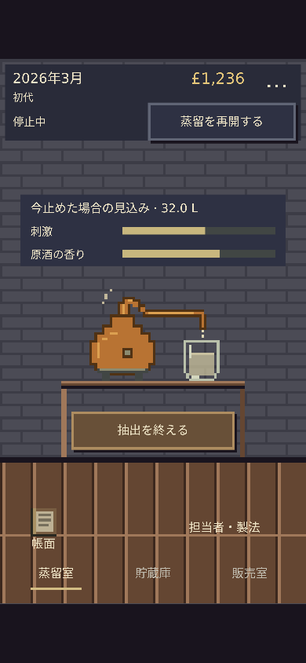
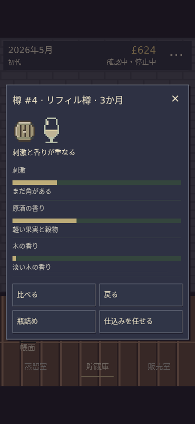
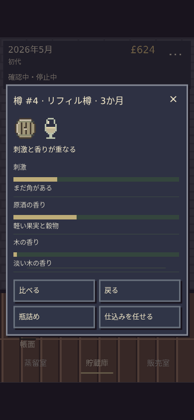

# AmberTime — 余白・物体・ピクセル表現と入力

Stagingのみ。本編のモデル・容量・時計・乱数・保存形式／キーと、終了した独立試作は変更していない。基準は着手時のmain `dee810b9928dc0f4ffd29ed7ff6cdb3a1941270a`。Plan Lockは `.change-plans/ambertime-pixel-space/r0.lock.json`。

## 変更

- 360×640の等比論理画面を維持。時間操作を日時・資金と同じ上部領域へまとめた。棚を左右24pxずつ内側へ寄せ、段間隔と札の位置を調整。4樽・商品ページの容量は従来どおり。
- 蒸留器／受け器を60×36セル、グラスを10×14セルで描き直した。1セル＝3論理px。少数色・1セルの輪郭・段状の銅釜・透明な受け器を使い、作業台へ接地。液色の閾値・透過率・採取量と液量の対応・反応フックを維持し、液体の描画基点を変更した。
- CanvasとHTML窓・ボタンは同じ3論理pxの枠・影を使用。主操作は暖色、補助操作は暗色、選択・現在地・フォーカスの印は維持。通常フォントを変更せず、物体の縮尺とタップ領域を分離した。
- 帳面の道具入口、歩み／設定／3か月進行の補助メニューを維持。新しい説明・装飾・機能は追加していない。

原典から参考にしたのは、小さな物体を棚に置く密度、壁・床・情報窓を固定した構成、物体の周囲を空ける考え方。現在のWeb版のゲーム内容を維持している。

## ドラッグの調査と対処

変更前のChromiumでは、通常倍率の画面追従は再現しなかった。`scrollX/Y`だけでなく、操作中のvisualViewport・Canvasの実矩形・棚／設備の位置を記録した。Safariの弾性スクロールを再現した証拠にはしていない。

コード上では、ゲーム面の既定パン、透明ボタンの`touch-action:manipulation`、ページの既定overscroll、通常倍率でもvisualViewportのoffsetを画面位置へ反映する処理が併存していた。単一の原因を断定せず、役割ごとに対処した。

- ゲーム面は`pinch-zoom`を許可して通常の一指パンを抑制。ゲーム面だけに一指touchmoveのフォールバックを置き、10px超の移動ではクリックを実行しない。
- ページのoverscrollを抑え、通常倍率のゲーム面はvisualViewportのscroll offsetに追従させない。拡大中はブラウザのパンを許可。拡大禁止のviewport指定や、ページ全体の無差別な`preventDefault`は追加していない。
- 小窓はゲーム面の外に置き、長い本文だけを縦スクロール。方向を消費できる内側のスクロールを許可し、端や横方向の移動を背後へ伝えない。入力欄と拡大中の操作は除外。保存エラー／読込復旧の領域もゲーム面の外に置き、長い保存設定へ到達できるようにした。小窓は可視viewportへ追従し、入力・確定へ到達できる。

実機Safariで作者が見た挙動が解消したかは未確認。Chromium上の結果と区別する。

## 変更前後

同じ公開モデル操作で作った状態。画像は実際のビューポートで撮影したもの。三室とも通常倍率でページスクロールを発生させていない。

| 390×844 | 変更前 | 変更後 |
| --- | --- | --- |
| 蒸留室 |  |  |
| 貯蔵庫 |  |  |
| 販売室 |  |  |
| 蒸留器・受け器／採取中 |  |  |
| グラス／試飲窓 |  |  |

[360pxの三室・試飲](after/)／[PCの三室・試飲](after/1280-warehouse.png)／[補助メニュー](after/390-aux-menu.png)／[樽の窓](after/390-cask-window.png)。

## 検証

- `node --test works/ambertime/tests/*.test.mjs`：577成功、失敗0。既存のモデル・風味・費用・契約・世代交代・旧保存の回帰を含む。
- `node works/ambertime/tests/pixel-space-browser.mjs`：360×740、390×844、360×640、1024×768、1280×900。198件の寸法記録、108件のジェスチャー記録、16枚の変更後画面。通常状態のページ寸法、44px以上のタップ領域、押す前の実座標と描画の一致を検査。
- 背景・時間ボタン・樽・商品からの上下左右ドラッグを途中10点と終了時に記録。保存不変・誤作動なし・画面位置不変。瓶詰め確定や閉じる操作上のドラッグも検査。長い帳面を実際に両方向へタッチスクロールし、上端／下端を越えて引く操作と横ドラッグも検査。本文内だけが動くことと端の到達性を確認。
- 試飲の三指標・前回の印・風味タイプ、比較、瓶詰め、価格変更・販売、担当者・製法・委任、補助メニュー、時間進行が1時計であることを確認。旧保存・世代交代後の保存再読込、旧キーの原文と独立試作キーの保全を検査。壊れた保存の原文保全・復旧画面の設定／初期化入口への到達も検査。
- 2倍文字、430pxのキーボード相当高、2倍ピンチ時の入力と確定、フォーカス復帰・通常キー操作・名前を検査。別担当の独立確認では、実際の二指CDPジェスチャーでも拡大が可能で、時間ボタン内の25pxドラッグ後も通常タップが動作した。
- Lifecycle、Search/Share v2整合、既存公開集合のRelease Validator：成功（1540 PASS／0 FAIL／既存WARNING3）。これを実機確認・Release Completeとは扱わない。
- 三室・試飲窓・描き直した物体を実画像で確認。表現監査：新しいコピーや説明窓を増やさず、操作名・費用・条件・エラーの到達性を維持。

[変更前の証拠](before/browser-results.json)／[変更後の証拠](after/browser-results.json)。実装担当と別担当で入力レビューを実施し、具体的な未修正不具合は見つからなかった。

未確認：物理iPhone Safariの端の引っ張り／慣性・OSキーボード・VoiceOver・OS文字拡大。作者の触感評価・採用判断とProduction反映は行っていない。窓内の長い内容はスクロールを維持している。

## 接地の最終確認

上記577テストと全回帰の証拠はPR #507のhead `05f04edc09ca79d1fe26ecc570213a5f141322dd` に対応する。その公開画面の目視で、作業台の脚が床より24論理px上で終わっていることを見つけたため、脚の高さだけを床面まで伸ばした。設備・文字・操作の座標、入力・モデル・時計・保存は変更していない。追加Lockは `.change-plans/ambertime-bench-footing/r0.lock.json`。

最終の蒸留室画像は上表の「変更後」へ反映し、#507の全回帰JSONと画像は原記録としてそのまま残した。[最終接地の画像・Canvas画素と操作の検証](after-footing/footing-results.json) は360×740・390×844・1280×900の待機／採取中を対象とする。左右の脚の床直前のCanvas画素、ページ寸法、実座標での蒸留・抽出終了・樽選択、採取量と瓶詰め見積もりを確認。関連する描画・座標・入力の10テストも成功。
