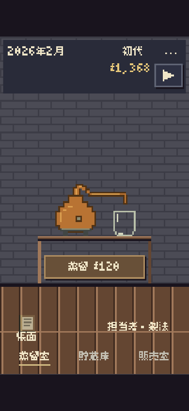
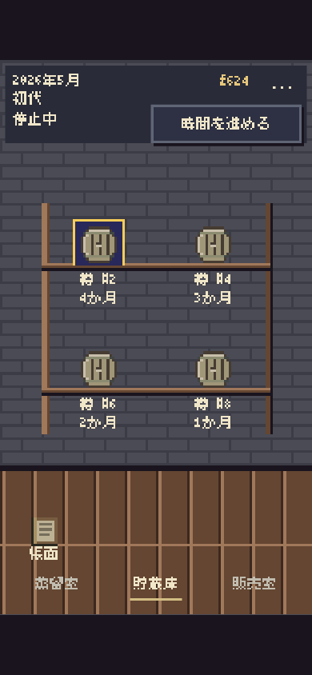
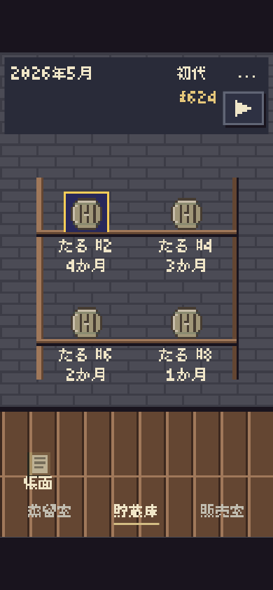
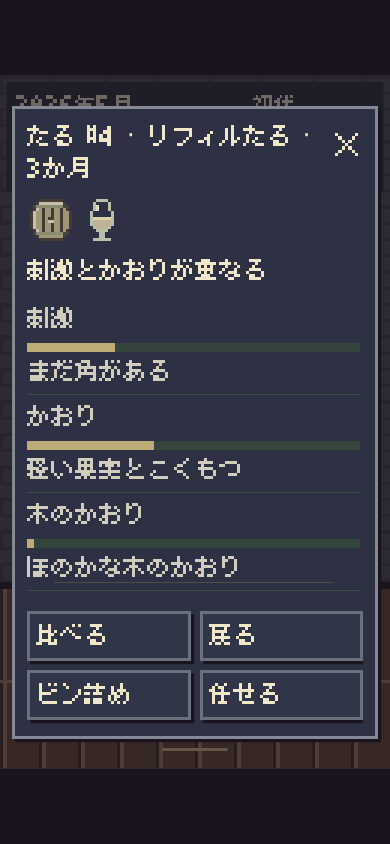
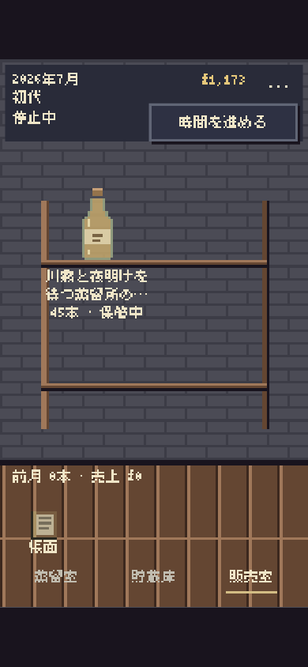
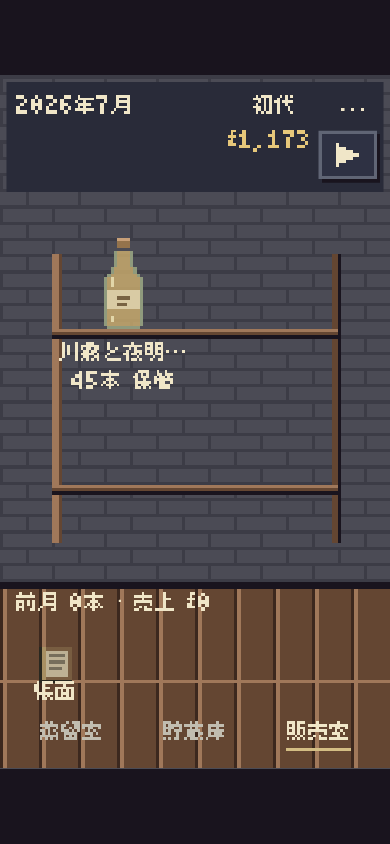

# AmberTime — 文字・数字・短い言葉

基準：PR #509 / main `59fa6bf7c508df5ad45c003181413cd0970488b2`。PR [#510](https://github.com/SukimaStock/yumaniwa-town-staging/pull/510)。[Staging](https://sukimastock.github.io/yumaniwa-town-staging/works/ambertime/)。Production変更なし。

## 文字と数字

通常の美咲ゴシック（既存の公式TTF、2021.0505）を継続。字体・フォント資材・読み込み方式は変更していない。日本語の字面7ドットに対し、半角数字は5ドットの高さなので、数字だけ自然な字形のサイズを大きくし、ベースラインを合わせた。文字列・桁・半角幅・小数・単位は維持。太字化・縦横別拡大・全角数字への一括変換なし。

| 表示 | 変更前 | 変更後 |
| --- | --- | --- |
| Canvas本文の基準 | 論理16px | 論理20px、物理8px倍数へ丸め |
| 360幅/DPR1の本文・数字 | ともに物理16px | 本文24px・数字32px（字面高さ21/20px） |
| 390幅/DPR3の本文・数字 | ともに物理56px | 本文64px・数字88px（字面高さ56/55px） |
| HTML小窓の本文・数字 | ともに16 CSS px | 本文24px・数字32px、行送り32px |
| 入力欄 | 通常フォント16px | 通常フォント20px。未収録文字・長い名前を編集しやすくするため |

部屋・設備・棚の拡大率は維持。Canvasの計測・改行は数字を含む各字形の実幅を使用し、物理整数座標で描画する。小窓も位置を物理画素へ合わせ、数字の装飾はテキストを保ったまま行う。代替字体では数字だけの拡大を解除する。HTMLのアンチエイリアス・非整数ズーム時の均一性は環境に依存する。

## 変更前後

| 画面 | 変更前（#509） | 変更後 |
| --- | --- | --- |
| 蒸留室・日時・資金 |  |  |
| 貯蔵庫・番号・年数 |  |  |
| 試飲の小窓 |  |  |
| 販売室・数量 |  |  |

## 言葉と記号

指定の「たる」「ビン」を複合語も含めて統一。「おわる」「蒸留」「たる詰め」「抽出見込み」「かおり」「試飲」「ビン詰め」「待つ」へ変更。長い「仕込みを任せる」は「任せる」、「果実と穀物」は「果実とこくもつ」、「木の渋み」は「木のしぶみ」、「控えめ」は「ひかえめ」など、風味の違いを保って整理した。

「木の移りと蒸発を抑え、口当たりの変化をゆっくり待てます。」と同じ冷却説明の選択肢ヒントを削除。空の棚・空の貯蔵庫の説明、進行中／停止中の重複表示を削除。費用・条件・警告・結果は残す。比較の候補一覧は番号・種類・年数を表示し、抽出・日付・置き場は比較詳細で確認できる。予約の抽出条件・由来は担当者の窓に残す。

再生▶・停止‖・閉じる×は共通7×7マスの矩形で描画。CanvasとSVGで同じマスクを使う。整数物理マス、既存UI相当の粒度、48px以上の小窓操作領域を確保。読み上げ名「時間を進める」「時間を止める」「閉じる」、選択・操作不可・押下・フォーカス表示は維持。保存済みの記録本文やユーザーが付けた銘柄名・製法名は置換しない。長い棚名は実測幅で省略表示し、操作名・商品窓では全文を残す。

## 検証

- 既存単体テスト577件成功、失敗0。製造・熟成・経済・契約・時間・担当者・製法・世代交代・保存を含む。これらのモデル・保存キー・保存形式・入力制御ソースは変更なし。
- [記号・数字・名前の契約テスト](contracts/results.json)：360×740/DPR1、390×844/DPR3、768×1024/DPR3、1280×900/DPR1、フォント失敗の5条件。実Canvasの再生・停止マスク、実際の開始・再開・停止と停止後の時間保持、整数描画、数字と日本語の字面高さ、閉じるSVGと読み上げ名を確認。銘柄名「樽と瓶2026𠮷・長い銘柄名の試作」を入力→ビン詰め→再読込、過去の記録本文の一致も確認。
- [フォント読み込み回帰](font-checks/results.json)：cold/warm/failed/delayed×DPR1/3の8条件。読み込み確定前のCanvas計測・描画なし、遅延到着後の再描画、代替字体で設定・閉じる操作、濁点・半濁点・指定文字と未収録文字を確認。
- [全画面ブラウザ回帰](after/browser-results.json)：5サイズ、10結果・198寸法・108ジェスチャー・16画像が成功。最終結果とソースハッシュはverification-summary.jsonを参照。三室・試飲・比較・ビン詰め・販売・製法・担当者・帳面・歩み・設定、キーボード・フォーカス、文字200％・ピンチ2倍・430px高入力画面・640px高リサイズ、窓内スクロールと背後固定、旧保存・破損保存・世代交代後再読込を対象とする。
- [独立レビュー](review/REVIEW.md)：実装差分と現在の実画面を確認。予約理由も5サイズ×通常／代替字体の70ケースで2行以内に収まり、条件の省略なし。表現監査は重複・不要説明の削除と必要な操作名・費用・条件の保持を確認。新しい説明コピー・常設設定なし。

修正履歴：拡大後の比較候補が高くなりすぎた問題は、数字spanのインライン表示と候補の情報整理で修正（1回）。文字200％で小窓の位置が旧寸法のまま残る問題は、内容・スタイル変更時の寸法再計測と位置更新で修正（1回）。それぞれ同じ回帰で再確認し成功。

実機iPhone/iPad Safari、OSキーボード、OS文字拡大、VoiceOver、作者による読み心地・採用は未確認。ブラウザによる模擬検査を実機確認とは扱わない。CI・StagingマージをRelease Completeや最終VERIFIEDとしない。
