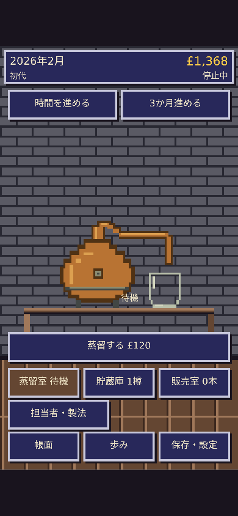
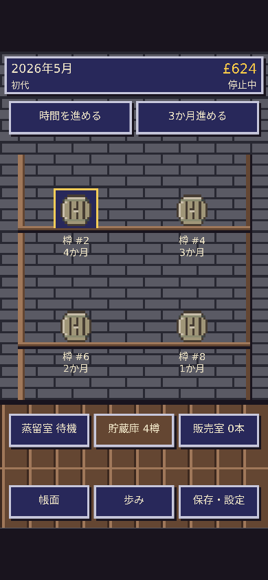
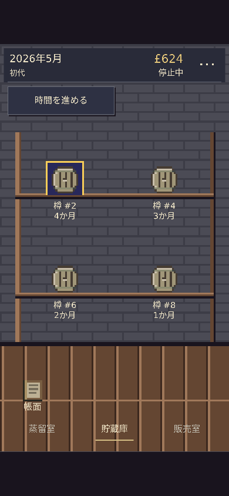

# AmberTime — 画面の引き算

既存Canvas版の表示と入口を整理したStaging変更。製造・熟成・経済・乱数・契約・銘柄・取扱店・製法・担当者・世代交代・時計・保存キーと形式は維持。既存の物体素材、共有Engine、終了済み試作、Productionは変更していない。

## 常設表示から移したもの

| 対象 | 今回の配置 |
| --- | --- |
| 歩み、保存・設定、3か月進める | 右上の「…」から開くメニュー。実際の既存ボタンと処理を移し、機能・記録を維持 |
| 帳面 | 床側の帳簿の絵と短い名前。タップ領域66×54論理px、Enterでも開く |
| 時間操作 | 通常の停止／進行だけを残し、日時・資金・状態を薄い上部表示へ整理 |
| 三室への移動 | 大きな明色枠と状態の再掲を外し、部屋名と現在地の下線に整理 |
| 担当者・製法、取引、申し出 | 床側の控えめな文字の入口。新しい申し出の入口は出現時に表示 |

設備・棚・樽・ボトルの大きさと座標は変えず、空いた面積をそのまま残した。レンガの目地と壁面の明暗差を抑え、明色の太い枠は選択表示とキーボードフォーカスなど必要な箇所へ絞った。「待機」の重複と設備に重なる状態文字を外し、予約・操作できない理由は設備の上の空間へ置いた。本文・数値・操作ラベルの文字サイズは縮めていない。

小窓の幅は、利用可能な表示領域と描画されたゲーム画面の両方を上限にした。1280×900では、ボトル詳細が従来の680pxから約482pxへ収まり、約506pxのゲーム画面より横へ広がらない。長い条件・履歴・文字入力は窓内スクロール、実行・戻るは固定した窓の操作部で扱う。メニューは「×」とEscapeで閉じ、同じ結果の閉じるボタンは重ねて置かない。

## 三室の変更前後（390×844）

前は着手時main `d5429d65` の公開モデル操作による画面。前のPNGはそのcommitの既存検証画像とバイト一致を確認し、[来歴](before/baseline-provenance.json)へ記録した。

| 部屋 | 前 | 後 |
| --- | --- | --- |
| 蒸留室 |  |  |
| 貯蔵庫 |  |  |
| 販売室 |  |  |

[360pxの蒸留室](after/360-distill.png) · [貯蔵庫](after/360-warehouse.png) · [販売室](after/360-sales.png) · [メニュー](after/390-aux-menu.png) · [試飲](after/390-tasting.png) · [比較](after/390-comparison.png) · [瓶詰め](after/390-bottling.png) · [PCのボトル詳細](after/1280-product-window.png)

## 確認

- `node --test works/ambertime/tests/*.test.mjs`：575件成功。座標・入力変換、製造・経済・保存を含む既存回帰。
- `node works/ambertime/tests/balance-browser.mjs`：360×740、390×844、360×640、1024×768、1280×900。前回のCanvas回帰を残し、新しいメニュー経路を確認。9件の結果・186件の寸法記録・16枚の画像を保存。
- 通常画面はページ全体の縦横スクロールなし。表示前のページ寸法、44px以上の主要タップ領域、中央の遮蔽、実座標のタップと描画座標の一致を確認。自動スクロールして押せたことを画面内到達の証拠にしていない。
- 待機・手動蒸留・抽出終了・樽詰め、担当者の採用・予約・取消・稼働、樽ゼロ／少数／4樽、商品ゼロ／少数／6商品、ページ送りを確認。
- 帳面、メニュー、歩み、保存・設定へ到達。メニュー中の6秒では保存バイト・年月・部屋の座標が変わらず、閉じると入口へフォーカス復帰。「3か月進める」は窓を閉じ、既存時計で正確に3か月進行。
- 試飲の実値・前回の印・風味タイプ、樽比較、瓶詰め、価格・販売、旧保存の元バイトと移行後／世代交代後の再読込、独立試作の保存分離を確認。
- 小窓がゲーム画面幅を超えないこと、開閉で背景・物体が動かないことを確認。長い名称、文字2倍、高さ430px、2倍ピンチで入力と確定に到達。
- 実画面を三室・メニュー・試飲で確認。実装担当と別のレビューでも、メニュー→保存設定→閉じるの保存不変とフォーカス、正確な3か月進行を確認。新しい装飾コピーや常設説明は追加していない。

[寸法・ソース・画像ハッシュと結果](after/browser-results.json)。Scope / Risk / Impactと必須CIはPRの固定headで確認し、マージ後はPagesの同一SHA成功と公開URLの操作・配信内容を別に確認する。

実機Safari、OSキーボード、VoiceOver、OSの文字拡大は未確認。文字2倍・短い入力領域・ピンチはChromiumでの模擬確認。自動テスト成功は、作者による見た目の採用や実機確認の代わりにはしない。
