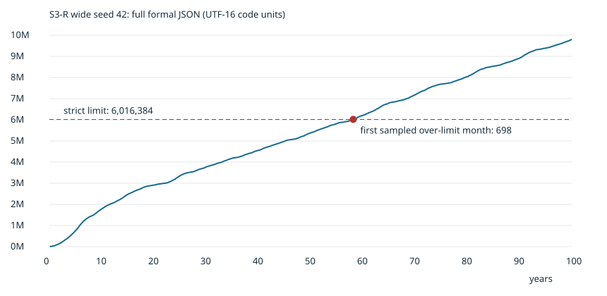

# S3-R R0: 100年保存容量監査

## 判定

**R0の容量監査。R1の本編修正は実施しない。R2およびS3完了は未成立。**

広域seed42の正式な公開操作列を再利用した。容量超過はlocalStorageのquotaではなく、展開後の完全ゲームJSONに対する厳密な `< 6,016,384 UTF-16 code units` 制約である。既存C方式は既に保存時のarrivalsを省略しているが、正式復元後は元の全状態へ戻すため、完全状態の上限には余裕を作らない。

今回の権限範囲では、履歴削除・上限引上げ・検査迂回をせずに受理可能にする最小修正の安全性を証明できない。このため、ユーザーの停止条件に従いR0で区切る。修正したふりをしてR2へ進まない。

## 対象・証拠

- Runtime source: `7635a2637da741d333934915dd68dce8a2314202` (main, PR #853 merge)。正式本編ファイル変更なし。
- Plan Lock: `.change-plans/ambertime-s3-r0-capacity/r0.lock.json`。研究コードより先にcommit。
- #805 H1-A1 merged (`0f22b025542ebb09abb464c632d998fbc88cac2c`)、#810 H1-B1 merged (`778f783043256bed02197988caecd65cda576167`)、#811 H1-B2 merged (`57ad539c26cef0d12a76e2603c482c586bcf878c`)、#812 recovery correction merged (`74924b2729565531dcc3a499dcb7e24bcc0dced8`)。
- #840 は確認時 open Draft / 未マージ。head `187cd9eb9621747f8a5063209a02194495d24f16`。checkpoint信頼設計は正式導入済みではなく、容量上限の解決でもない。
- #853 の10/30年state/session SHAは今回の再現と完全一致。既存のcold復元・翌月一致証拠を再利用し、同じ復元を不要に繰り返していない。
- 100年状態は以前保存されていなかったため、1200か月を1回だけ公開操作で再現。各月のcheckpoint時点のJSONを測定し、10/30/60/80/90/95/100年と最初の月次観測の拒否候補を隔離fixtureへ保存。これは正式セーブではない。
- `results.json`: 月次寸法、checkpoint別の項目容量・件数・SHA、実行時間・メモリ、理論C容量。`capacity.csv` と `capacity.svg` は同じ結果から生成。

## 容量推移

| 年 | 完全game UTF-16 | 完全game UTF-8 bytes | 理論C session UTF-16 | 理論C session UTF-8 bytes | 完全状態の余裕 | 前回比units |
|---:|---:|---:|---:|---:|---:|---:|
| 10 | 1,782,877 | 2,002,343 | 1,605,251 | 1,748,803 | 4,233,507 | — |
| 30 | 3,766,463 | 4,227,533 | 3,014,885 | 3,290,897 | 2,249,921 | 1983586 |
| 60 | 6,212,189 | 6,967,889 | 4,939,512 | 5,388,274 | -195,805 | 2445726 |
| 80 | 8,040,455 | 9,015,323 | 6,264,306 | 6,832,680 | -2,024,071 | 1828266 |
| 90 | 8,917,261 | 9,996,547 | 7,088,892 | 7,727,062 | -2,900,877 | 876806 |
| 95 | 9,384,878 | 10,521,686 | 7,508,071 | 8,183,369 | -3,368,494 | 467617 |
| 100 | 9,808,696 | 10,994,786 | 7,898,496 | 8,606,446 | -3,792,312 | 423818 |

最初の超過月次観測は **698か月（58年2か月）**。6,020,487 units、上限を4,103超過。前月観測は6,014,604 units（寸法上の余裕1,780）。前月が正式保存・cold復元済みという意味ではない。

100年は **9,808,696 units**。上限比63.03%超過、余裕-3,792,312。過去H1広域100年5,838,093より3,970,603 units増えている。

### 100年の内訳（親子を合算しない）

| 範囲/項目 | UTF-16 | UTF-8 bytes | 件数/キー数 |
|---|---:|---:|---:|
| game | 9,808,696 | 10,994,786 | 37 |
| town（game内） | 9,492,444 | 10,655,992 | 18 |
| town.events | 3,238,341 | 3,879,233 | 10333 |
| town.attempts | 3,017,047 | 3,017,047 | 26221 |
| town.arrivals | 2,746,667 | 3,267,559 | 8153 |
| town.seen | 303,735 | 303,735 | 8153 |
| town.shipments | 108,303 | 108,303 | 1003 |
| town.releases | 44,239 | 46,003 | 49 |
| town.packets | 28,778 | 28,778 | 136 |
| town.nodes | 3,957 | 3,957 | 14 |
| town.pending | 1,091 | 1,091 | 8 |
| town.lastEncounter | 37 | 37 | 3 |
| town.version | 23 | 23 | — |
| town.mode | 11 | 11 | — |
| town.external | 4 | 4 | — |
| town.month | 4 | 4 | — |
| town.seed | 2 | 2 | — |
| town.memories | 2 | 2 | 0 |
| town.trades | 2 | 2 | 0 |
| town.generation | 1 | 1 | — |
| game.shop | 85,549 | 85,593 | 7 |
| game.operations | 85,113 | 85,117 | 1730 |
| game.core | 50,399 | 68,729 | 15 |
| game.releases | 49,678 | 51,442 | 49 |
| game.records | 26,205 | 28,269 | 12 |
| game.marketRules | 6,312 | 6,312 | 5 |
| game.productsById | 3,243 | 3,243 | 49 |
| game.department | 2,635 | 2,775 | 3 |
| game.result | 2,180 | 2,352 | 32 |
| game.generations | 1,002 | 1,002 | 2 |
| game.shopDemand | 780 | 780 | 3 |
| game.placement | 390 | 390 | 2 |
| game.batchesById | 337 | 337 | 1 |
| game.notesById | 313 | 333 | 1 |
| game.trade | 244 | 244 | 14 |
| game.usual | 199 | 199 | 2 |
| game.automation | 195 | 195 | 4 |
| game.workPreferences | 189 | 189 | 4 |
| game.storeMarket | 146 | 146 | 3 |
| game.staffProgression | 134 | 134 | 3 |
| game.brands | 72 | 76 | 1 |
| game.staffExperience | 51 | 51 | 3 |
| game.still | 50 | 50 | 3 |
| game.bottlingRoles | 49 | 49 | 3 |
| game.staff | 48 | 48 | 3 |
| game.recipeBook | 32 | 32 | 2 |
| game.brandIdentity | 31 | 31 | 2 |
| game.alleyBar | 31 | 31 | 2 |
| game.rules | 22 | 22 | — |
| game.monthlyTiming | 13 | 13 | 1 |
| game.freeAging | 13 | 13 | 1 |
| game.tastingId | 4 | 4 | — |
| game.origin | 4 | 4 | — |
| game.version | 2 | 2 | — |
| game.seed | 2 | 2 | — |
| game.decisions | 2 | 2 | 0 |
| session.userPaused | 4 | 4 | — |
| session.elapsed | 1 | 1 | — |
| session.caskSlots | 20 | 20 | 4 |
| session.recentLedger | 25,290 | 25,890 | 7 |
| session.historyRecord | 86,875 | 88,387 | 9 |
| session.recallRecord | 724,165 | 764,805 | 20 |

### 記録数と会話投影時間

| 年 | operations | 発売回 | 納品 | town events | 会話件数 | 投影ms（単回） |
|---:|---:|---:|---:|---:|---:|---:|
| 10 | 268 | 13 | 106 | 1,830 | 5 | 3.208 |
| 30 | 583 | 20 | 249 | 3,936 | 18 | 6.994 |
| 60 | 1,062 | 31 | 420 | 6,533 | 35 | 15.718 |
| 80 | 1,398 | 40 | 543 | 8,461 | 46 | 14.331 |
| 90 | 1,569 | 45 | 604 | 9,387 | 50 | 15.563 |
| 95 | 1,639 | 46 | 633 | 9,888 | 53 | 17.797 |
| 100 | 1,730 | 49 | 665 | 10,333 | 56 | 27.675 |

100年のtownは全gameの96.78%。events/arrivals/attemptsは91.78%。

100年fixture SHA-256: `ee2849503b2b9113b388a2c8049a1c8b650afc64821719ad7c42703fa9f14cf4`。完全game SHA-256: `b5701cdac0a8277abe9be432cc5dd3ea126fcedc8438a62567bfce9a80d50d55`。初超過fixture SHA-256: `25eb9e039aadb4eba86ebdc2e6a9ffcc3dd6ab34e95b1556db37a9719eab1ce3`。

実行Node v24.22.1、career計測総時間821.628秒、100年時maxRSS 841,288 KiB。



「最初の超過月」は月次checkpoint観測であり、月内の全操作ごとの最初の保存失敗を特定した値ではない。

UTF-16の文字列長、UTF-8 bytes、プロセスメモリを区別する。100年の理論C sessionも7,898,496 unitsで、別のsession上限6,017,408未満を超える。したがって入口のgame検査を移動しただけで保存が通る状況でもない。

C容量とsession容量は、厳密に同値なarrivals導出を先に確認した上での**理論値**。正式guardを通過した保存成功ではない。親gameと子townの容量は内訳として示すが合算しない。JSONの括弧・キー・区切りもあるため子容量の和は親容量と一致しない。

## 直接原因と増加要因

容量を支配するのは既存町モデルの個別伝播・抽選記録である。arrivalsはevents内arrivalの完全な重複表現だが、H1-B2でwireから既に除去済み。eventsとattemptsには別個の出来事・試行の内容があり、一律削除や件数への集約は歴史保持契約を損なう。

30年の独立監査:
- events 3,936件はID一意・連番、sourceIdは先行イベント。arrivals 3,108件はeventsのarrival部分と値・順序が完全一致。cohort+to重複0、seen対応一致。
- attempts 9,968件 = 3×arrival(3,108) + 2×interest(120) + encounter(404)。type/sourceId/month重複0。各arrivalのmemory/interest/share、interest成立時visit/inquiryという既存処理に対応。
- shipments 411件はreceipt ID重複0。shop由来249件は元納品の年月・宛先・本数と一致し、発売本数超過なし。
- events/arrivals/attempts合計3,394,260 units、gameの約90.1%。誤った二重計上を新たな不具合として断定できる証拠はない。

### 過去H1との比較と帰属の限界

H1-B1の広域100年は5,838,093 unitsで、既に約2.96%しか余裕がなかった。今回と同一の操作列ではない。H1広域30年→今回30年で発売回15→20、元納品91→249、town受領253→411、events 2,446→3,936、arrivals 1,885→3,108、attempts 6,099→9,968。

H1の`newMarketRulesDistillery`からS3の`newShopDialogueDistillery`へ変わり、配分先にbarを加えた。既存仕様は受領ごとにcohortを作るため、少量でも受領回数が増えると伝播・抽選履歴が増える。30年でbar宛147受領は各1本の別の実売事実。barを祖先とするarrivalは1,145件だが、これは系譜集計であり、barなしの同条件反実仮想比較ではない。**「バーだけが超過原因」という因果主張はしない。**

H1-B1 merge `778f7830` と現mainのtown model・town-connectionはbyte同一。S1 `8da1c491` はUI/scroll変更で、このNode runnerはそのUIを通らない。S2 `ce3a63a8` のモデル追加は会話切替operation1件。会話は既存事実の投影でtownへ追記しない。S1/S2会話データの新規重複が支配的原因という証拠はない。

## R1候補比較と停止理由

| 候補 | 容量への効果 | 安全性と判断 |
|---|---|---|
| C wireのarrivals省略 | wireを縮める | 既に実装済み。完全状態の長さは変わらない |
| 追加の可逆wire圧縮 | wireや一時配列を縮め得る | 展開後に同じJSONへ戻れば同じ上限違反。今回の解決として不採用 |
| guardを圧縮後へ移動 | 見かけの拒否位置だけ変える | decoder/readerで再拒否。そこも変えれば禁止された契約迂回 |
| streaming JSON | 一時メモリ低減候補 | 同じ正式JSONなら文字数不変。過去研究も正式serializer置換を非推奨 |
| events/attempts履歴の削除・集約 | 大きい | 個別事実、因果、同値性を失う。禁止 |
| runtimeの導出参照層・正式canonical表現の再設計 | 将来の候補 | replay、validator、地図、clone、旧形式移行を含む別の信頼契約。最小codec修正ではなく今回未実装 |
| checkpoint | cold復元高速化候補 | townの完全状態の成長を止めず、保存追加容量が必要。上限解決として不採用 |

拒否境界は `development-save.mjs:33`、`save-codec.mjs:25,36–38`、`partner-orders.mjs:1369`。保存は正式readerの復元値と元game/sidecarの完全一致を求める (`development-save.mjs:37–38`)。復元後のJSONが元のJSONと同一なら、その長さも同一である。この制約を維持したまま超過状態を受理することはできない。

削除不可の主な根拠:
- eventsの件数は次ID、rumor履歴は年間上限、sourceIdと履歴位置は後続処理に依存。
- shipments/releasesは受領重複防止・商品適合度・本数上限・将来関係に使用。
- seen/pending/packets/nodes/lastEncounter/seedは将来伝播や抽選状態。
- arrivalsは導出可能でも正式モデル/地図が通常配列を要求。wireでは既に省略。
- attemptsは将来抽選が過去配列を直接読む証拠がなくても、失敗・skip・rollを含む個別事実と正式全状態一致の対象。削除してよい根拠にはならない。

## 店舗会話・回想・回帰

各採取checkpointで過去会話prefixが不変であることをassertした。30年までのstate/session SHA一致はRNG、履歴、collectorを含む。100年の測定は新しい実行結果であり、過去の合成400発売回/7,585記録/165ms条件とは別。今回のdialogue時間は実シナリオの単回投影計測で、一般的な性能上限やSafari時間ではない。

月次更新後には新状態が生まれるため投影cacheが無効になる。増分計算は過去確定文、発話間隔、再登場間隔、参照商品、回想との境界を保持する設計が必要で、今回同時改造しない。

新規計測テスト5件、既存C codec 7件、S3/S4保存回帰10件、計22件PASS。新規に確認したのは採取fixtureのhash/長さ、arrivalsのJSON文字列完全一致、超過状態を正式size guardおよびdecoderが寸法超過の理由で拒否すること。全操作cold復元の成功ではない。Plan Lock、Scope/Risk/Impact、4ファイルのnode --checkがPASS。CIのexact SHAとマージ状態はPR #854を参照。

保存拒否は新しい保存候補を書き込む前に発生する。研究fixtureのJSONを正式保存として書いていない。既存codec/保存失敗保護のNode回帰を実施したことと、100年の復旧可能性は別である。readback失敗後の独立旧保存や全領域消失からの復旧は現行単一キーでは保証されず、R0で新しいバックアップ保証を追加していない。

## 再現と環境

```sh
node --expose-gc works/ambertime/design/s3-r0-capacity/run.mjs /tmp/ambertime-s3-r0
node works/ambertime/design/s3-r0-capacity/summarize.mjs /tmp/ambertime-s3-r0
node --test works/ambertime/tests/s3-r0-capacity.test.mjs works/ambertime/tests/h1-b2-codec.test.mjs works/ambertime/tests/s3-save.test.mjs works/ambertime/tests/s4-save.test.mjs
```

Linux cloud executor。Node版、経過時間、process.memoryUsage、maxRSSはresults参照。memoryUsageは採取時点の観測でありGC後保持ヒープではない。maxRSSは研究runner全体（fixture生成・計測を含む）の高水位で、本編単独のメモリとは異なる。1方針を順次実行。途中に短い単体テスト/監査処理が同一ホストで動いたため、career経過時間を最適化前後のbenchmarkとして使わない。cold復元を新たに計測したとは主張しない。10/30年の既存cold値はそれぞれ4.59秒/26.15秒で環境差がある。

全fixtureは合成シナリオの研究データで、プレイヤー個人の記録ではない。巨大JSONはGitへ含めず、実行出力に保持。SHAはresultsへ記録。超過fixtureは通常のゲームへの取込用ではない。

## 未確認と次の判断

- 100年の正式保存、cold復元、復元後次月、再保存は未成立。R2未着手。S3未完了。
- 地元・混合・別seed・多数店舗条件は追加していない。先に失敗したwide42への安全な修正が成立していないため。
- Chromium実保存・quota・iPhone Safari・ブラウザー終了後の復旧は今回未検証。Nodeの容量監査で実機を保証しない。
- iPhoneで巨大な研究fixtureを読み込ませることは勧めない。正式な保存候補が成立後、元保存を書き出して保護した隔離環境で、保存→終了→再開→状態確認→1月進行→再保存を最小受入手順とする。
- 次段階には、完全な個別事実を保持するcanonical表現と、その新しい計測/メモリ/信頼境界を明示した設計が必要。現上限を圧縮データへ付け替えるだけではない。旧v8からの同値移行、正常保存の保護、全操作replay、未来状態/RNG/回想一致、最大展開・走査制限を独立に定義し承認してから限定試作へ進む。

Production・正式保存形式・上限・モデル・UI・Canvasは変更していない。R0研究のStaging反映が成功しても、本編の容量修正が公開されたことにはならない。
