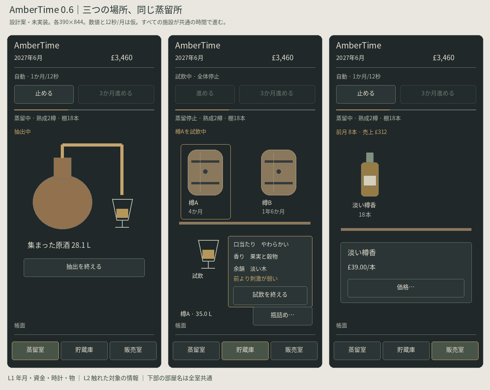
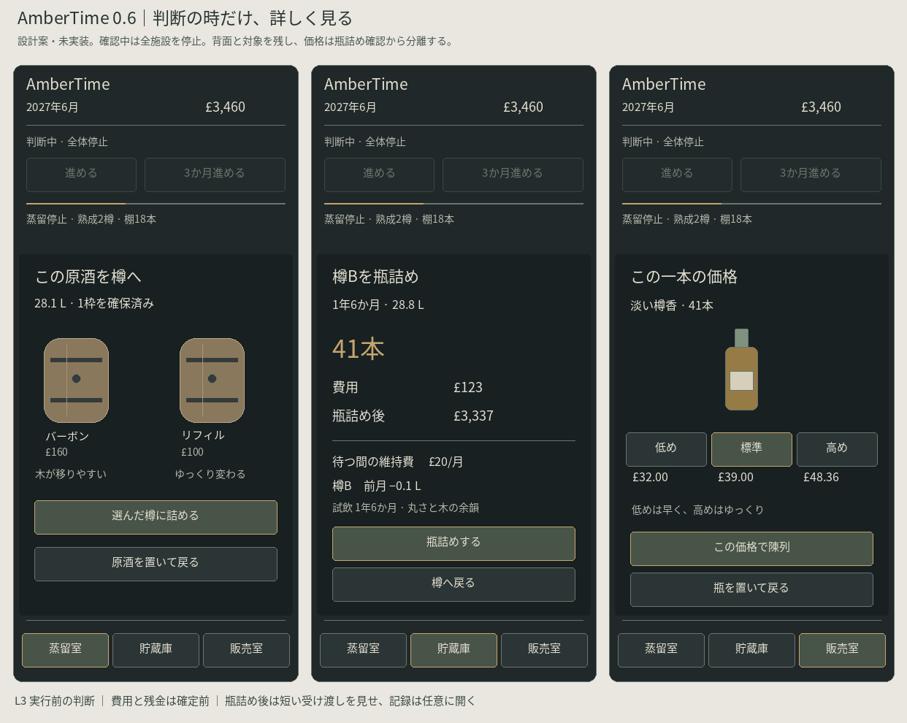

# AmberTime 0.6 — Rediscover the Design

**設計案 / 未実装 / 採用はプレイ比較後。** 2026-10-15、調査基準 `a071bc1e71b5a5d2d96837f3d325159d89bc14c4`。原典の確認事実と版比較は [AUDIT.md](AUDIT.md)。今回はこのディレクトリの文書・静的図だけを追加し、既存ゲーム・保存データ・共通Engine・Productionは変更しない。

## 提案の中心

蒸留室・貯蔵庫・販売室は、別々のゲーム進行ではなく**同じ蒸留所を見る三つの場所**にする。樽を選んでも部屋を替えても、他の樽・蒸留器・棚の仕事は残る。普段は物、触れた時は小さな操作面、確定する時は一つの確認、振り返る時は帳面へ進む。

物に触れること、表示情報を整理すること、操作数を減らすことを分ける。蒸留の止めどきと瓶詰めは行為として残す。重複説明は削る。試飲は表示位置を変え、比較に使う情報は削らない。

## 画面を見る

[3室のiPhone案 PNG](rooms.png) / [編集用SVG](rooms.svg)

[樽詰め・瓶詰め・価格の判断 PNG](decisions.png) / [編集用SVG](decisions.svg)

[iPad・PC展開 PNG](wide.png) / [編集用SVG](wide.svg)

すべて静的なワイヤーフレーム。表示数値は同じ蒸留所を説明する仮データで、操作可能なプロトタイプでも確定バランスでもない。どの案でも樽の中は透かさず、量は短い数字、色は注いだグラスで分かるようにする。

## 1. 情報の4階層

| 階層 | 見せる情報 | 見せ方・時間 |
| --- | --- | --- |
| L1 常時 | 年月・資金・自動/停止/判断待ち、月の進行線、今の場所の物、3室の名前 | 画面上下の共通位置。各室の作業を「蒸留中 / 熟成2樽 / 棚18本」と短く示す。部屋選択では止めない |
| L2 触れた時 | 対象名、樽の年齢/残量、グラスの現在の3風味、前回との差、商品在庫/単価 | 対象に近い小パネル。別画面へ遷移しない。樽・瓶の単なる選択は進行継続。実際に試飲している間だけ全体停止 |
| L3 判断 | 蒸留開始の費用と空き、樽詰め先、瓶詰めの本数/費用/残金、値付け、状態イベント | 一度に一つのモーダル/下部シート。確定/取消を具体名で表示。蒸留所全体を止め、停止理由をヘッダーに表示 |
| L4 詳細 | 試飲全履歴、原酒・樽係数、売上/維持費累計、過去の一本 | 帳面を明示して開く。階層を増やす常設メニュー群にはしない。履歴閲覧だけでは止めず「停止」操作は残す |

最初から全対象の操作パネルを並べない。選択中の対象は一つ、試飲の吹き出しも一つ。短いラベルと意味のある図を併用し、アイコンだけに操作名を委ねない。

## 2. 三つの画面の仕様

| 必須項目 | 蒸留室 | 貯蔵庫 | 販売室 |
| --- | --- | --- | --- |
| 役割 | 自分の抽出を作り、次の樽へ渡す | 樽を見比べ、試飲して手放す時期を選ぶ | 商品を覚え、値付けし、次の資金を得る |
| 常時 | 蒸留器/受け容器、idle/抽出中/原酒待機、収集量。未操作の原料条件は出さない | 最大4樽の棚。樽名の短い札・年齢、選択枠。量や味の全文は全樽に並べない | 瓶の棚、短い商品名・在庫本数。前月の販売本数と売上を一行 |
| オブジェクト | 蒸留器、受け容器、原酒 | 樽、選択樽の横のグラス | 瓶、未陳列の瓶の受け台 |
| タップ | 蒸留器→開始/抽出停止の操作、原酒→樽詰め先 | 樽→年齢・残量・「瓶詰め…」、グラス→その場の試飲吹き出し。前回差は一言、全履歴は帳面 | 瓶→在庫・現在単価・「価格…」。在庫を常時数で確認でき、瓶絵の本数を実在庫と誤解させない |
| 判断の窓 | 費用を確かめて開始、出来た原酒へ2樽種を選ぶ。複雑な条件は今回追加しない | 本数・費用・瓶詰め後資金・月維持費・残量/直近の減少。価格は置かない | 低め/標準/高めの実額と売れ方の方向。価格決定と陳列を同じ確定にまとめる案 |
| 通知 | 完了を受け容器の変化と短い室ラベルへ。回収は自分で触る | 通常は色/年齢/量更新。重要変化は対象枠と一行。判断のみ停止 | 瓶の代表絵と在庫数の減少、資金増。月売上は一行へまとめる |
| 移動 | 下部の「蒸留室・貯蔵庫・販売室」、現在室を形と文字で選択表示 | 同左。判断が他室にあれば「樽Bの判断」へ一回で移動 | 同左。商品化後も棚を眺めるだけの終端にしない |
| 増えた時 | 蒸留器1台＋未回収原酒1件を上限。作りかけを部屋移動で捨てない | 初回検証は2樽、既存上限4樽を維持。4樽の2×2配置。履歴は選択対象だけ | 瓶の数ではなく商品単位で棚枠を使う。小画面は4商品/棚ページ、ページ名と前後を明記。記録は別帳面へ |

起動時に部屋を選ばせるメニューは置かない。新規は蒸留室、再開は前の場所と対象を復元する。空いた樽枠からも蒸留室へ進めるが、空枠を設備購入に化けさせない。初回だけ対象に短い「蒸留器に触れる」を添え、操作後は消す。

### iPhone、iPad、PC

基準は390×844、320pxでも縦スクロールで情報を失わない。操作領域は44px以上、本文は16pxを基準、補助は14pxを下限案とする。下部移動はsafe-areaを避け、スクロール末尾やシートに隠れない。長い履歴だけ内部スクロールし、重要確定ボタンまで二重スクロールさせない。

iPadは同じ一室を広げ、選択対象の軽いパネルを右側へ置く。PCも部屋を一つ表示し、詳細の固定幅を確保する。三室を常設3カラムの管理ダッシュボードにはしない。判断は端末が広くても同じ内容の窓。物のサイズを際限なく拡大しない。

キーボードでも樽・グラス・瓶を選べる名前付きbuttonを使う案。選択はaria-pressed等で分かり、色だけに頼らない。モーダル中は背面を操作不能にし、フォーカスを戻す。取消可能な窓はEscape/外側で閉じられ、瓶詰めや支払は外タップで確定しない。フレーバーは短文を基本とし、全文は読み上げ・帳面から辿れる。これは要実装の検証条件であり、今回達成済みとはしない。

## 3. 試飲・瓶詰め・完成の違い

**試飲**：樽を選ぶ→横のグラスに触る→注いで停止。樽/他の棚/年月の位置は維持。口当たり・香り・余韻を各一語句、前回差を一行にする。「試飲を終える」で元の停止状態へ戻る。回数制限や罰は加えない。記録は毎回保存し、同月の連打を無意味な履歴で埋めない扱いを既存仕様と照合する。

例：口当たり「丸さが出た」、香り「果実と穀物」、余韻「ほのかなバニラ」、差「前より刺激が弱い」。数値を隠しても、現在の風味と前回の方向は隠さない。過去の全文は「試飲履歴」へ。

**瓶詰め**：樽の操作から「瓶詰め…」→本数/費用/残金/月維持費/残量を一窓で判断。試飲を強制しないが、直近試飲の年月と短い味、未試飲なら「試飲なし」を示す。推定販売価格・長い市場説明はここへ出さない。「瓶詰めする / 樽へ戻る」で分かれる。

**商品化**：短い樽→瓶の移行を同じ棚位置で見せ、完成名と特徴を一言。画面全体を結果一覧に置き換えない。瓶は未陳列の受け台へ。完成記録を開く/販売室へ置く/今の場所に残るを可能にし、移動を強制しない。詳細な過去の記録は帳面で比較できる。

**販売**：受け台の瓶→価格の窓→「この価格で陳列」。陳列後の最初の販売は次の月。すでにある商品は次の蒸留・熟成中にも売れる。新作の瓶だけがまだ売れない状態を、計算層でも保つ。

## 4. 文章と通知の監査案

| 旧Web版／現行0.5 | 新しい置き場所/文 | 判断 |
| --- | --- | --- |
| 瓶詰め確認の推定販売価格＋維持費＋蒸発＋再投資を一段落 | 「41本」「費用 £123」「残金 £…」「維持費 £12/月」「残量…L / 前月−…L」 | 説明削減ではなく判断値へ分解。販売価格は販売室へ |
| 試飲全文＋前回全文＋差の箇条書き | 樽横の現在3語句＋差1行、全文比較は履歴 | 比較能力は維持し常設文章を減らす |
| 完成後、試飲/判断メモと価格/棚が縦に連続 | 同位置の瓶と短い特徴→任意に記録/価格を開く | 完成を管理画面で埋めない |
| 全部屋で風味・同じルールを再説明 | 対象に一度だけ。初回操作の短い注記と必要時の「詳しく」 | 見れば分かる説明の重複を避ける |
| 0.4以前の「次の変化まで」 | 0.5の「3か月進める」＋月ごとの年月更新を維持 | 新しい変更ではなく0.5の改善を残す |

通知位置は全室で時計の下の一行に固定。通常「前月 8本販売・£…」、変化が乏しい月は文章を増やさない。重要だが判断不要の変化は該当物の短い強調＋一行のみ、履歴へ残し自動で退く。意思決定だけ全体を止める。同月の売上/維持費はまとめて通知し、樽数に応じたポップアップを連打しない。

## 5. 並行処理の状態設計（提案）

新しい共通Engineや多数の管理クラスは作らない。作品内の一つの状態と純関数で足りる。0.1の `model.advanceMonth` は全樽/全商品をすでに更新できる。0.4の試飲・変化判定を樽IDへ分け、0.5の一樽のphaseを全体のphaseとして使うことをやめる。

| 領域 | 保持するもの | 保持しないもの |
| --- | --- | --- |
| core | 月・資金・RNG・原酒・casks[]・products[]・累計 | 現在表示している部屋による進行条件 |
| still | idle/collecting/awaitingFill、実際の抽出位置・原酒ID・支払済み情報・予約枠 | 全体をwatching/sellingへ切り替える単一phase |
| caskNotes[id] | 試飲スナップショット、選択、既出節目、前回イベント月齢、熟成方針 | casks[0]への暗黙の参照 |
| productStatus[id] | unlisted/listed、単価。未陳列は月次販売対象外 | 画面を隠せば売れないというUI依存 |
| decisions[] | 樽ID・eventID・発生月、解決状態 | 非表示樽で発生した判断の破棄 |
| records[] | 蒸留条件→樽→試飲→判断→瓶の由来。商品IDで実売上を追記 | 次仕込みによる資金や前の記録の初期化 |
| ui | room、selectedObject、overlay、フォーカス戻り先 | 売上/熟成の計算責任 |
| clock | userPaused、hidden、pauseReasons、月内進行、抽出進行 | UIの閉じる処理が上書きする単一pausedフラグ |

### 一月の更新順序

1. 停止理由/重複月次/入力対象の有効性を検査。資金不足などの判断があれば進めない。
2. 前状態を取り、一度だけ全体の月次を計算。全樽の熟成・蒸発、**listedだけ**の販売、維持費、年月を更新する。
3. 前後の各樽と樽別メモから節目を検出する。`tickCharacter`を樽の本数だけ呼ばない。そこには全体の `advanceMonth` が含まれるため。
4. 同月の判断を `{month,caskId,eventId}` で重複排除し、同一シードで安定した順番（発生月→樽ID→イベントID）へ並べる。
5. 全結果を一括保存。途中の一樽だけ新しい月になった状態は保存しない。保存失敗時はそれ以上の自動進行を止め、元データを上書きで救済しない。
6. 判断キューがあれば全体停止。「樽A 1/2」を表示し、一つ解決しても別樽が残れば再開しない。瓶詰めは当該樽の残留判断だけ除き、別樽と販売を維持する。

部屋移動を何度行っても同じ一月の出力となる。モーダル中の決定は月次処理と直列に実行し、二重押しで二回瓶詰めしない。閉じた対象が既に消えていた場合は他の対象へ操作を転用しない。

### 未陳列商品と樽詰め待ち

現行0.5は瓶詰め段階で全体が停止するため、未陳列品は売れない。並行化後には他樽のため月が流れる。既存 `advanceMonth` は全商品を売るので、**listed判定を作品内の新ルールへ組み込む変更が必要**。棚から描画を除外するだけでは不十分。旧ルールの引数なし動作は保持し、同じ商品を戻し入れする仮の在庫操作で回避しない。

未回収原酒は蒸留器横に実体を残す。開始時に空き1枠を予約し、4樽が埋まっていれば次の仕込みを始められない。原酒待機は1件、重複蒸留は不可。樽詰めは予約枠と実費を再検査し、画面移動しても課金を重ねない。いきなり複数原酒の分割管理へ戻さない。

### 時計と停止の一貫性

- 自動進行中は全室共通の月進行線と「自動」、停止は「停止中」、判断は対象名を表示する。操作は独立した「止める/進める」と「3か月」。一つの循環アイコンにしない。
- 試飲・瓶詰め確認・樽詰め/値付け・未解決イベントは、どの室にいても**月次と蒸留の両方を停止**。終了してもuserPaused/hidden/他の判断が残れば停止を維持する。単なる樽選択・部屋移動・帳面では止めない。
- タブを隠すと全体停止。復帰は明示再開、オフライン追いつき処理は加えない。復帰時の停止理由を表示する。
- 一つのdispatcherが抽出の細かい刻みと月の進行を管理する。ブラウザの重いフレームを一気に何か月も消化しない。実際の入力（抽出停止位置）と業務月次の順序を記録する。同じ操作位置/順番/seedで同じ結果を得る。
- **速度は未確定。比較候補は6秒/月と12秒/月、図は12秒/月の仮案。** 0.5の2.2秒/月をそのまま並行化すると10秒の蒸留中に約4か月過ぎる。12秒なら最大1か月程度だが、長期熟成の待ちが退屈になる可能性がある。蒸留中だけ他樽の月を黙って凍結する案は採らない。
- 抽出中の3か月送りは不可。他の時は一月ずつ同じ更新を最大3回、途中の判断で停止。12秒案でもスキップで全熟成を済ませるゲームになっていないか比較する。蒸留器の操作中に別樽の判断が起きたら両方停止し、抽出位置を保持する。判断後は「蒸留を再開」を明示する。

### 費用と低資金

現行0.5は樽があれば一律£12、なければ£4で、樽数分の加算ではない。案は基礎£4＋稼働樽£8/本（1樽12、2樽20、4樽36）。**仮パラメータであり今回変更しない。** 2樽の方が常に得になる量産優位、初期資金、瓶代の確保を同シードで比較して決める。

仕込み開始は既存樽の瓶代・次の原酒の最大瓶代・最低樽代を考慮して費用を確認する。月次の資金確認は販売収入も含む全体収支で行う。低資金で自動を止めても、既存商品を売る一月まで永久に止めてしまわないことが必要。案は、残金非負の一月だけ明示的に進められ、自動再開はしない構造。最低資金ルールの厳密な採用値はシミュレーション後に決める。融資・無償仕込み・自動リセットで解決しない。

## 6. 保存と段階移行

0.4/0.5はシードと操作列から再実行し、現在状態と一致検査する。月次順・費用・選択順を同じversionのまま変えると、正しい古いデータも拒否される。**新構造は新version・別キーの候補とし、既存のreader/規則/キーを凍結して保持する。** キー名とschemaの確定は実装段階の契約レビュー対象で、今回は作らない。

1. 旧readerで元データを完全検証。不正・将来形式は上書きせず元の版へ戻れるようにする。
2. 0.5の現役樽のトップレベル試飲/選択/方針を、その実在caskIdへ割当。`seen / lastEventAge / targetAge / peakCharacter / cooled` を明示的に移し、未解決 `pending` は当該樽の `decisions[]` へ変換する。残りの待機期間と既出節目も失わない。支払済みの蒸留途中/未樽詰め/未陳列/販売中をそれぞれ保持する。原酒や所持金を作り直さない。
3. 0.1～0.2の3～4樽も欠落させない。0.3～0.4の一樽ごと初期化した資金を、0.5の継続経営資金と合算しない。複数世代が同時にある場合は元データの由来を選び、勝手に統合しない。
4. 検証済みの旧状態を新ルールの移行起点とし、移行後の新操作列と分けて再現検査する。旧操作列を新しい月次規則で再実行しない。新状態を別キーへ書き、readerで読戻し一致検査。元の文字列は残す。新規/移行元の版・時点を記録し、移行を二回適用して増殖しない。
5. 旧 `legacy.html / v04.html` と0.5の継続用入口も保持する。新方式へ自動で押し込まず、比較と復帰を可能にする。

これは移行案であり、実装や保存データの移し替えは今回行っていない。

## 7. 実装ロードマップと最初の一手

| 段階 | 小さな変更範囲 | 次へ進む条件 |
| --- | --- | --- |
| 0 今回 | 原典監査・静的ワイヤー・設計案だけ | 事実/提案/未確認が区別され、既存runtimeが同一 |
| 1 計算境界 | 作品内で「全体の月を進める」と「樽別の節目を検出」を分離する設計検証。旧APIは既定動作を保持 | 2樽＋商品を一月更新し、年月/売上/維持費が一度だけ。旧0.4/0.5の再現保存回帰が同じ |
| 2 任意試飲の位置 | 現行一樽のまま、樽横の短い試飲パネルと履歴への退避だけを試す | 画面の位置が動かない、比較が判断に使える、停止/閉じる/再開が一貫 |
| 3 並行する最小状態 | 2樽＋蒸留器1台＋販売在庫、新ルール/移行reader、未陳列の除外。新UIを完成させる前に数値検証 | 異なる表示室/操作順で同じ状態、低資金で脱出可能、2回の仕込みと既存在庫販売、保存の各段階復元 |
| 4 三室の見せ方 | 共通時計/名前付き移動/物の選択/瓶詰め確認/商品化、図のiPhone案を一室ずつ | 320/390/768/PCで操作、モーダルと再開、同月2判断、別室蒸留完了を確認 |
| 5 テンポと経営 | 6秒/12秒案と維持費案の比較。A早期/B長期/C個性で同seed・同月数 | 人間の待ち/試飲/並行把握を評価し、数値の偏りも記録。好転した部分だけ採用 |

**最初の小改修は段階1の「二樽＋商品を一月だけ更新する境界」を検証すること。** 新しい3室UIと新保存を同時に作らない。ユーザーがすぐ触って比較する最初のUI変更は段階2の樽横試飲に絞る。今回、それらのコードは作らない。

### 必須の回帰・比較シナリオ（将来の実装用）

- 樽A/Bとlisted/unlisted商品を用意し、蒸留室/貯蔵庫/販売室のどこにいても同じ一月の結果。A/Bは各一回、売上/費用も一回。
- A/Bに同月の節目、Aを瓶詰め、Bの判断は残る。キューがなくなるまで月も蒸留も停止。決断の連打・樽ID取り違えなし。
- 試飲→瓶詰め確認→取消→試飲終了で、ユーザーの停止を勝手に解除しない。背景化・復帰も同じ。
- 抽出途中に別樽の判断。液量/支払を保存し、復帰後に課金や原酒抽選を繰り返さない。空き予約も保持。
- 新商品を未陳列のまま他樽の月を進める。未陳列は売れず、以前の商品は売れる。
- 2樽以上の瓶代、低資金、既存在庫、次仕込みを同時に検査。維持費の停止で販売も永久停止しない。
- 0.1/0.2の4樽、0.3/0.4の試飲中、0.5の全phaseと二本の記録、破損/将来形式/保存失敗を復元。元キー・元文字列は変えない。
- 人間には「別室の変化に気づくか」「グラスを自分から触るか」「瓶詰め/値付けを区別できるか」を尋ねる。自動テストだけで面白さや愛着を合格にしない。

## 8. 未解決事項

- 6秒/12秒と3か月送りの関係。待つことを消さず、蒸留中に何か月も過ぎない適切な比率。
- 基礎費＋樽数の料金、複数樽の瓶代保護、移行時の初期資金の扱い。早期回転の既存優位を悪化させないこと。
- 同月の複数樽の判断が、自分からの試飲を阻害しない頻度。キューの技術的安定と興味深さは別に評価する。
- 4樽をiPhoneで見分ける札の大きさ、グラス吹き出しの高さ、完成直後にどこへ視線が移るか。
- 空樽再利用や原酒分割を戻す価値。経済モデルへ影響するため、見た目の復元として追加しない。
- 原典PDF欠落画像は公開同記事で補完したが、当時のCodea実行・全モーダルの挙動・指の操作感は未確認。

これらは技術的な不具合の対応を作者へ差し戻すリストではない。実装時にAIが再現・検証し、作者には触感と採否の具体的な比較を提示する。

## 今回の確認記録

原典コードとWeb履歴は別担当で読取監査し、主担当が記事の4画面画像と統合した。設計と3枚のPNGは実装担当とは別の読取レビューを受け、重大な矛盾なし。指摘された「次の変化まで」の版表記、樽別の既出節目・残り待機・未解決判断の移行項目を補強した。

静的SVGのXML・リンク先・PNGを確認。SVGはscript/foreignObject/イベント属性を含まない。図中の28.8L→41本→瓶代£123は既存0.7L/本・£3/本に合わせた例で、価格・維持費・速度の採用を確定しない。試飲/判断中と抽出中の早送りは図でも無効状態にした。

既存のゲームファイルが基準HEADと同一であることを差分で確認し、既存Node回帰92件が成功。Scope/Risk/Impactも成功。設計資料のSVGは既存の安全検査でWORKの下限があるため、CONTENT/ASSETだけの初期分類を公開前に修正し、最新mainを基準に正しいLockを先に固定した。検査ルールの変更や回避はしていない。

これは静的な画面設計のレビューであり、提案UIのブラウザ動作、実機のタップ、面白さ、移行処理の実行を確認したものではない。LAB・作品入口・公開状態も変更しない。

初回PR #397のCIでは、独自のXML/リンク/同一性確認名をtrusted登録済みIDとして記載したため、静的検査宣言が拒否された。未マージのまま、登録済みID（この差分に実行対象のない構文検査はN/A）と、独自に実施した文書/図の検証証拠を分け、新しいbase/Lockで提出し直した。ゲーム・検査ツール・workflowを変更して通過させてはいない。
