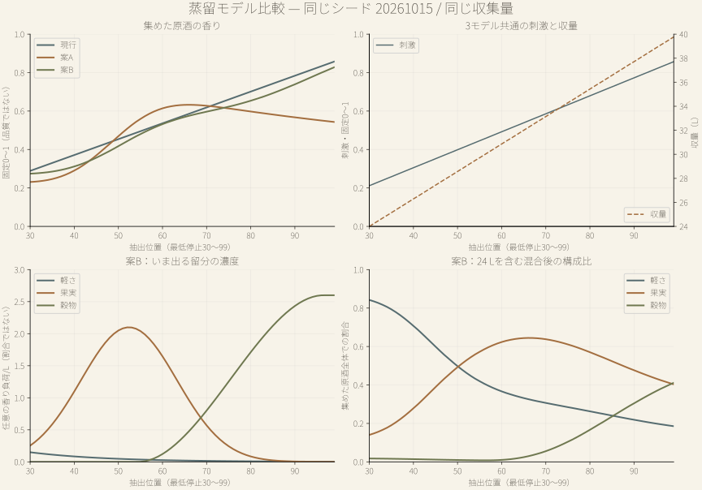

# AmberTime 蒸留モデル比較実験 Phase 2

## 今回の結論

Aは「中盤の香り」と「後半の量」に違いが出る。Bは集めた原酒の構成が、軽さ→果実→果実と穀物へ滑らかに変わる。どちらも本編への採用は未決定。数値検証で面白さを判定しない。

既存の熟成・経済をそのまま接続すると、Bの構成比は価格・需要・特別注文に読まれない。香りのscalar値が上限1に達する範囲では、蒸留で作った違いが既存計算上は消える。Bの保存・熟成との接続は採用前の課題として残す。

## 触って比較する

index.html でモデルを選び、同じシードから開始・停止・もう一度を試す。早め30・中頃65・遅め99は比較用の代表点で、推奨停止位置ではない。停止時には同じ位置の3モデルを並べて確認できる。

この試作はプレイヤーの保存キーを読まず、書かない。本編の計算モジュールへの変更もない。結果JSON・曲線は固定したmodels.mjsのSHA-256を記録している。

[比較試作](index.html) · [全数値データ](results.json) · [曲線データ](curves.json)

## 抽出曲線と設計

合法な停止位置p=30〜99を x=(p−30)/70 に変換。3案とも収量は既存の round(24+16x,2) L、刺激は (0.22+0.68x)×既存の個体差。停止前30未満では風味を確定扱いしない。

現行：香り=(0.30+0.60x)×個体差。A/Bのために現行式を再調整しない。

案A：初めの24 Lの香り濃度0.24に、c(x)=0.10+3 exp(−((x−0.28)/0.18)²) の留分を追加する。各追加量ΔLで重みづけて集めた原酒全体の香りを求める。中盤の香りが後半の量で穏やかに薄まり、刺激と量は引き続き増える。

案B：初めの24 Lの濃度は軽さ0.24・果実0.04・穀物0.005。追加留分は軽さ0.15 exp(−4x)、果実2.1 exp(−((x−0.32)/0.22)²)、穀物2.6 smoothstep((x−0.35)/0.60)。濃度は任意の香り負荷/Lで、割合ではなく1を超え得る。構成比だけを各成分量の合計で正規化する。

混合は (初期濃度×24 L + Σ留分濃度×ΔL) / 総収量。丸め済みの実際のΔLを用い、各1位置を16分割した共通中点格子で積分する。瞬間の留分をそのまま樽へ入れる値として表示しない。

3モデルとも既存と同じシード付き0.96〜1.04の個体差を使い、同じ樽個体差も共有する。追加乱数で新案を有利にしない。Bの構成比は個体差の共通倍率で変えず、全体の香り強度が変わる。

## 現実の蒸留との距離

Esteban-Declouxほか（2023）は、留分ごとの香気成分濃度・分配の変化を実測とシミュレーションで調べている。ここから参考にしたのは「今出る留分と、集めた原酒全体は異なる」という一般的な考え方だけ。

今回の軽さ・果実・穀物と各曲線は、観察しやすさを試すゲーム用の仮説。論文の成分を3種類へ化学的に同定したものでも、実測曲線へのフィッティングでもない。

[一次資料：Behaviour of volatile compounds during batch multi-stage distillation of whisky（2023）](https://jib.cibd.org.uk/index.php/jib/article/view/28) · [DOI:10.58430/jib.v129i3.28](https://doi.org/10.58430/jib.v129i3.28)

## 同条件の抽出結果

例はシード20261015・仕込み0。刺激と原酒の香りは固定0〜1、woodは将来を含め固定0〜1.35で、品質や達成率ではない。

| モデル | 位置 | 刺激 | 香り | 収量L | 一言 |
| --- | --- | --- | --- | --- | --- |
| 現行 | 30 | 0.212 | 0.289 | 24.00 | 香りは控えめで、刺激は穏やか。 |
| 現行 | 65 | 0.539 | 0.578 | 32.00 | 果実と穀物が香り、口当たりに角がある。 |
| 現行 | 99 | 0.857 | 0.858 | 39.77 | 熟した果実と穀物が香り、刺激は強い。 |
| 案A | 30 | 0.212 | 0.231 | 24.00 | 香りは控えめで、刺激は穏やか。 |
| 案A | 65 | 0.539 | 0.632 | 32.00 | 果実と穀物が香り、口当たりに角がある。 |
| 案A | 99 | 0.857 | 0.543 | 39.77 | 軽い果実と穀物が香り、刺激は強い。 |
| 案B | 30 | 0.212 | 0.274 | 24.00 | 軽い香りに、果実が少し重なる。 |
| 案B | 65 | 0.539 | 0.569 | 32.00 | 果実が前に出る、ふくらみのある香り。 |
| 案B | 99 | 0.857 | 0.828 | 39.77 | 果実を残して、穀物の厚みが前に出る。 |

## Bの内部構成

この表は混合済み原酒の構成比。後半でも果実が40%ほど残り、穀物だけへ瞬間的に切り替わらない。2本のゲージだけでは同じ香り強度の構成差を表せないため、一言にも構成を反映する。

一言は少数の固定分岐。A/現行は本編の刺激・香りの試飲閾値を使う。Bは軽さ・果実・穀物の優勢と混ざり具合を言葉にし、数値の順位や成功・失敗を示さない。

| 位置 | 軽さ | 果実 | 穀物 | 一言 |
| --- | --- | --- | --- | --- |
| 30 | 84.2% | 14.0% | 1.8% | 軽い香りに、果実が少し重なる。 |
| 65 | 33.2% | 64.4% | 2.4% | 果実が前に出る、ふくらみのある香り。 |
| 99 | 18.5% | 40.3% | 41.1% | 果実を残して、穀物の厚みが前に出る。 |

## 熟成後の比較

下表の香りは12 / 24 / 36か月。刺激・wood・量は24か月時点。すべて既存M.ageCaskを毎月そのまま呼んだ結果で、新案に合わせた熟成式の変更はない。

熟成後のBは「構成比が選択的に変わらない」という実験用の側記録を保持し、瓶詰め・実験用発売記録へ渡す。これは検証済みの化学変化ではない。woodと刺激、香りscalarは本編の式で別に進む。樽由来の香りをBの果実・穀物へ再配分する計算も未実装。

Bの「果実寄り」等の一言と、既存のscalar試飲文は別の観測を示す。既存試飲の「熟した果実と厚い穀物」は特定構成を識別できない。本編採用時に二つの意味を整理する必要がある。

| 樽 | モデル | 位置 | 香り12/24/36 | 刺激24 | wood24 | 量L24 |
| --- | --- | --- | --- | --- | --- | --- |
| バーボン | 現行 | 30 | 0.412 / 0.483 / 0.523 | 0.054 | 0.465 | 22.58 |
| バーボン | 現行 | 65 | 0.734 / 0.824 / 0.875 | 0.154 | 0.465 | 30.10 |
| バーボン | 現行 | 99 | 1.000 / 1.000 / 1.000 | 0.273 | 0.465 | 37.41 |
| バーボン | 案A | 30 | 0.354 / 0.426 / 0.465 | 0.054 | 0.465 | 22.58 |
| バーボン | 案A | 65 | 0.788 / 0.879 / 0.930 | 0.154 | 0.465 | 30.10 |
| バーボン | 案A | 99 | 0.731 / 0.840 / 0.902 | 0.273 | 0.465 | 37.41 |
| バーボン | 案B | 30 | 0.398 / 0.469 / 0.509 | 0.054 | 0.465 | 22.58 |
| バーボン | 案B | 65 | 0.725 / 0.816 / 0.867 | 0.154 | 0.465 | 30.10 |
| バーボン | 案B | 99 | 1.000 / 1.000 / 1.000 | 0.273 | 0.465 | 37.41 |
| リフィル | 現行 | 30 | 0.412 / 0.483 / 0.525 | 0.090 | 0.228 | 22.95 |
| リフィル | 現行 | 65 | 0.734 / 0.824 / 0.877 | 0.245 | 0.228 | 30.60 |
| リフィル | 現行 | 99 | 1.000 / 1.000 / 1.000 | 0.416 | 0.228 | 38.03 |
| リフィル | 案A | 30 | 0.354 / 0.426 / 0.467 | 0.090 | 0.228 | 22.95 |
| リフィル | 案A | 65 | 0.788 / 0.879 / 0.931 | 0.245 | 0.228 | 30.60 |
| リフィル | 案A | 99 | 0.731 / 0.840 / 0.903 | 0.416 | 0.228 | 38.03 |
| リフィル | 案B | 30 | 0.398 / 0.469 / 0.510 | 0.090 | 0.228 | 22.95 |
| リフィル | 案B | 65 | 0.725 / 0.816 / 0.868 | 0.245 | 0.228 | 30.60 |
| リフィル | 案B | 99 | 1.000 / 1.000 / 1.000 | 0.416 | 0.228 | 38.03 |

## 滑らかさと再現性

8シード×70停止位置×3モデル=1680原酒、2樽×0/12/24/36か月=13440熟成条件。隣接位置の収量差は最大0.23 L、刺激差は最大0.01009。曲線の導関数ではなく、実際に操作できる1刻みで比較した。

1680件で同じ製法・シード・仕込み番号の結果が完全一致。別シードと次の仕込み番号では香り・刺激・樽個体差が変わる。Bの構成比は丸め誤差内で同じであり、構成そのものの個体差は今回追加していない。

36か月で香り上限1に達する件数は下表。上限によってscalarの違いが消える範囲があり、Bの構成比を側記録に残すだけでは既存ゲームで違いが活きたことにならない。

| モデル | 隣接香り差最大 | B構成比差最大 | 36か月で香り1 |
| --- | --- | --- | --- |
| 現行 | 0.00890 | 0.00000 | 390 / 1120 |
| 案A | 0.02217 | 0.00000 | 0 / 1120 |
| 案B | 0.01394 | 0.02262 | 316 / 1120 |

## 経営・需要との接続

既存E.marketValue / salePrices / economicMonthlyを使用。標準価格帯と共通固定£24で、8シード・全70位置・両樽・4熟成期間を比較。追加の高価格・再発売・競合例を含め26919販売シナリオ、646056月次取引を実行した。

単独の一樽を十分な資金で作り、所定月に瓶詰めして24か月販売する規格化比較。販売後に在庫が0でも24か月目まで£4/月の基本維持費を含める。資金難、判断モーダル、取引先が申し出る確率、樽を連続生産する戦略はこの経済比較では再現しない。

費用は蒸留£120、樽£100/160、瓶£3、本編の維持費。抽出を月初から開始した場合、位置60以降は抽出中に1か月分の基本維持費£4が発生する。熟成期間は樽詰め時点を基準にし、月途中からの樽詰め後の残り時間は費用比較の軸にしない。

下表は24か月バーボン熟成後の販売。利益は製造・瓶詰め・維持費をすべて引いた24か月販売期間の現金差。早めの一樽が赤字になる例もあり、全位置を同じ収益にはしていない。

12か月の例では3モデルとも標準価格が最低£16に揃い、香りの違いが価格に表れない範囲がある。24か月でA中盤の価格は現行中盤より少し上がる一方、後半は香りが少ない分、価格が下がる。量の増加は残る。

固定£50では代表9条件が24か月で0本。香りの数値だけで高価格が無条件に売れる状態にはなっていない。

| モデル | 位置 | 製造総費用 | 標準単価 | 販売本数/完売 | 標準利益 | 高め単価/完売 | £50販売本数 |
| --- | --- | --- | --- | --- | --- | --- | --- |
| 現行 | 30 | £664.00 | £20.15 | 32 / 3か月 | £-115.20 | £24.99 / 7か月 | 0 |
| 現行 | 65 | £701.00 | £22.99 | 43 / 4か月 | £191.57 | £28.51 / 7か月 | 0 |
| 現行 | 99 | £731.00 | £23.77 | 53 / 4か月 | £432.81 | £29.48 / 7か月 | 0 |
| 案A | 30 | £664.00 | £19.54 | 32 / 3か月 | £-134.72 | £24.23 / 7か月 | 0 |
| 案A | 65 | £701.00 | £23.57 | 43 / 4か月 | £216.51 | £29.23 / 7か月 | 0 |
| 案A | 99 | £731.00 | £22.07 | 53 / 4か月 | £342.71 | £27.37 / 8か月 | 0 |
| 案B | 30 | £664.00 | £20.00 | 32 / 3か月 | £-120.00 | £24.80 / 7か月 | 0 |
| 案B | 65 | £701.00 | £22.90 | 43 / 4か月 | £187.70 | £28.40 / 7か月 | 0 |
| 案B | 99 | £731.00 | £23.77 | 53 / 4か月 | £432.81 | £29.48 / 7か月 | 0 |

## 費用の内訳

同じ位置・同じ樽・同じ熟成月なら3モデル共通の費用。下表は24か月バーボン、販売期間の£96維持費はまだ含めていない。瓶詰めに満たない端数は既存の扱いに従う。

| 位置 | 蒸留 | 樽 | 抽出中維持 | 熟成中維持 | 瓶詰め | 製造計 |
| --- | --- | --- | --- | --- | --- | --- |
| 30 | £120.00 | £160.00 | £0.00 | £288.00 | 32本 / £96.00 | £664.00 |
| 65 | £120.00 | £160.00 | £4.00 | £288.00 | 43本 / £129.00 | £701.00 |
| 99 | £120.00 | £160.00 | £4.00 | £288.00 | 53本 / £159.00 | £731.00 |

## 卸売・特別注文・複数銘柄

通常卸売は実在の12か月£13.20、18か月£14.98、24か月£17.00を使う。量・刺激・樽が全案共通なので、同じ停止位置なら3案で卸売の本数・費用・収益は同じ。香りが弱いことを卸売失敗とはしていない。量が多い後半はこの経路で優位になりやすい。

特別注文は24か月、刺激≤0.30、香り>0.80、wood≤0.66の実際の厳密条件のみ比較。取引履歴・依頼発生・予約資金まで含む達成確率ではない。Aで条件に届く原酒が増えるため、将来採用時には経済調整をしなくても注文の達成域が変わる。Bの果実寄り・穀物寄りを現行注文は識別しない。

3つの代表原酒を同時販売し、毎月の合計販売が既存の共通客数24を超えないことを確認した。単独販売の売上を足し合わせて複数銘柄の売上とみなしていない。

実売した初回発売から既存retailReputationFactorsを使い、再発売の倍率は代表例で1.0116〜1.0180。A中盤の完売が4→3か月になる例はあるが、新しい評判式や価格補正は追加していない。

全70位置・両樽・各熟成期間・固定/同価格帯販売と卸売を横断して、すべての金融条件で他の全位置以上となる単一位置は見つからなかった。ただしこれは代表8シード・有限条件での平均利益の比較で、全戦略に最適解が存在しない証明ではない。風味の強さはこの判定の優劣指標に使わない。

| モデル | 樽 | 注文風味条件に一致 / 検査数 | 比率 |
| --- | --- | --- | --- |
| 現行 | バーボン | 310 / 560 | 55.4% |
| 現行 | リフィル | 164 / 560 | 29.3% |
| 案A | バーボン | 359 / 560 | 64.1% |
| 案A | リフィル | 213 / 560 | 38.0% |
| 案B | バーボン | 306 / 560 | 54.6% |
| 案B | リフィル | 160 / 560 | 28.6% |

## いつもの仕込み・保存との境界

実験用製法は契約名・モデルID・シード・停止位置・樽を含み、同じ仕込み番号なら同じ結果、次の仕込み番号なら既存の範囲で個体差が出る。UIの「もう一度」は同じ条件の比較用で、次の仕込みの個体差とは区別する。

本編の「いつもの仕込み」はモデルIDを持たず、Bの構成は本編の樽・瓶・発売記録・保存にはない。今回は本編に新モデルを予約させたり、実験状態を本編serializeへ渡したりしない。将来採用時は、既存手動製法と自動仕込みの再現契約、旧保存の移行、Bの発売後までの保持を一緒に設計する必要がある。

## 本編採用前に確認すること

人間の試遊：Aで香りの山を追うだけになっていないか。Bで果実から穀物への変化を止める判断に使えるか。同じゲージ強度でも一言の違いが届くか。「今止めたい」「もう一度違う位置で作りたい」を、順位を付けずに確認したい。

2本のゲージは構成比を直接示せない。一言が不足する場合は、小さな構成表示の要否を次の試遊で判断する。見せ方を単純にするために、違いそのものを消さない。

熟成のscalar上限1、樽由来香りとの意味の接続、B構成の保存・再発売・注文への伝達が未解決。現在の経済が後半の収量を強く評価することも確認された。モデルを複雑にする前に、どの差をプレイヤーが覚えたいかを確かめる。

本編ロジック・乱数・時間進行・保存・価格・需要・評判・卸売・注文は変更していない。PC/iPhoneサイズの操作・表示は別途ブラウザ検証記録を参照し、実機Safariの確認とは区別する。

## 再実行と監査

node works/ambertime/experiments/distillation/analyze.mjs で有限比較を再実行。各シード終了時にresults.jsonへ途中状態を書き、完了時にstatus:completeへ置換する。--report-only は既存results.jsonから資料だけを再生成する。python works/ambertime/experiments/distillation/plot-curves.py でSVGを生成。

候補モデルSHA-256: f321c7fd03a5012934b974853cf67a5bf6cefb556ee8a89bdc3523e9cdeb5e26。経済結果を見た後の曲線調整は行っていない。

[比較試作へ戻る](index.html) · [全結果JSON](results.json)

