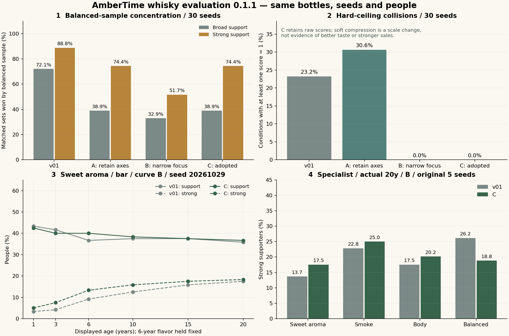

# AmberTime 評価 Lab 0.1.1 — 偏りの分析と改善

2026-10-29。基準main：`bdb683ec07b41b9507294b81d4a37ef01e2b9556`（PR #673）。v01・本編・販売・経済・保存・Productionは変更していない。計算で確認した改善と、後続の体験Labで判断する面白さは分ける。

## 1. 結果

**偏りは低減し、上限で情報が失われる問題は修正した。ただし、店ごとの優位をすべて解消したわけではない。**

| 同じ条件での指標 | v01 | 採用した案C |
| --- | ---: | ---: |
| 元の5シード・540比較組：バランスが支持率最高 | 398 | 223 |
| 同：強い支持率最高 | 461 | 398 |
| 同：両方最高 | 359 | 223 |
| 30シード・3240比較組：支持率最高 | 2335（72.1%） | 1261（38.9%） |
| 同：強い支持率最高 | 2878（88.8%） | 2410（74.4%） |
| 同：両方最高 | 2156（66.5%） | 1242（38.3%） |
| 30シード・12960条件：誰かの評価が1に飽和 | 3010条件（23.2%） | 0条件 |
| 同：客全体の平均支持率 | 33.70% | 34.64% |
| 同：平均強い支持率 | 7.19% | 9.18% |
| 同：「合わない」の割合 | 34.47% | 46.67% |

最高の件数は同率を含む。全商品を均等な勝率に調整した結果ではない。30シードすべてで「バランスが両方最高」の件数は基準より減った。

**残った問題：食堂・B・実熟成の元の30条件では、バランス型が両方最高のまま。** 穏やかな嗜好群が多い分布と、その群に近い代表レシピが主因である。これを隠して「店舗ごとの正解はなくなった」とは言わない。一方、同じ店でも全員が同じ味を好むわけではなく、煙・深みを強く支持する客がいる。比較Labはその分布を表示する。

## 2. 基準の再現と原因

`audit-baseline.mjs` はv01の保存済み2160行を再実行し、瓶・製法・風味・人数・全ての保存済み集計値・中央客・反応文・最大支持客の反応までdeep equalityで一致した。差分ゼロ。報告済み398 / 461 / 359組も一致。客一人ずつのfit・score・印象も独立に再計算して確認した。

問題は主に次の組み合わせだった。

1. 4つの嗜好群の理想点と、穏やかな代表レシピとの位置関係。8軸の誤差を同程度の重みで平均すると、個性を好む客でも「重視する特徴以外の違い」が積み重なる。
2. 支持の閾値は同じでも、平均距離で中心寄りが有利になるため、閾値を動かすだけでは直らない。
3. 熟成加点が味の相性の高い客に乗ると、上限前の値が1を超える。v01は切り詰めるため、強く支持する客同士の差が消える。
4. 中央の客が同じ評価区間に残ると反応文が同じになる。数値が変わったことと、発言の種類が変わることは別である。

単一要因だけを変えた結果（元の5シード、540比較組、バランスの最高件数）：

| 変更した要因のみ | 支持率 / 強い支持率 / 両方 | 判断 |
| --- | --- | --- |
| 変更なし | 398 / 461 / 359 | 基準 |
| 嗜好群の混合比を均等化 | 439 / 513 / 420 | 悪化。人数を均等にすれば解決するわけではない |
| 軸重みを均等化 | 397 / 463 / 359 | ほぼ変わらない |
| 好む主軸の重みを4倍 | 352 / 441 / 310 | 重点を反映する根拠。ただし飽和が増える |
| 味の距離を二乗平均平方根へ | 438 / 525 / 436 | 大きな違いへの減点が増え、中心寄り優位が悪化 |
| 熟成加点を除去 | 408 / 472 / 389 | 強い支持の平均が7.00%→0.825%。待つ役割を損なう |
| 熟成関心が低い客への減点を除去 | 373 / 466 / 317 | 一部改善するが、短熟を好む役割が薄くなる |
| 飲みやすさの加点を除去 | 399 / 468 / 371 | 主因ではない |
| 支持 / 強い支持の閾値を.65 / .85へ | 416 / 482 / 394 | 悪化 |
| 上限だけを外しraw値を保持 | 398 / 461 / 359 | 判定は同じ。情報欠落だけを分離できる |
| 印象を正負へ分離 | 398 / 461 / 359 | 支持率は変えず、将来の誤加算を防ぐ |

詳細は `audit-baseline.json`。専門酒店の煙好み群では元から煙に強い支持24.63%、バランス1.02%だった。個性的な味の支持層が存在しないのではなく、集計と重みの構造がその違いを弱く見せていた。

## 3. 比較した3案と採用理由

全案で同じ原酒・樽・風味・客ID・理想値・熟成への関心を使う。客層の人数や店の混合比、熟成曲線A/B/C、加点・減点の係数、判定閾値は変更しない。

| 案 | 変更 | 30シードでの副作用 |
| --- | --- | --- |
| A `salience` | 重視する主軸4倍・次点1.5倍、他は元の重み1倍。上限は旧式 | バランス集中を減らすが、飽和条件が3010→3970へ増える |
| B `soft` | 主軸4倍・次点1.5倍、その他.35倍。連続上限 | バランス集中はさらに減るが、煙が支持率最高の2058/3240組へ偏る。他の不一致を軽視しすぎる |
| **C `guarded`（採用）** | **案Aの重みを保ち、上限だけ連続化** | Aと支持・強い支持の判定が完全一致。飽和を解消し、他軸を下げる追加仮説を採用しない |

主軸 / 次点は既存4群の特徴から、果実/穀物、果実/バニラ、煙/深み、深み/スパイス。商品IDへのボーナスではない。4倍・1.5倍はゲーム比較用の仮説で、実際の飲酒者を測定した値ではない。

他軸の**生の重み**は維持するが、全体で正規化するため、主軸を増やすと他軸の相対的な寄与は下がる。従来の減点が全て同じ数値で残る、とは言わない。

追加の感度分析 `priority-sensitivity.mjs` では、他軸.7倍、強い不一致への追加減点も比較した。後者は煙への移行を抑えるが、否定的な評価を増やす追加仮説になるため採用しない。勝率を均等にするための混合比・閾値調整も行わない。

## 4. 修正した式と残した式

味の距離は、既存の客の軸重みに上記の倍率を掛けた加重絶対誤差平均。`fit = exp(−2.65 × distance)`。味との相性を熟成価値の条件にする `gate = clamp((fit−.45)/.4)` はそのまま。

`rawScore = .94fit + .06(1−rough) + .36 agePotential × ageInterest × gate − .24 agePotential × (1−ageInterest) × (1−.4gate)`

熟成の価値は相性と関心が合って初めて乗る。低関心の客の減点も維持する。全員への年数ボーナスは追加していない。

上限だけを次へ変更した。

```text
rawScore ≤ .8 : score = max(0, rawScore)
rawScore > .8 : score = .8 + .2 × (1 − exp(−(rawScore−.8)/.2))
```

接続点で値と傾きが連続、実際の入力範囲で単調増加し、1へ切り詰めない。支持.62・強い支持.80・中立.48という判定境界を跨がせない。案AとCの全12960条件で判定・rawScoreの一致を検査した。**飽和ゼロは式による情報保持の改善であり、美味しさの向上を意味しない。**

各客の `rawScore`、圧縮前の支持強度 `rawSupportStrength`、圧縮後の値、10区間の分布、分位点、強い支持率を保存する。圧縮による強度低下を支持の実質低下と混同しない。最高値だけを後続の評判へ渡さない。

印象の大きさの元の式は保持し、結果を `positiveImpression / negativeImpression / neutralImpression / signedImpression` へ分けた。「合わない」客の強い印象はnegativeだけに入り、支持へ加算しない。中立も好意へ自動加算しない。

## 5. 短熟と長熟の価値

seed20261029・B。表の数字はパーセント、支持 / 強い支持。

| 条件 | 1年 | 20年 | 同じ120人の変化 |
| --- | ---: | ---: | --- |
| 甘い香り・バー・風味6年固定 | 42.5 / 5.0 | 36.7 / 18.3 | 上がる36人、下がる81人、同じ3人 |
| バランス・食堂・風味6年固定 | 70.0 / 12.5 | 51.7 / 19.2 | 上がる34人、下がる86人 |
| 煙・専門酒店・実熟成 | 38.3 / 0.8 | 50.0 / 25.8 | 上がる92人、下がる28人 |
| 深み・専門酒店・実熟成 | 16.7 / 0.0 | 34.2 / 25.8 | 上がる87人、下がる33人 |

風味固定の上2行は、幅を失って強い支持を得る例。下2行は風味自体も変わるため、支持の幅も増える。長熟なら必ず幅が狭くなる、という結果へ無理に固定しない。

30シードの1年→20年比較2160組のうち、2091組で強い支持率が増え、1092組で支持率が減り、1026組で両方が起きた。全2160組で評価の上がる客と下がる客が混在し、全員が上がる組はゼロ。年数効果の確認と、資金・待つ楽しさの確認は別であり、経済性はこの数字から判断しない。

## 6. 味・店の違いと残る偏り

30シードでは、甘い香りが強い支持率最高389組、煙547組、深み52組、バランス2410組（同率含む）。個性的な味が全て均等に勝つようにはしていない。深みは支持の**幅**で最高の組がゼロだが、強さで勝つ組はある。広く受け入れられる味とは異なる役割が確認できる。

煙は支持の幅で1887/3240組（58.2%）と多く、バランスは強い支持で74.4%の組を占める。**偏りが消えたとまでは言えない。** 特に食堂の代表4種の順位は変わりにくい。これをなくすために店の混合比を勝率から逆算することはせず、既存の好みの仮説を維持した。

また「合わない」の割合は34.47%→46.67%へ増えた。好みの重点によって評価が分かれやすくなった副作用である。否定的な印象の平均も.1050→.1544へ増える。これをそのまま不評の蓄積やペナルティへ接続することは今回の採用範囲に含めない。ゲーム全体を厳しい評価へ変える判断は保留する。

## 7. 代表例以外・シードの安定性

30シードは元の5つに小整数の未使用シードを加えた固定列。全て `results.json` に保存。代表4種×6年数×3店×3曲線×2熟成モード×30＝12960条件を、基準＋3候補で比較した。

さらに原酒モデルのplain/peat、short/long、refill/first、採取区間.05–.35 / .58–.94を組み合わせた**16製法**を用いた。元の4レシピと重複せず、全6年数・3店・3曲線・2熟成モード・30シードで、基準と案Cを51840条件ずつ比較した。候補の計算に製法IDや代表サンプル名は使わない。

| 16製法での指標 | v01 | 案C |
| --- | ---: | ---: |
| 平均支持率 | 21.16% | 23.45% |
| 平均強い支持率 | 2.74% | 4.06% |
| 誰かが1に飽和する条件 | 4149 / 51840 | 0 / 51840 |
| 「合わない」割合 | 44.26% | 54.81% |
| 1年→20年で全員の評価が上がる組 | 0 / 8640 | 0 / 8640 |

代表4種以外でも、支持と強い支持が分かれ、飽和の情報欠落を防げた。ただし「合わない」の増加も再現した。30シードの確認は観測した入力集合の安定性であり、あらゆる製法・全人口での一般的証明ではない。

## 8. 評価文・画面の改善

反応文はランダムに増やしていない。客が重視する特徴と実際の強さが近いときは、それを理由として表示する。煙が強すぎる／もう少し欲しいの符号を維持し、熟成加点が十分に発生した支持客だけが「熟成を待った価値」を話す。

中央の客の発言だけで店全体を代表させず、v01/v011の支持・強い支持・客数・10区間の分布を並べる。年数比較では1年と同じ客をIDで対応づけ、「上がった／下がった人数」を示す。中央の発言が同じでも実際の変化を確認できる。少数の強い支持客が重視する風味と、最大支持客の理由も確認できる。

基本の一本・年数・店を選ぶ構成は維持。式・候補・raw値・正負印象・全客JSON・比較グラフは開閉式にした。数値を見た作者へ面白さの判定を求める画面にはしていない。



グラフの1・2は30シード全体、3は指定シードの年数単独比較、4は元の5シードの専門酒店・実熟成20年・B。英語ラベルのSweet aroma＝甘い香り、Smoke＝煙、Body＝深み、Balanced＝バランス。グラフの対象条件を混同しない。

## 9. 検証・再現データ

新モデル10テスト＋保存結果4テスト成功。旧v01の8テストも成功。テストは再現性、一変数比較、実熟成/年数単独、連続上限の単調性と閾値保持、正負印象、反応の方向、客IDの並べ替え・非連番ID、不正な瓶や客の拒否、レシピID非依存を含む。独立レビューで指摘された「IDを配列位置として使う」「異なる客を同一人と比較できる」「風味の不正入力」「尺度圧縮の混同」を修正した。

ブラウザーは360/375/390pxのiframeで美咲フォント・瓶・改善前後・分布を確認。年数6行・味4行・店3行が生成され、3幅とも文書横幅とスクロール幅が一致した。実機iPhone Safariの触感は未確認。公開後のexact SHA・必須CI・配信結果と追加操作確認はPRに記録する。ブラウザーでJSONの実ファイル保存を確認したが、再取込とCSV保存の観測中に接続がtimeoutしたため、その2操作は未確認。計算の再現・CSV形式はNode検証済み。正式verificationStateはUNVERIFIED。

独立レビューを使い、v01の原因分析は新モデルと別のコードで再計算した。レビュー成功や数学的整合を作者の採用・ゲームとしての面白さと同一視しない。

データ：

- `audit-baseline.json`：元の全2160行との一致、単要因比較、軸別誤差、客層別・シード別の分析。
- `results.json`：30シードの集計・勝ち数・シード別結果・年数差・16製法の集計。`columns / rows` は元の5シード・全候補8640行の表。
- `comparison.csv`：その8640行。各行は一つのseed/店/味/年数/曲線/熟成モード/評価案。評価分布とraw値を含む。
- `all-30-seeds.csv.gz`：全51840行。`holdout-30-seeds.csv.gz`：基準と案Cの全103680行。gzipは容量を抑える形式で、CSVの列定義は同じ。
- `priority-sensitivity.mjs / .json`：その他の軸の倍率と、追加減点の感度比較。採用モデルへ追加減点は入れていない。
- `plot.py / comparison.png`：上のグラフを同じ集計から生成。

```sh
node works/ambertime/experiments/whisky-evaluation/v011/audit-baseline.mjs
node works/ambertime/experiments/whisky-evaluation/v011/priority-sensitivity.mjs
node works/ambertime/experiments/whisky-evaluation/v011/run.mjs
node --test works/ambertime/experiments/whisky-evaluation/v01/model.test.mjs works/ambertime/experiments/whisky-evaluation/v011/model.test.mjs works/ambertime/experiments/whisky-evaluation/v011/results.test.mjs
python3 works/ambertime/experiments/whisky-evaluation/v011/plot.py
node tools/work-lifecycle.cjs --check
```

UIでも任意の比較条件を全客JSON/CSVへ出力し、JSONを同条件で再計算できる。時刻や外部APIを評価へ使わない。固定SHAからの必要ソース取得と通常GitHub連携の登録を使い、リポジトリ全体のScope→Risk→ImpactとTrusted Staticは既存CIで確認する。共有generatorは変更せず、別のv011入口を試作作業台へ接続する。

表現監査：計算していない食事相性・売れやすさ・面白さを発言として捏造せず、操作に必要なラベル、評価の根拠、変化を残した。反応の数を増やすための文章は追加していない。

## 10. 次の体験Labへの引継ぎ

計算上は、短熟の支持の幅と、長熟・個性への強い支持が、現行風味モデルから成立する条件を再現できた。全商品・全店でその関係を強制してはいない。食堂の順位の固定しやすさと、否定の増加は未解消の条件として引き継ぐ。

次の体験Labでは限られた瓶の実在庫を店へ届け、販売と評価の結果を見て次の一本を考える流れにつなげる。その際は次を守る。

1. 単一最高点を評判へ加算せず、受領した客数、支持の幅、強い支持、正負印象、理由を区別する。
2. 今回増えた否定的印象を、そのまま経営への罰や不評の拡散へ接続しない。店への配分の楽しい選択が成立するかと併せて判断する。
3. 食堂へバランス型を置く一手だけで完結しないか、限られた在庫・別の店・次の製造という実際の選択で確認する。計算Labの勝率だけで成立を主張しない。
4. 作者は納得感、次を造りたくなるか、店や年数を選ぶ楽しさ、長く遊びたいか、ゲーム全体の方向を体験の中で判断する。今回の数値の逐次校正を作者へ戻さない。

本編採用・評判蓄積・地域拡大・世代交代・次の体験Labの実装は今回行っていない。

登録直前にmainが `86db20b4a7f4c3e2e72fdb34f1168395e05c1d22` へ進んでいたため、数値モデル・v01・指示・検査のblob不変を照合した。共有台帳は最新から取り直し、同時進行のポストカード・3D作品を保持してLABを再生成。新しいbaseの最初のcommitに `.change-plans/ambertime-whisky-evaluation-v011-refresh/r0.lock.json` を固定してから実装を登録する。計算基準SHAは上記bdbのままで、後付けのbase差替えはしていない。
