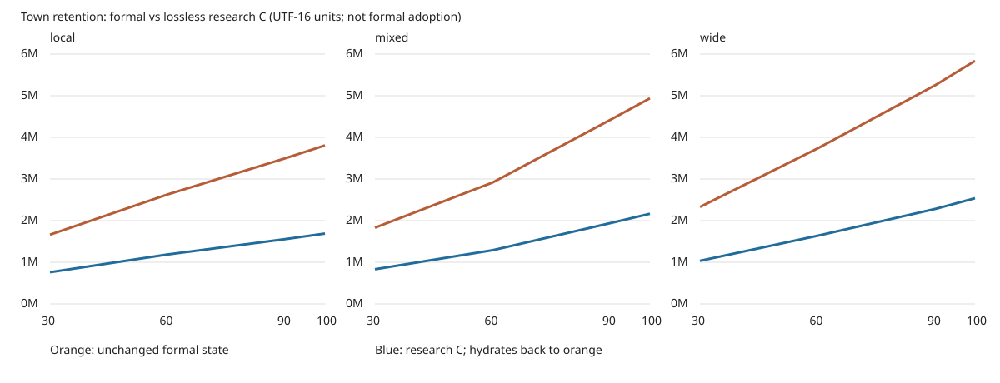

# L100-4A：町の記録を失わない長期保持の比較研究

## 結論
**推奨：Bの導出参照＋冗長キーを除く完全可逆な個別記録表現を次の設計候補にする。正式採用は追加研究。Cの意味的集約は未成立、件数だけへの不可逆集約は不採用。Dは保持・復旧契約を別段階で確立するまで保留。**

今回の研究は正式上限を解消していない。研究形式から本編へ戻すと元の完全JSONへ展開するため、広域は引き続き約103年で上限に近づく。容量削減を実用化するには、正式ランタイムが完全展開を要求しない参照契約の設計が必要。これを黙って導入していない。

## 対象と境界
- base main `8a145ec4bb810baccbb2dfb353e990db72a3ef21`。直前baseline29697583から本編計算・正式保存の差分なし。H4 #829のCanvas比較Labだけが追加されており今回変更しない。
- L100-3 #828：Draft/open/未マージ、head `739754b57e80620235ca2550d2978f69c0813294`。未マージの試験修復をmainで実施済みと扱わない。
- Plan Lock `.change-plans/ambertime-l100-4a/r0.lock.json`、digest `42313c69684762fb8926197e5012a98891ab843803e45a71334db795e42397da`。
- Node隔離コピーだけ。正式保存、乱数、履歴、UI、Canvas、上限、Productionに変更なし。Draft PRまで、マージしない。
- 容量はUTF-16 code units。正式上限は6,016,384未満。UTF-8 bytes・ブラウザーquotaとは別。入力の展開時にも既存codecの上限を適用。

## 構造と増加原因
詳しい関数・参照行はDEPENDENCIES.md。townのevents・arrivals・attemptsが主因。arrivalsはeventsのarrival部分と内容/順序が一致する重複。eventsは因果IDと回想位置、attemptsは抽選の監査事実。『現在表示しない』は削除可能性を意味しない。

本編createExternalはresponsesモード。memoriesはこの保存群で空だが、別memoryモードの再登場契約を捨ててよいことにはならない。town.shipmentsは現在のrelationship計算にも使われ、順序付き浮動小数点加算を含むため単なる件数・平均への置換は不十分。eventsは配列長が採番に使われ、history/recallは位置とIDを参照する。seen等の増大も残る。

## 12基準保存の容量
コードと測定列でCと呼ぶ試作はschema辞書＋全個別行を保持する可逆構造（以下C-pack）。これは分類上Bの延長であり、依頼Cの意味的集約が成立した証拠ではない。Dはmanifest＋分割したraw blob全量を合計。DBのkey/index/transaction管理領域は含まない。研究envelopeのescape込みtransport量もresults.jsonに別記。D currentだけを総保存容量と呼ばない。

|方針|年|正式全体|town|events|arrivals|attempts|研究C総量|D current|
|---|---:|---:|---:|---:|---:|---:|---:|---:|
|local|30|1663003|1539045|525053|431775|488339|761114|201487|
|local|60|2631181|2463697|837851|693803|784658|1188302|288695|
|local|90|3500658|3297424|1124750|940458|1056623|1557188|344898|
|local|100|3806900|3590644|1224918|1025164|1152652|1690016|367476|
|mixed|30|1830735|1706779|579079|478828|540891|832534|213398|
|mixed|60|2917707|2758638|943946|785489|882188|1290822|278074|
|mixed|90|4425277|4211750|1438858|1205032|1346121|1942479|393228|
|mixed|100|4938560|4708105|1607505|1347528|1504053|2165204|432413|
|wide|30|2328417|2202878|748564|624482|698797|1034814|233327|
|wide|60|3737497|3560666|1214143|1019573|1133600|1638448|334093|
|wide|90|5259993|5037723|1718739|1452446|1606805|2284178|432782|
|wide|100|5838093|5600017|1909147|1609859|1782557|2538595|481486|

詳細な100年以降の容量・変換時間・本編翌月比較は [MEASUREMENTS.md](MEASUREMENTS.md)、生データは results.json / future-results.json / capacity.csv。



## 年あたり増加（区間平均、将来保証ではない）
|方針|区間|正式units/年|town units/年|C units/年|
|---|---|---:|---:|---:|
|local|30→60|32272.6|30821.7|14239.6|
|local|60→90|28982.6|27790.9|12296.2|
|local|90→100|30624.2|29322.0|13282.8|
|mixed|30→60|36232.4|35062.0|15276.3|
|mixed|60→90|50252.3|48437.1|21721.9|
|mixed|90→100|51328.3|49635.5|22272.5|
|wide|30→60|46969.3|45259.6|20121.1|
|wide|60→90|50749.9|49235.2|21524.3|
|wide|90→100|57810.0|56229.4|25441.7|

1回だけの削減でなく各追加記録の表記も小さくなるが、Cの増加率はゼロにならない。全個別事実を保持する以上、ここで調べた方式の総量は有界ではない。Dのcurrentもreleases/seen/operations等が増えるため有界と証明していない。区間ごとの傾きは販売・反応・乱数で変わり、線形外挿した到達年は保証できない。

## A–D比較
|方式|保持・一致|容量/性能|復旧・互換性|判定|
|---|---|---|---|---|
|A 現状全保持|既存契約そのまま。全ID/順序/乱数を保持|近い上限、履歴全量のclone/復元負荷が残る|既存v8互換。単一キーの復旧制約も残る|長期解決策として不採用、比較基準として維持|
|B 冗長データ導出|eventsからarrivalsを完全に再構成。不一致なら拒否|現行wire codecでも実施済み。完全展開後は容量が元に戻る|正式APIで導出view化するなら全利用箇所/clone/検証契約の再設計が必要|導出参照として採用候補、現状の保存改善とは数えない|
|C 記録の意味的集約|件数/平均では個別事実・因果・順序を再現できない。完全復元可能な集約則は未成立|C-packはBの延長の対照実験。意味的集約の性能改善値ではない|浮動小数点の順序、初回/最終、再登場ID、全歴史の復元が必要|追加研究、件数だけは不採用|
|D 現在/歴史分離|events/attempts/shipmentsを256件chunkで保持。単一参照の遅延読込可能|current縮小だが総archiveは成長。現行月次は全hydrateなので高速化未実証|欠落/破損/混在/順序不整合拒否。永続transaction/CAS/旧正常世代未実装|追加研究、正式採用は保留|

## 一致の範囲
27入力×4方式＝108比較で、全ゲームJSON文字列の完全往復一致と同じtown翌月操作後の全JSON一致を確認。12基準時点のほかL100-3/今回の専用継続コピーを含む。同じ年月でもpauseや操作列が違うコピーは別入力であり、27個の独立した年代と数えない。全入力SHAは不変。

- 完全JSON一致には正式状態・乱数・operations・town各記録が含まれる。これは観測同値だけではない。ただしコンパクト形式のまま未来を計算する実装の証明ではなく、完全にhydrateした後の有限個の同入力比較。
- future.mjsは別に公式readSessionで全再生し、同一の本編tick、cask slots、帳面、歩み、回想collector、公式保存/再読込を比較する。town-onlyの結果と混同しない。
- 確定回想の文/順序/IDはsession全体比較対象。9回の新たな世代交代を今回ブラウザーで再実行したとは主張しない。L100-2/3の既証拠を継承し、本研究は無変更と一致を確認する。
- 別memoryモード固定seed20261021の合成試験で、月319に26年前の記憶m2/e7がresurface e1345として再登場。4方式の翌step全JSONが一致。本編responsesモードでこの経路が起こるという意味ではない。

## 障害・互換性
Dの欠落、破損、順序変更、件数不整合、別sourceHash、schema不正、manifest変更を拒否。元のコピーは不変。遅延参照で読んでいないchunkの欠落はその参照だけでは発見できないため、単一参照成功を完全復旧と呼ばない。全hydrateで全chunkを検証し、失敗なら結果を返さない。

hashは偶発破損の検出であり、攻撃者がmanifestもhashも再計算する場合の真正性は保証しない。これは永続バックアップやDBの原子性試験ではない。古い正式保存の移行・v5互換を新たに成立させていない。現行v8は無変更。研究オブジェクトを本編へ直接渡さない。

## 既存研究と責務分離
H1-B2のarrivals導出はwireで既採用。H1-A2/A3のcheckpoint＋tailは再開再生量を減らす研究だが、townの全量自体は消えない。H1-A4のtransaction/CAS・source/model/branch/hash・旧正常commitの検証設計はDの将来契約へ再利用できるが、その実装を本研究へ無条件移植しない。H2/H3の回想因果・境界・採用順の保護を維持。L100-4Bの再開性能、4Cの永続バックアップ、H4 Canvasは別責務。

## 次の最小段階
1. B拡張（C-pack）について、events/attemptsの各行アクセスを内部APIへ限定する設計だけを別Planで固定。ID採番、配列ordinal、全履歴参照、浮動小数点順序を保持する。
2. コピーだけのcompact-runtimeモデルを作り、30〜100年の全操作列再生と110年以上の同入力比較を行う。月次前後の展開ピークも測定し、元へ全展開するだけの実装は容量改善としない。
3. 全field・未来・乱数・回想・旧保存の一致が成立した後に限り正式保存の版/移行を相談。既存上限の下での安全停止と旧形式exportを先に設計する。
4. Dの永続化は4Cとtransaction/復旧契約を合わせて別段階で検証。今回のhash付きファイルを実用バックアップと扱わない。

## 再現
リポジトリrootで実行。入力には既存L100-1 paused12保存、L100-3 continuation、今回のcontinuationコピーを指定する。元保存は書き換えない。

```
node --test works/ambertime/l100-4a/research.test.mjs
node works/ambertime/l100-4a/run.mjs results.json /absolute/baseline/paused /absolute/continuation
node works/ambertime/l100-4a/future.mjs /absolute/input-v8.json /absolute/future-result.json
node works/ambertime/l100-4a/continuation.mjs /absolute/110-v8.json local /absolute/output 1440
node --test works/ambertime/tests/{formal-save,s3-save,s4-save,recall-save,stage4-town}.test.mjs
```

continuationは既存scenarioの公開操作を使い、6,000,000unitsの予防guardで候補を未保存のまま停止。正式上限は変更しない。ゲーム計算へ別経路を設けない。

実機iPhone Safari、ブラウザー内部性能、IndexedDB永続archive、破損媒体からの復旧は未検証。今回UI変更はなく新たな実機合格を主張しない。表現監査：研究報告と再現コマンドのみ、作品UIやコピーを追加していない。
