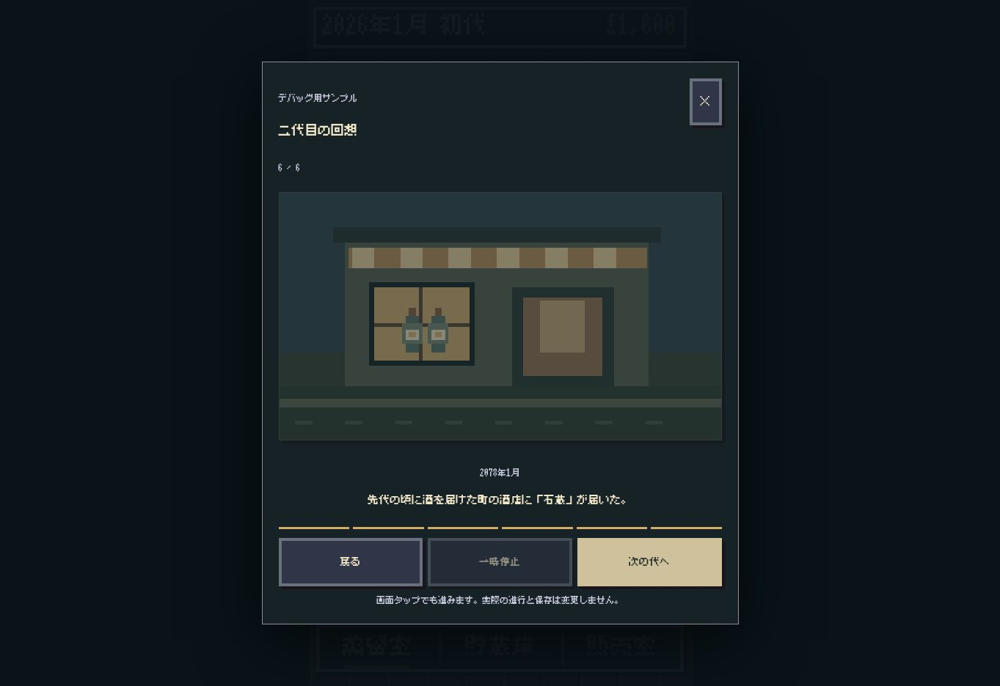
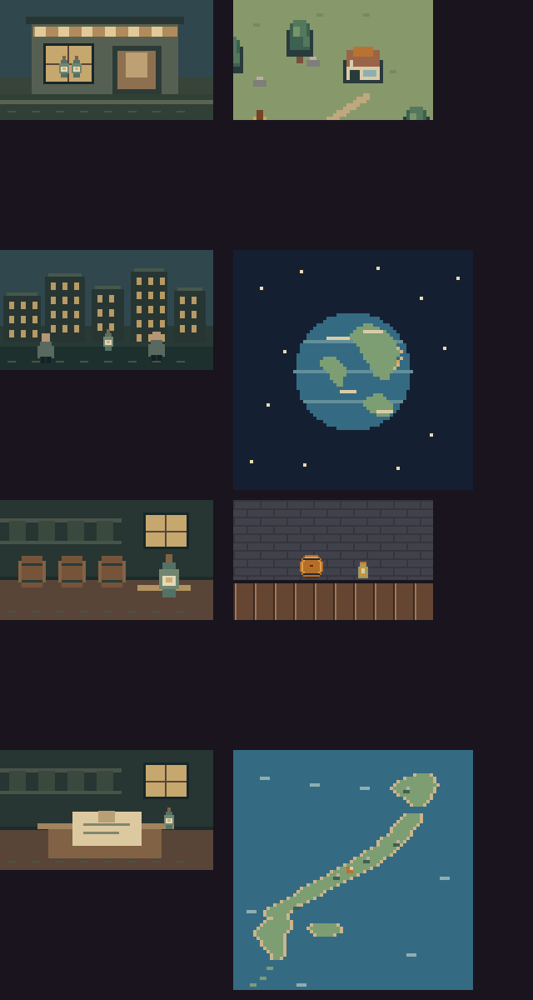

# AmberTime H4-1 — 回想の表示比較

対象base: `29697583d15f4e4524ba39ba9052b790fd66ae9c`。2026-11-06調査。

結論：**C案を推奨。現行のCanvas情景＋DOM文字・操作を維持し、既存資産と文字規則へ揃える。** 本PRは比較Labのみ。本編置換・Stagingマージ・Production反映を行わない。

## 現状と不一致

- `recall/debug-scene.mjs` の `drawRecallDebugScene` が256×144 Canvasに専用の店・人・瓶・樽を矩形描画する。`createRecallDebugPreview` はDOMのdialog、年月、一文、場面数、進捗バー、前後・一時停止を構成する。すでに一場面ずつの方式。
- `shop-app.mjs:88,327–350` で同じplayerをデバッグ、世代交代、過去の回想に利用。`recall/live-scene.mjs` は確定済みのsentenceを変更せずに渡す。
- 世代交代は最終「次の代へ」でcallbackを呼ぶ。再閲覧は最終「閉じる」。絵タップ、前後、左右キー、Escape、フォーカス復帰がある。通常は5秒自動送り、reduced-motionでは自動送りとフェードを停止する。
- 本編 `canvas-scene.mjs:41,155–165,231` は120×214のworld、Codeaの瓶・樽、壁・床の共通色を使う。現行回想は別の256×144絵と独自色を使用し、同じ幅でも粒度が異なる。
- `font-uniform.css` の明示ルートに現行回想は含まれない。familyは継承するが、回想は18/15/14/12pxを個別指定する。長い一文と自動送りの相性も比較対象。
- 研究画面の根拠・分析欄は本編には持ち込まれていない。デバッグの説明は本編modeで隠れる。研究用カードが残っている、と断定する根拠はない。

経緯：`276248e2` でデバッグ再生、`958b5317` で本編と歩みの再閲覧へ接続。`world-map-view.mjs` と `design/map-stage2/REPORT.md` の「既存Lab描画を読み取り専用adapterで接続し、保存を変えない」判断を今回も利用する。

## A・B・C比較

| 比較項目 | A 全面Canvas | B Canvas＋既存文字UI | C 現行構造の部分改修 |
| --- | --- | --- | --- |
| 本編との統一 | 強いが全面化だけでは資産は揃わない | 資産と文字規則を揃えれば十分 | 同左、既存の境界を維持 |
| 実装の単純さ | 折返し・hit test・読み上げの補完が必要 | DOM標準機能を利用 | 最小の変更範囲 |
| 既存部品 | 絵は再利用、文字・操作再実装 | 絵とDOM双方を利用 | 現行playerの構造も利用可能 |
| iPhone Safari性能 | 要実測、文字描画も必要 | 場面変更時だけ描画可能 | 同左、常時RAF不要 |
| 日本語 | 自前の折返し・font読込管理 | DOMで自然な折返し | 同左、一文保持 |
| アクセシビリティ | DOM代替を別途維持 | native dialog/button/文章を利用 | 同左、既存操作も維持可能 |
| 保守性 | 二重の操作表現になりやすい | 比較的単純 | 最も小さい変更範囲 |
| 100年再閲覧 | 一場面描画なら可 | 同左 | 確定sceneを読むだけで済む |

CはBと排他的な描画方式ではない。現状がB構造なので、Cはその構造をどこまで変更するかの選択である。Safari性能の優劣は実測済みとはしない。

## 比較Labと資産

4場面：店との関係、町の外への口コミ、過去の酒、問い合わせ。`fixtures.mjs` は既存のデバッグ文を参照する固定ダミーedition。実際の `edition.scenes[].month/sentence/event.ids` 構造を利用し、`playbackScenes` に通す。表示のための保存情報は追加しない。

- 文章はそのまま。現在のゲーム状態・文章解析・新しい抽選を使わない。
- 現行比較はiframeに本編の4つのCSSを隔離して適用する。ゲーム本体の背景は起動しない。比較バーの48px分だけiframeが短いため、同じ高さの厳密な比較ではない。
- 海外・全国は既知地域IDから地図の第6・5段階を選び、144×144全体を整数倍率で表示する。未知IDは中立背景にする。
- 店は `renderMap` の既存建物を再利用し、同じIDなら年月が違っても同じ構図になる。
- 樽と瓶は本編の `codeaCask` / `codeaBottle` の全セルを利用する。固定の標準瓶は象徴であり、当時の個別ラベルや瓶形状を再現したと主張しない。
- 色は本編の `sourcePalette` と既存地図描画から取得。壁・床は本編の論理セル規則を使う。
- 文章は美咲フォントと既存 `uniformMetrics` を利用し、可読性のため16pxを下限とする。
- 新案は手動送り。絵タップ／次へ、戻る、左右キー。最後だけ再閲覧は閉じる、世代交代はLab内の完了表示となり、ゲームには接続しない。新しい確認ボタン・待機・パーティクルはない。
- 比較説明と幅・経路選択はLabだけにある。本編へimportしていない。

## 確認手順

未マージのため、Stagingの公開URLにはこのLabは存在しない。

```sh
git switch work/ambertime-h4-1-canvas-lab
python -m http.server 8765
```

`http://localhost:8765/works/ambertime/recall-canvas-lab/` を開く。幅と経路、開始場面を選び、「現在の表示」と「新しい表示」を比較する。
既存のLAB → 回想Lab →「回想の表示比較（H4-1）」からも接続。登録済み回想Lab内の下位比較なので新workや共有台帳は追加しない。LAB再生成は差分なし、lifecycle check成功。

## 画像とブラウザー確認の境界



上は公開Stagingの `?debug=1&recall-preview=1` を実際に開いたクラウドブラウザーのスクリーンショット。デスクトップviewportであり、iPhone実機ではない。公開ファイルのSHA一致までは確認していない。



上は左が現行、右が提案の**Canvas描画関数を実行した画像**。DOM、文字、ボタンを含む画面スクリーンショットではない。実際の描画出力を確認するために用意したもので、ブラウザー検証の代用とはしない。

ローカルChromiumの起動は `socket() failed: Operation not permitted` で失敗。クラウドブラウザーはローカルHTTPへ接続できず、共有HTMLのfile URLもURLポリシーで拒否された。ブラウザー制限を回避する操作は行っていない。従って**新Labの実画面スクリーンショット、iPhone相当のviewport検査、タッチ・VoiceOver・Safari性能は未確認**。

## テストと非干渉

- Labのpure tests：実行結果は `evidence/lab-tests.txt`。文章保持、入力不変、同じ店の構図安定、未知情報のfallback、既存資産全セル利用を確認。
- 本編の `tests/recall-*.test.mjs`：29件中27成功、1失敗、1 browser skip。失敗は `recall-app.test.mjs` の `debugSkipJob is not defined`。H4-1編集前にも同じ失敗を観測。既存appとtestは無変更で、今回のLabへ混ぜて修正しない。詳細 `evidence/recall-tests.txt`。
- `browser.test.mjs` は実ブラウザー用の再実行手順。環境変数未指定時は明示skipし、PASS扱いしない。
- 本編の回想、保存・復元、候補選定、履歴生成、checkpoint、乱数、ゲーム画面のソースは変更ゼロ。互換性は今回の差分がそれらへ到達しないことを確認した範囲であり、100年実機検証を新たに実施した意味ではない。
- 独立レビューで地域描画の意味とbaseline CSS混入を指摘し修正。視覚採用・実機確認は未完了。
- 表現監査6点：新規の情緒的コピー・分析見出し・意味を書き換える文を再生面に追加せず、一文と必要な年月・操作を維持。装飾的な追加専用絵は作っていない。

ブラウザー検査の実行例（別ターミナルで上記HTTP serverを起動）：

```sh
AMBER_BROWSER_MODULE=/absolute/path/playwright/index.mjs \
AMBER_BROWSER_EXECUTABLE=/absolute/path/chromium \
AMBER_H4_SCREENSHOTS=/tmp/h4-screenshots \
node --test works/ambertime/recall-canvas-lab/browser.test.mjs
```

## 本編統合前の判断

1. 地図の既存建物・瓶・樽の再利用で、回想の情景として十分か。専用パーツはまだ増やさない。
2. 手動送りを採用するか。現行の5秒送りを残す場合も読む途中で進まない設計が必要。
3. 絵の密度・サイズと文章のバランス。地図の2pxセルと室内の1pxセルは既存資産の違いとして残る。全資産のドット密度が同じになったとは判定しない。
4. 320×568を含む短い画面、長い確定文、拡大文字、Safari/VoiceOverで可読性・操作を確認する。長文や拡大時には切り捨てよりscroll fallbackを優先する。
5. 上記を確認後に別PRで本編の表示接続を判断する。L100-3の保存改善とは分離する。

現時点は比較可能な実装Draftであり、表示検証完了・本編採用済みではない。

## 変更ファイル

- `.change-plans/ambertime-h4-1/r0.lock.json`：実装前の範囲固定。
- `recall-lab/index.html`：登録済みLabからの入口1件。
- `recall-canvas-lab/index.html`, `style.css`, `lab.mjs`：比較操作と提案player。
- `recall-canvas-lab/baseline.html`, `baseline.mjs`：本編CSS・現行playerの隔離表示。
- `recall-canvas-lab/fixtures.mjs`, `scene.mjs`：固定editionと読み取り専用描画。
- `recall-canvas-lab/scene.test.mjs`, `browser.test.mjs`：pure / optional browser検査。
- `recall-canvas-lab/REPORT.md`, `evidence/*`：調査・画像・実行結果。

Scope → Risk → Impact は実装commitに対してすべてPASS。これらは実画面の正しさを証明しない。
