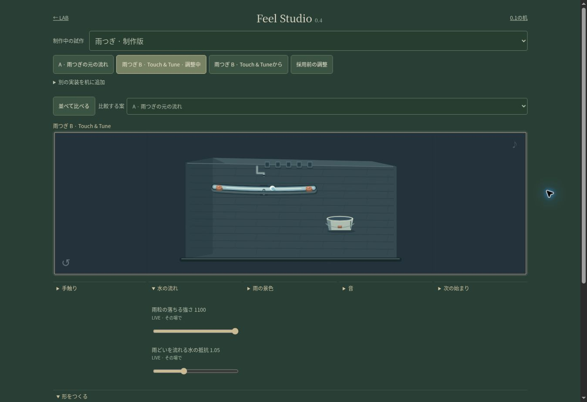
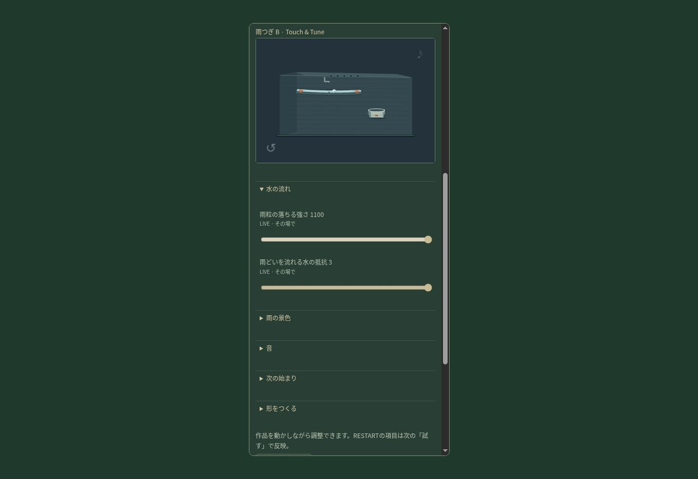

# Feel Studio 0.4 · Touch & Tune 検証

対象: Feel Studio内だけ。元の `works/ametsugi/**`、旧 `ametsugi-a`、旧buildと依存、Engine・Motion Lab・3D Lab・Productionは変更しない。

## 実装

- 新build `ametsugi-b`。重力、水の抵抗、指への追従と反応、雨の密度・表示・見え方、水滴の見た目の大きさと色、水音音量をLIVE更新。
- 最初の傾きと一粒目までの間はRESTART。調整時は設定のみ変更し、次の「試す」で反映。
- 雨どいの形はREBUILDとして既存Work依頼画面へ。依頼には現在configとparameterApplicationを含める。自動通信はない。
- 旧コードを保護するためBridge client/host/Records/UIは新しいv04ファイル。共通UIとCSSの変更はFeel Studio内だけ。
- per-build schemaは任意。旧project configをfallbackし、旧workspace/2・key・node/hashを維持。旧保存机にはBを明示追加。
- 同じ開始条件から比較する「試す」は左右の現在draftを渡してreset。A/Bで共通の角度/間以外の物理は違い得る。入力の自動再生による公平性は主張しない。

## Node / テストハーネス（実ブラウザとは別）

`node tests/touch-tune-v04.cjs`（works/feel-studioから）11グループPASS。

- 全登録buildのcode/HTML/依存SHA256。
- ゲーム/時間/水滴identityを維持して重力変更。1/120秒後の速度差を検証。
- 接触した水滴の抵抗による速度変化、雨どいばねの追従、実ドラッグ式の感度。
- 初期値で全5屋根を完了。5/30/120fpsでLIVE設定を極端値へ交互に変え、位置/速度/雨どいが有限のまま推移。
- RESTARTは進行を変更せず、resetで傾き/間を反映。初期値同期でも不要なresetなし。
- 色・雨表示・雨密度・水滴サイズがCanvas呼び出しを変える。型/範囲/色/選択肢の不正値は原子的に拒否。
- Bridgeなしの独立RAF動作。旧Aのみの机を読み、Bを追加し、分岐・採用・保留・再読み込み・undo・依頼。
- 返答登録と互換開始設定の合成。新projectを同じ宣言方式で登録し、共通Studio source不変。
- optional applyState、parent/nonce、不正送信元の拒否。

既存の `ametsugi-v3.cjs`、`bridge-v3.cjs`、`cycle-v2.cjs`、`frame-v2.cjs`、`legacy-01/tests/verify.cjs` PASS。元雨つぎ物理/描画本文一致、50屋根経路を含む。NodeのCanvas/DOM代替は視覚・音・実機の証拠ではない。

## 実ブラウザ

2026-10-13、クラウドChromeの公開Stagingで実操作。確認コードはPR #330 merge `e57e97e41e08763e9dd175643695f9045cded45e`（Pages run 38355243911 success）。後続3D追加でmainが進んでもFeel Studio subtreeは同一。

- 雨つぎBを開き、作品内の雨どいをドラッグ。調整モードで重力670→1100、抵抗1.05→3がLIVE表示に反映。作品iframeを切り替えず調整を継続。時間/水滴identityと数式の厳密な確認はNodeハーネスの証拠で、ブラウザ内部state読取りとは区別。
- 分岐後のJSONを実際に書き出し、Aのangle0/wait.85、元Bのgravity670/resistance1.05、分岐のgravity1100/resistance3を確認。両親に新設定が混ざらない。
- Aを右に選択して比較、「試す」、作業机JSONの復元、ページ再読み込み、重力1100/抵抗3の復帰、undo→1100、初期値→670/1.05を確認。
- 開始角度.66/待ち時間2秒をRESTART設定、「試す」で傾いた初期雨どいを視認。水滴1.5倍/オレンジ色、背景雨off、くっきりのchoiceを操作し、Canvas画面と保存値を確認。
- REBUILDボタンから依頼を実生成。base.configに角度・間・全LIVE値、parameterApplicationに適用方法が入る。自動Work通信・コード実行はなし。
- 採用操作は検証用の分岐のみで代理確認し、最後に保留へ戻した。作者採用ではない。
- 390×844のiframe viewportでは操作可能だが、調整時に作品が画面外へ隠れる問題を発見。844×390の横画面とともにsticky作品表示で修正し、公開後の追確認を行う。実機サイズの再現であり、iPhone実機確認ではない。

0.4のRecordsで旧cycle-v2 / bridge-v3の同じテスト本体を実行し、小舟・あかり・紙・小棚の保存/往復の回帰もPASS。旧テストファイルそのものは変更しない。

## 実機・感覚

実機iPhone/iPad Safari、実際の指での触感、音の実聴、作者本人の採用は未検証。Staging mergeとCI成功をこれらのPASSとは扱わない。

## 最終公開追確認 · 2026-10-13

修正コード: PR #333 merge `cfc706d8af1b0ff92b5c3190cf7d10018c20dcfb`。Pages run `38356664449` success。追加の文書・画像PRはこのコードを変更しない。

- クラウドChromeで390×844と844×390の作品表示を再確認。LIVEつまみを操作する位置までスクロールしても作品は上部に残る。横画面ではHTMLのscrollWidth/clientWidthが829/829で横溢れなし。縦は背景全体付きの検証画像を保存。これはviewport再現であり、指/OS/実機Safariではない。
- 縦でgravity300→1100、resistance1.05→3を操作し、作品を動かしたままLIVE表示を確認。iframe documentはvisibility='visible'。開始後の水滴と、タイトルが消えたままの画面を確認。位置・速度・時刻identityの数値証拠はNodeのものとして維持。
- 横ではresistanceを0へ変更。作品が見えるまま、他の項目へスクロールできる。画面内の項目は折り畳める。
- 修正後のREBUILD依頼を生成し、全12設定のbase.configと13個のparameterApplication、A/Bそれぞれの能力を含むinputComparisonLimitを確認。旧Aのみの説明は残っていない。
- Bのplay.htmlは実ブラウザでも独立起動。旧小舟も起動・直接編集できる。旧build・全依存hashと旧保存JSONは変更なし。
- 実際の採用判断は行っていない。AI検証で一時的に採用を試した分岐は保留に戻した。
- 画像取得のclip指定はブラウザAPIがtimeout。通常のviewport画像取得を使い、取得した同じbytesを保存した。検証手段の失敗を作品の障害とは扱わない。

完了範囲: Staging実装・Node/ハーネス・公開Chrome操作・PR/CI/マージ。未検証: 実機iPhone/iPad Safari、実指の触感、音の実聴、作者の採用。保存/分岐は制作設定を保持する。途中の水滴位置は保存しない。
